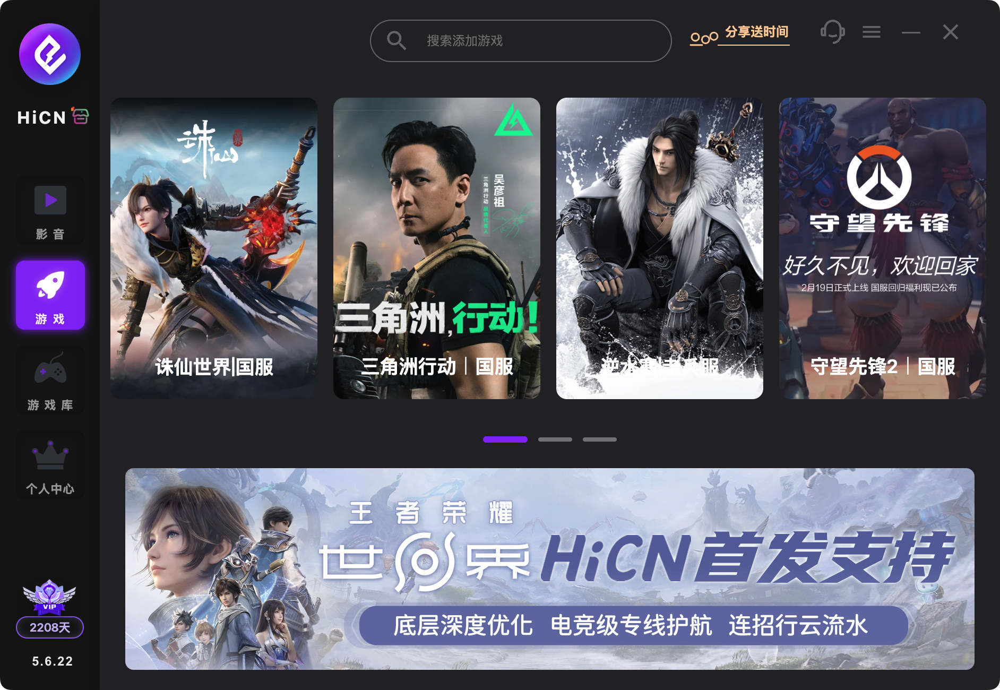

# 海外如何解除哔哩哔哩地区限制？搬家换网络后，B站突然看不了怎么办？

在旧公寓追得好好的视频，搬进新住处却出现地区提示，另一些内容也开始缓冲。海外使用B站，可以先确认新网络能正常上网，再打开 **HiCN 回国加速器**一键加速；新用户可免费试用3天，连接后重新进入原视频。

手机和账号都没换，播放体验仍可能变化。换住处也可能换了运营商、无线覆盖和共享网络环境，需要重新确认连接，而不是直接删除原来的观看设置。

## **搬家之后，先确认基础网络已经接通**

宿舍、公寓或酒店可能要求网页认证。设备显示连上无线网络，不一定代表接入流程已经完成。

先按管理方提供的方式接入，看看普通网页能否正常打开。如果多个应用都无法联网，先处理基础网络，必要时联系网络管理人员。

如果日常网页正常，只有B站播放异常，再看具体视频提示。地区相关提示、持续缓冲、账号要求和内容失效，需要分别处理。

## **不同提示，下一步不同**

| **新网络下的表现** | **先确认什么** | **下一步动作** |
| --- | --- | --- |
| 多个应用都无法联网 | 接入认证、信号及网络服务 | 先恢复正常上网 |
| 原视频出现地区相关提示 | 当前加速连接及原链接 | 一键加速后重新进入，仍异常时保留提示咨询客服 |
| 多条视频持续缓冲 | 共享网络占用、跨境连接及平台状态 | 暂停不必要的传输，再优化回国连接 |
| 只有一条视频失效 | 视频当前状态 | 查看页面说明，向平台反馈 |
| 提示登录、购买或会员要求 | 账号与对应权益 | 按平台当前说明处理 |

回国加速器用于优化网络连接，不能恢复失效内容，也不能替代会员或购买要求。不要因为发生在搬家之后，就认定所有异常都来自新网络。

## **旧住处的连接状态，不会自动延续到新环境**

如果之前使用过路由器方案，换到另一套网络后，不能默认新路由器也完成了配置。原本在手机上开启加速，也不代表新接入的电脑已经使用相同连接。

可以从实际观看设备入手，重新确认加速状态。共享路由器需要改动时，先和管理人员沟通，不必为了看视频直接重置整屋网络。

## **用HiCN重新接好回国连接**

**HiCN 回国加速器**面向海外华人的国内影音、音乐、游戏和学习等场景，提供**一键加速、智能选路与智能分流**，帮助应用匹配适合的回国线路。

手机或Windows电脑观看时，可以打开对应的HiCN客户端，一键加速，再重新进入B站原视频。换了住处，从当前设备重新连接开始，不需要先安排复杂的网络设置。

对于长视频缓冲，连接平稳也值得关注。HiCN 回国加速器支持**极速双路并发**，同时利用两条独立网络通道传输数据，用于降低网络抖动、改善连接稳定性。具体播放仍受当地网络、设备和平台服务状态影响，不能保证所有内容都可播放。

HiCN 回国加速器支持 **Windows、iOS、安卓（Android）和路由器**。手机用户可在应用商店搜索“HiCN”，电脑用户可在浏览器搜索，或访问HiCN官网下载客户端。路由器的适用型号和配置方式按官方指引确认。

**新用户可免费试用3天**，遇到连接问题还有**7×24小时人工技术支持**。说明问题从换住处后开始，并提供当前地区、运营商、设备系统和提示文字，方便客服协助。

现在就下载对应客户端，在新住处一键加速后打开原视频，先把常用设备上的观看流程跑顺。

## **重新打开原视频，按剩余问题处理**

1. **保留链接与提示。** 记住视频名称、分集和错误文字。

2. **完成基础网络接入。** 确认设备能正常上网。

3. **打开HiCN 回国加速器，一键加速。** 连接后重新进入原播放页。

4. **查看当前状态。** 连接异常咨询HiCN，视频或账号要求咨询B站。

如果仍出现相同地区提示，保留截图求助，不必不停刷新或退出账号。换一条能播放的视频，只能帮助判断异常范围，不能直接证明原问题已经解决。

## **共享网络忙时，缓冲可以另行处理**

新住处可能有更多设备同时上网。留意云盘上传、系统下载与大型传输，先暂停自己不必要的任务，再和室友协调使用时间。

B站客服的播放诊断建议区分视频与网络问题，并提供更新应用、提交故障日志等处理方式。具体操作以当前应用界面与官方说明为准。B站客服播放诊断

如果只有高画质下持续缓冲，可以临时降低画质继续观看，再检查连接与设备。画面不连贯、电脑负载高时，也要关注播放性能，不能全部归到地区问题上。

清理缓存前看清选项，保留需要的离线视频与登录信息。不必一开始就重装应用或清除全部数据。

## **常见问题**

### **搬家后B站看不了，账号会不会出问题了？**

不能仅凭搬家判断。先看页面提示，分别检查基础网络、加速连接和账号要求。

### **新公寓测速很快，为什么视频仍缓冲？**

测速目标与视频连接目标可能不同，下载速度也不能完整代表持续播放质量。还要结合共享网络占用、跨境连接和平台状态。

### **以前用路由器加速，搬家后可以直接沿用吗？**

需要确认新设备和接入条件。不能默认所有路由器都适用，按官方或客服指引配置。

### **搬家后能重新领取HiCN新用户试用吗？**

更换住处或设备不会自动重新获得新用户资格。新用户3天免费试用的领取方式，以当前客户端为准。

### **加速后还出现会员提示，怎么办？**

按B站页面要求确认对应账号与权益。网络加速不能替代平台会员或购买条件。

### **联系客服需要提供具体住址吗？**

无需提供详细住址。说明地区、运营商、网络类型、设备和错误提示即可帮助沟通，不要提供账号密码或验证码。

**现在搜索“HiCN”下载客户端，新用户开启3天免费试用，在实际观看的设备上一键加速，再打开原B站视频。** 先把新网络接通，再按具体提示处理，让搬家后的观看准备更顺手。

## **HiCN回国加速器专属会员兑换码：1124**
