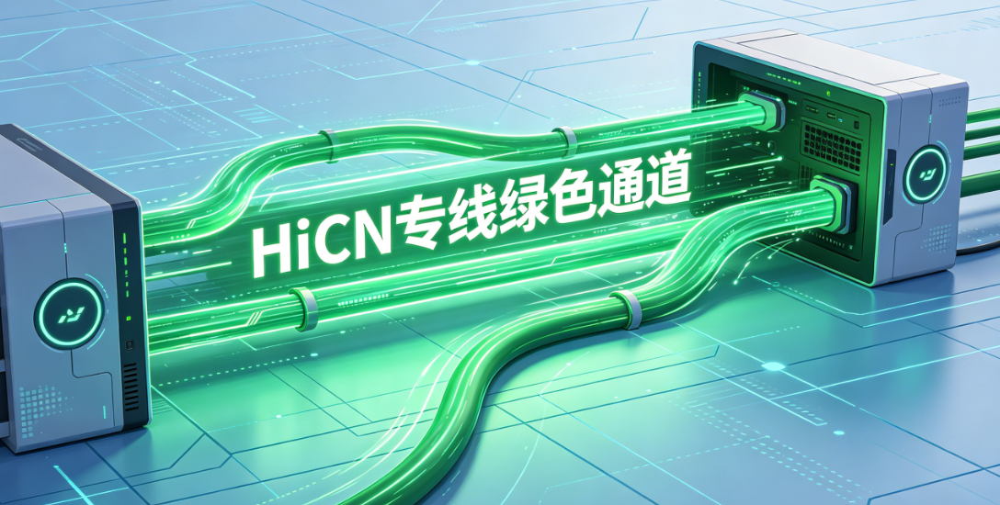

# 海外如何解除哔哩哔哩地区限制？追更时下一集打不开怎么办？

上一集刚结束，点进下一集，播放器却停在地区提示上。海外追更遇到这种情况，可以先确认分集页面，再用 **HiCN 回国加速器**优化回国连接；新用户可免费试用3天，一键加速后重新进入想看的那一集。

追更和随手刷短视频不同，打不开的往往就是你正在等的内容。处理时围绕原分集继续判断，比不停换视频、换设备更容易理清原因。

## 上一集能看，不代表下一集的问题完全一样

先检查点开的是否为正片，以及页面是否显示更新、登录或会员要求。不要只凭封面相同，就把预告、花絮和正片当作同一种播放条件。

如果提示与地区有关，可以从连接环境入手；如果页面明确要求账号或会员权益，则应按平台说明处理。加速器不能替代这些条件，也不能恢复失效内容。

还有一种情况是页面没有地区提示，只是在转圈。这更适合沿着加载问题处理，不能因为人在海外，就把所有异常都认定为地区限制。

## 看清提示，再决定下一步

| 当前页面的表现 | 先确认什么 | 适合采取的动作 |
| --- | --- | --- |
| 地区相关提示 | 原分集链接、当前连接状态 | 一键回国加速后重进该集，仍异常则咨询客服 |
| 提示登录或会员要求 | 当前账号及对应权益 | 按平台页面完成确认 |
| 显示尚未更新或暂不可用 | 分集列表与平台更新信息 | 等待平台安排，网络加速不能提前开放内容 |
| 持续加载、缓冲或报错 | 是否多条视频都异常、本地网络是否正常 | 检查基础连接，再按播放帮助处理 |

把提示记下来，后续求助也更清楚。节目名称、具体集数和错误截图，比一句“番剧看不了”更方便说明问题。

## 用HiCN接好连接，再回到原分集

**HiCN 回国加速器**面向海外华人的国内影音、音乐、游戏等场景，提供**一键加速、智能选路与智能分流**，帮助应用匹配适合的回国线路。

手机上可以打开HiCN，一键加速，再进入哔哩哔哩；Windows电脑用户也可以先打开对应客户端，一键加速后重新进入播放页。日常追更无需先安排复杂的网络设置。

长视频播放还要关注连接能否持续平稳。HiCN 回国加速器支持**极速双路并发**，同时利用两条独立网络通道传输数据，用于降低网络抖动、改善连接稳定性。实际播放仍受当地网络、设备与平台服务状态影响，不能保证每条内容都可播放。

HiCN 回国加速器支持 **Windows、iOS、安卓（Android）和路由器**。手机用户可在应用商店搜索“HiCN”，电脑用户可在浏览器搜索，或访问[HiCN官网](https://www.hicn01.com)下载客户端。路由器方案的适用型号与配置方式，按官方或客服指引确认。

**新用户可免费试用3天**。先打开原来出问题的分集，正常观看一段，连接有异常时可联系HiCN 回国加速器的**7×24小时人工技术支持**，说明所在地、设备和页面提示。

## 追更时，把操作缩成四步

1. **保留原分集链接。** 看清正片、预告与花絮，确认当前页面要求。
2. **打开HiCN 回国加速器，一键加速。** 本地网络无法正常上网时，先恢复基础连接。
3. **重新进入原分集。** 关闭旧播放页再打开，查看当前提示是否变化。
4. **按剩余问题求助。** 视频状态与账号要求找平台，连接异常找加速器客服。

如果连接后仍出现相同地区提示，不必不断刷新或反复退出账号。带着原链接和提示咨询，更容易明确接下来该处理什么。

## 能开始播放，后半集却总缓冲怎么办？

先看无线信号和后台任务，留意是否有大文件上传、下载与视频共用网络。必要时临时降低画质继续观看，再分别检查连接和设备表现。

B站帮助中心将视频源信息获取失败与网络或平台服务异常联系起来，并提供播放诊断入口。遇到持续异常，可以按[哔哩哔哩帮助中心](https://www.bilibili.com/blackboard/help.html)的当前指引处理。

清理缓存之前，先确认具体选项。B站客服的播放诊断提醒，清理时注意保留已缓存视频等重要内容；不要为了下一集打不开，就直接清空全部应用数据。[B站客服播放诊断](https://www.bilibili.com/opus/1037476855331946498)

如果只有画面不连贯、声音仍正常，也要考虑设备性能或播放环境。网络优化与设备问题需要分别处理。

## 常见问题

### 前几集能看，最新一集打不开，账号是不是异常了？

不能直接判断。先看该集是否已更新、是否有登录或会员要求，以及具体错误信息。其他分集能播放，只是一条参考线索。

### HiCN能提前看到还没有更新的集数吗？

不能。内容更新时间由平台安排，回国加速器用于优化网络连接，不会改变内容开放进度。

### 开着HiCN，还需要B站大会员吗？

如果页面要求相应会员权益，仍需满足平台条件。加速服务与视频平台会员作用不同。

### 为什么连接后要重新进入原分集？

让该集在当前连接下重新发起播放，也能避免把另一条视频能播放误认为原问题已经解决。

### 手机和电脑都想追更，试用能分别重新领取吗？

新用户3天免费试用是新用户权益，不能因为更换设备就默认重新获得。具体领取方式以当前客户端为准。

### 一直缓冲，是不是应该直接买更高套餐？

先检查本地网络、后台占用、设备与平台状态，再看实际需求。HiCN 回国加速器价格和套餐权益以当前客户端展示为准，不必把升级套餐当作所有异常的处理办法。

**现在搜索“HiCN”下载客户端，新用户开启3天免费试用，一键加速后重新进入正在追的那一集。** 记住具体提示，按问题分别处理，把观看流程安排得更顺手。

## HiCN回国加速器专属会员兑换码：1124
