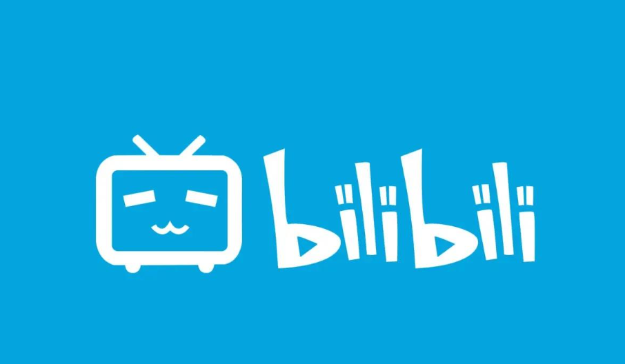

# 海外刷 B 站总被地区限制拦下来？我把踩过的坑和解决路径都整理在这了

## 摘要

海外用户看B站遇到地区限制，根本原因是出口IP非中国大陆。通过使用专业的回国加速器（如HiCN），可以稳定切换至国内节点，一键解锁番剧、影视的高清画质与流畅直播。

## 出国第一年我挺不适应的，倒不是时差，是 B 站。一打开想追个番，「根据版权方要求，你所在的地区无法观看本片」——啪，挡脸。再点开大会员专享，画质直接降到 720P。直播间倒是能进，但弹幕飘得跟下雪似的，一卡一卡。

后来我才搞明白：不是账号坏了，是平台在用我的 IP 决定我能看什么。

## 这种限制到底是怎么来的

B 站上大部分番剧、影视、综艺、体育赛事的版权，都是按"中国大陆"这个范围卖的。平台不会去查你护照，它就看你现在连的是哪儿的 IP——是国内就给你看，不是就拦你，或者把画质往下压。

所以"我开了大会员为什么还是看不了"——问题从来不在账号上，在出口 IP 上。顺带说一句，账号登录地区异常那个提示，也是同一套逻辑在跑：你平时用的 IP 和登录瞬间的 IP 差太远，风控就跳出来了。

港澳台情况稍微特殊一点，有些番剧确实开放了，但绝大多数热门内容还是会被挡住，这事没什么例外可讲。

## 我遇到过的几种「卡法」

老实讲，这一年多我把能踩的坑基本踩了一遍：

● 整页直接打不开，提示版权方要求、地区不可观看

● 能播，但画质最高 720P，1080P+、高码率、杜比那几个选项直接消失

● 大会员界面显示「专享」，点进去还是地区受限

● 视频能加载，转圈三秒缓冲两秒，晚高峰更严重

● 登录账号时被短信验证或者直接拒绝登录

这些症状北美、欧洲、澳洲、新加坡的朋友反馈最多，和运营商关系不大，说到底就是跨境回源链路本身的延迟和合规问题。

## 我试过的几条路

为了把番追完，我前后折腾过几种方法，简单列一下感受：

方案

适合谁

我自己的实际体验

浏览器插件

临时应急

装上能用，但只对网页版有效，App 一打开还是老样子

改 hosts / DNS

喜欢折腾

折腾一晚上，第二天节点失效，又回到原点

第三方转播

只追特定直播

画质取决于别人推的流，延迟和稳定性都不受控

回国加速器

长期海外用户

一劳永逸谈不上，但确实最省心

如果只看一两个视频就完事，浏览器插件够用；但凡你打算稳定追番，把爱奇艺、腾讯视频、网易云、抖音也都搞定，再加一堆国服游戏要打——基本上只剩加速器这一条路了。

## 加速器是怎么工作的

原理没多玄乎：你和 B 站之间塞一台国内服务器当「中转站」，平台读取到的 IP 就变成中国大陆的了。

但选哪个加速器差别还挺大，主要看这几个点——

节点覆盖：北美、欧洲、东南亚、澳新，每个地区都有专门的回国线路，比单节点稳定度高太多。

线路质量：普通的公共节点高峰时段能跑到 300ms 以上，看视频还凑合，直播弹幕就飘了。BGP 双线路或者自建专线，延迟一般能压在 100–200ms。

协议适配：游戏追求低延迟，视频追求带宽和稳定，两边适合的协议不一样。一个好的加速器会分「游戏专线」和「影音专线」，而不是一刀切。

节点切换：这个很多人忽略。节点挂了客户端能不能秒切备用，决定了你追番到一半会不会突然黑屏。

我现在在用的是 HiCN 回国加速器。它支持 Windows、iOS、Android 以及路由器，覆盖比较全。多端的好处很明显——电脑上追番，手机上刷抖音，电视上投屏，不用一个个折腾。线路部分有智能路由和双线路备份，节点故障会自动切，稳定性比之前用过的好不少。

顺带提一句，新人一般有 3 天免费时长，注册时顺手输个口令「1124」，能再领到一些会员加速时长，亲测能用。

## 不同设备的操作

具体操作我按设备拆开讲，少绕弯子：

电脑（Windows）去官网下载安装包，装好之后注册登录。一键连上对应 B 站的影音专线，打开 bilibili.com 或者桌面端就能正常看。如果同时要访问 YouTube、Netflix，记得开「智能分流」，别让本地流量也绕一圈。

iPhone / iPadApp Store 里搜 HiCN 就能装。第一次会弹一个 VPN 描述文件授权，确认一下就生效。影音分类下选 B 站线路，点连接。打开 B 站 App 或者 Safari 进网页版都能解锁。

安卓官方 APK 或者 Google Play 都行。授权 VPN 后选 B 站专线，回桌面打开 B 站就完了。

路由器这一步推荐给家里有智能电视、Apple TV、Switch 的朋友。一次配置，电视盒子、客厅设备、所有连 Wi-Fi 的终端一起受益，不用每个设备单独装客户端。

## 几个被问得比较多的问题

用加速器会不会被风控？本身不会——它只改出口 IP。但如果你用的是那种 IP 池被几十万人共享的免费代理，那基本一定会被风控，登录地区异常、弹幕发不出去、评论被屏蔽都可能。正规的、有独立节点的加速器会好很多。

大会员会不会因为海外被取消？会员本身不会。但长期在海外 IP 登录，可能会被要求短信验证，这是风控的常规动作，不是会员失效。

直播延迟大不大？看节点。BGP 双线路、自建专线的加速器延迟能压到 100–200ms，弹幕互动没问题；普通公共节点高峰期能上 300ms，体验会差一些。

海外看 B 站算不算违规？个人学习、追番这种用途基本不会被追责。但如果拿去做录播、二次传播、商业转播，那是另外一回事了，涉及到版权方利益，会有麻烦。

加速器会不会让其他网站变慢？开智能分流就没事——只有国内流量走加速器，YouTube、Google 这些还是走本地带宽。设置里可以按需切。

## 我的一点小建议

如果你刚被这个问题卡住，先别急着一通操作。判断一下自己的情况：

● 临时看几个视频：浏览器插件先顶上，验证问题是不是出在 IP 上；

● 打算长期稳定用：直接试回国加速器，先用 3 天免费跑一跑，看看晚高峰能不能顶住、画质能不能恢复到 1080P+；

● 家里一堆设备：选支持路由器级的，省得到处装客户端；

● 还要办公：找带专线和智能路由的，视频、远程两不误。

跨境这事没有什么"装一次就完事"的方案，节点会变、平台政策会调，长期用就需要随时关注。我的建议是先小成本试一下，适合自己再订阅。我自己在 HiCN 跑了快一年，节点稳定、覆盖全，追番、办公、偶尔打打游戏，足够用了。

## 参考

1.  B 站港澳台地区番剧观看说明：[bilibili.com/opus/951380714033512457](https://www.bilibili.com/opus/951380714033512457)

2.  B 站官方海外党加速指南：[bilibili.com/opus/487966361379417048](https://www.bilibili.com/opus/487966361379417048)

3.  Chrome 浏览器插件 Unblock Bilibili：[chromewebstore.google.com](https://chromewebstore.google.com/detail/unblock-bilibili-%E6%B5%B7%E5%A4%96%E8%A7%A3%E9%94%81b%E7%AB%99%EF%BC%8C%E5%85%8D/iihhealhjbdfanllhhfiingmfmdiamcg)

4.  HiCN 回国加速器客户端下载：[HiCN回国加速器客户端下载，海外华人一键解锁国内音视频与国服游戏](https://www.hicn01.com/download)

5.  HiCN 海外 B 站地区限制专题：[海外看哔哩哔哩受限怎么办？用HiCN回国加速器一键解锁B站视频](https://www.hicn01.com/article/556)

## HiCN回国加速器专属会员兑换码：1124
