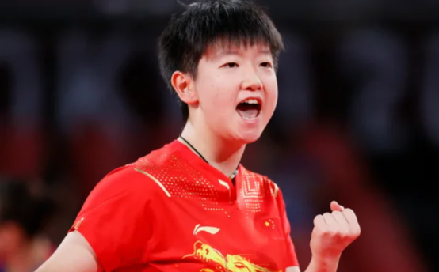

# 解决海外看体育直播地域限制的方法：父母来探亲，怎么帮他们接着看球？

父母刷到孙颖莎的精彩回合，又问“广东队这场在哪看”，打开直播却出现地区提示。海外家庭观赛，先帮他们找准本场官方入口，再准备连接。加载不顺时，推荐用 HiCN 回国加速器；应用商店搜索下载，新用户可免费试用3天，一键加速后进入目标平台体验。

## 热点带来观看需求，先把比赛名字说完整

“孙颖莎那场”和“广东队今晚的比赛”，对熟悉赛程的人容易理解，搜索时却需要更具体的信息。帮父母找比赛，可以先问对手是谁、哪一天、想看直播还是补看，再定位页面。

WTT蒙彼利埃冠军赛就是一个例子。央视已发布女单四分之一决赛集锦，内容说明为：**北京时间2026年10月31日，孙颖莎4比3战胜早田希娜。**截至11月1日，这场已经结束，应查找当前回看内容，不能继续当作待开播预告。查看央视官方集锦。

这场是中日选手对决，国乒内战则需要按另一组对阵查找。若父母想看完整比赛，再确认平台是否提供全场，别把几分钟集锦当成全场入口。

## 追CBA，用球队和日期帮他们定位

关注广东、山东、浙江的父母，可能记得球队，却不熟悉App里的栏目。可以把球队名称、日期和对手一起记下来，再核对赛季与轮次。

第6、7轮这样的信息适合作为补充，不能省略赛季与日期。平台搜索可能返回旧录像，页面写着“录像”也不代表比赛正在进行。

想沿用熟悉的CCTV5中文解说，可以先查央视体育频道节目官网及央视频当前页面。是否安排目标球队比赛、播直播还是录像，以当天节目单为准，不直接承诺所有场次免费或没有广告。

## 给父母留一张“看到什么就做什么”的小卡片

页面上出现什么

可以告诉父母怎么做

家人后续确认什么

提示需要登录

先停在页面，确认自己的账号

登录状态与验证要求

明确地区相关提示

截图保留，不必反复点播放

平台当前地区说明和可用入口

一直转圈、加载慢

先确认手机能上网，再开启加速

本地网络与回国连接

只有集锦，没有全场

先看标题，不急着继续找按钮

平台是否实际提供完整回看

播放时间与预想不同

看节目日期及“直播／录像”文字

时区、赛事安排与节目调整

这样远程沟通时，父母可以直接描述屏幕上的文字，不用记住一串技术名词。明确地区提示持续存在时，按平台官方说明确认，也可以查看当地提供本场赛事的官方入口。

## 用 HiCN 把连接动作简化成日常习惯

HiCN 回国加速器面向海外用户的国内直播、视频等回国访问需求，支持一键加速、智能选路与智能分流，可按应用或场景匹配回国线路。

**极速双路并发通过两条独立网络通道传输数据，降低网络抖动，改善持续播放所需的连接体验。**父母想看乒乓球回合过程，或跟着CBA看一段完整攻防，可以先把常用设备准备好。

HiCN 回国加速器支持 Windows、iOS、安卓（Android）和路由器，新用户可免费试用3天。手机或电脑可先使用对应客户端；路由器具体型号、配置与覆盖范围，按官网或客服指引确认。

可以陪父母走一遍手机操作：

1.  在应用商店搜索 HiCN，下载客户端，注册并登录。

2.  开启新用户3天免费试用，选择影音或直播场景，一键加速。

3.  进入已确认的赛事平台，打开本场比赛，核对直播、录像或集锦状态。

4.  查看实际播放结果，确认声音和画面，再把常用入口留好。

Windows电脑用户可在浏览器搜索 HiCN，或访问HiCN 官网下载客户端。一键加速后进入目标赛事页面即可。

现在就用新用户3天免费试用，和父母一起跑通一次常用观赛场景。HiCN 回国加速器提供24/7人工技术支持，连接异常可说明地区、设备、网络类型和发生时间，请客服协助。

HiCN 回国加速器用于网络优化，无法保证所有赛事均可播放，也不能改变账号要求或让缺少的全场回看出现。持续的平台提示，仍应按官方说明处理。

## 留一个固定入口，也留一种简单的求助办法

不必在父母手机上塞满多个直播入口。先保留他们会用的官方平台，再教会怎样找节目单、看页面提示，操作更容易记住。

远程帮忙时，可以请父母发当前提示截图，并说清比赛和时间；没有必要一遇到转圈，就让他们退出账号、删除数据或重装App。

如果改用电脑、电视或投屏，还要确认实际播放设备的连接与平台支持。手机加速成功，不代表其他设备已完成准备。先让一台设备正常播放，再增加观看方式。

## 海外帮父母看比赛，常见问题有哪些？

### 孙颖莎对早田希娜这场，还要等直播吗？

截至2026年11月1日，央视已发布该场四分之一决赛集锦。应查找当前回看内容，全场是否提供以实际页面为准。

### 广东、山东、浙江的比赛，CCTV5都会播吗？

不能直接保证。按球队、日期和对手找到本场，再查看当天官方节目单，区分直播与录像。

### 父母不熟悉设置，需要自己选很多线路吗？

手机打开 HiCN 回国加速器，选择影音或直播场景，一键加速后进入目标平台即可。连接问题可请人工客服协助。

### 开启加速后，地区提示一定会消失吗？

不能保证。HiCN 回国加速器用于优化回国连接，持续提示时按平台说明或客服答复处理。

### 新用户可以先免费体验吗？

HiCN 回国加速器新用户可免费试用3天。换设备不等于重新获得新用户资格，具体账号状态与后续方案以客户端为准。

父母想看的比赛，先帮他们找到，也把连接准备好。现在就在应用商店或浏览器搜索 HiCN，开启新用户3天免费试用，一键加速后打开目标赛事页面，陪他们熟悉一次操作，下次看球更省心。

## HiCN回国加速器专属会员兑换码：1124
