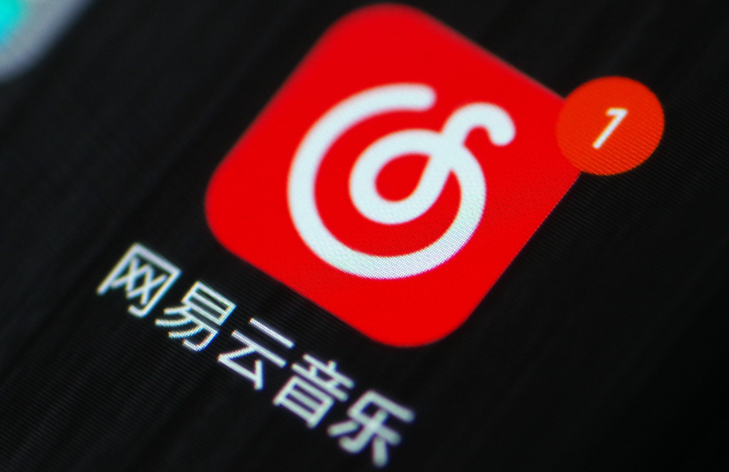

# 刚出国打开网易云歌单灰了一片？别急着换软件，老海漂教你一招搞定

大半夜刚赶完报告，整个人累得不行，本来想点开网易云音乐放几首老歌回回血。结果点进歌单一看，好家伙，平时单曲循环的那几首全变灰了。硬着头皮挑了首亮着的，加载圈转了半分钟硬是没出声，最后直接给我切到下一首，那一瞬间真是又困又无语。

刚来国外那阵子，我一度以为是手机系统抽风了，又是清缓存、又是切5G流量，甚至把App卸了重装，折腾半天纯属白费劲。其实这跟手机没啥关系，主要是跨国网络链路太绕，国内音乐平台的服务器都在内地，海外直连过去丢包严重、响应慢，歌单自然没法正常加载。

后来跟圈子里的老海漂聊了聊，才发现大家早就用上了**回国加速器**来做**网络优化**。我自己前前后后试过几款，有的晚高峰老断连，有的用着太繁琐，最后留在主力设备里一直没卸的，是 **HiCN回国加速器**。

它用起来没那么多弯弯绕绕，主打一个稳当。连上它的影音**网络加速**之后，再重新点开网易云音乐，之前灰掉或者加载不出来的歌基本都能顺畅播了，无损音质缓冲得也挺快。一边听着熟悉的华语歌，一边刷刷云村评论区，瞬间有种还在国内的错觉。

顺带一提，咱们在海外生活哪能光靠听歌解闷？晚上吃饱饭想刷两集国内热播剧、看个下饭综艺，或者周末约着国内老友连麦打几把国服游戏，HiCN都能一块儿兜住。特别是它自带的**游戏加速**和**延迟优化**，打国服排位的时候能把红字高延迟压得很稳，不用为了听歌、追剧、开黑装一堆软件来回切，省心不少。

还有一点用着特别爽，就是它的设备覆盖够全。平时随身带的 **iOS和安卓手机**、写论文办公的 **Windows电脑** 都能直接装。如果你是在外租房或者跟家人一起住，它甚至直接支持**路由器**配置——往路由器里一挂，家里连着Wi-Fi的智能音箱、平板、电视全都能顺畅用国内应用，周末在家直接外放歌单或者大屏追剧，幸福感直接拉满。

不过话说回来，海外每个国家、不同宽带运营商的网络底子差别挺大，别人说再好也不如自己测一把。HiCN对新用户挺实在，直接给 **3天免费试用**。建议大家先下下来，挑自己平时最常听歌、打游戏的晚高峰时段跑一跑，觉得稳当不掉线再留着，完全没啥试错成本。

最后顺嘴提个小细节：连上HiCN回国加速器之后，记得把原本在后台挂着的网易云音乐彻底划掉重进一次，让软件刷新一下网络路径，基本就能秒播了。

一个人在异国他乡打拼读书，耳机里能随时响起熟悉的旋律，闲下来顺顺当当追剧开黑，真的挺治愈的。对了，下载好HiCN后别忘了使用口令1124免费领取会员加速时长，赶紧去试试吧。
