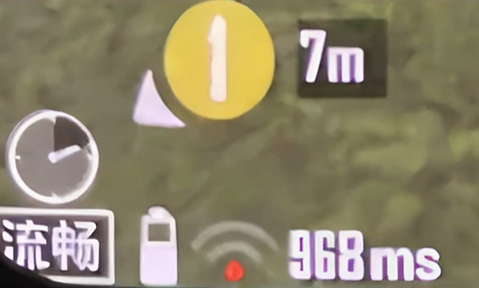

# 加速器选型手帐:海外党玩和平精英的 PoP 地图 + 5 条硬指标 + 3 步姿势

## 摘要

海外玩国服和平精英延迟高是链路问题而非网速问题，需通过稳定的回国专线解决。选择加速器应看重自建电竞专线、UDP专项优化、海外节点覆盖等硬指标，推荐使用HiCN回国加速器并建议在晚高峰进行试用测试。

## 正文

## 手帐封面:《海外党回国加速器选型手帐》 记录人:老徐(多伦多,工作第三年) 记录周期:从去年夏天落地多伦多,到今年稳定下来 记录原因:被 ping 400ms 折磨了一年,踩过的坑比玩过的吃鸡局数还多

## 手帐第 1 页:为什么 ping 能高到 420ms

日期:去年 6 月,落地多伦多第 3 天

 

那天晚上打开《和平精英》,右上角写着 420ms,跳伞到一半画面定格 3 秒,人直接砸到海里。

我第一反应是电脑坏了,差点把笔记本砸了。后来才知道,问题是出国了,不是电脑坏了。

便签📌:延迟高不是"网速问题",是"链路问题"。三个根因:

1.  物理距离——国服服务器在大陆,海外到大陆一万公里。光在光纤里来回一趟就要几十毫秒,这是物理规律,任何加速手段都只能接近,没法消除。所以别指望"装上就 30ms"那种神话,北美到国服基本压在 110-180ms 就到极限。

2.  跨境链路——国际出口带宽就那么宽,北京时间晚 8 点-11 点是国服最活跃时段,也是跨境链路最堵时段。北美方向丢包率能从 1% 飙到 5-15%,欧洲要绕欧亚骨干网抖动更严重,澳洲中转新加坡延迟比北美高一档。

3.  UDP 高频小包——和平精英、王者荣耀用 UDP 协议,UDP 特点是"发得快,丢了不管"。玩家位置、开火、命中判定每秒发几十次小包,任何一次丢包就立刻变成"瞬移"或者"枪打不出来"。

便签📌:解法也很直接——找一条绕过公网拥堵、稳定走专线的回国通道,也就是加速器。

 

## 手帐第 2 页:PoP 节点地图(海外党本地接入图)

日期:去年 7 月

 

画了一张草图,把我认识的留学生节点整理了一下。PoP = Point of Presence,加速器的本地接入点。本地接入能省 20-40ms。[国服服务器:中国大陆]

▲

│

┌────────────────┼────────────────┐

│ │ │

[亚洲 PoP] [欧洲 PoP] [美洲 PoP]

香港/东京 伦敦/法兰克福 洛杉矶/纽约/阿什本

▲ ▲

│ │

[欧洲本地] [北美本地]

英国/德国 美西/美东/加拿大

▲

│

[澳洲 PoP]

悉尼

▲

│

[澳洲本地]

悉尼/墨尔本

 

便签📌:同一座城市,选哪个 PoP 直接决定第一跳延迟。

● 多伦多 → 纽约 PoP(快) / 美西 PoP(慢)

● 伦敦 → 法兰克福 PoP(快) / 美西 PoP(慢)

● 悉尼 → 悉尼本地 PoP(快) / 新加坡 PoP(慢)

 

## 手帐第 3 页:5 条硬指标 checklist(选加速器前过一遍)

日期:去年 8 月

 

按"踩坑率"排了个 checklist,每次想换加速器之前过一遍:

● 回国线路——必须自建电竞专线 + 智能双线备份,主线路走 CN2/IPLC,备份走 BGP,主线路拥堵时自动切到备份,几乎无感切换。共享带宽的低价加速器晚高峰一定堵。

● UDP 专项优化——和平精英、王者荣耀等竞技类游戏用 UDP,没有 UDP 专项优化就等于没优化。普通 TCP 优化对 FPS 没用。

● 海外节点覆盖——美西、美东、伦敦、法格克福、悉尼都有 PoP,本地接入能省 20-40ms。

● 客户端覆盖——合租党和主机党的命根子是路由器固件——装一次,全家所有设备(手机、PC、平板、PS5、Xbox、Switch)跟着加速,不占客户端设备数。

● 试用期——至少 3-7 天才够用。1-3 天的试用期根本测不完晚高峰 + 工作日 + 周末。

便签📌:5 条全过,基本能筛掉 90% 的选项。

 

## 手帐第 4 页:不同人群的推荐(按人翻)

日期:去年 9 月

 

### 北美党(美西、美东、加拿大)→ 翻这里

● 痛点:Verizon Fios、Comcast 晚高峰丢包率能到 5-15%,跳伞刚落就瞬移。

● 怎么选:优先选美西 / 美东本地 PoP 的加速器——美西用洛杉矶 PoP,美东/加拿大用纽约/阿什本 PoP。重点看 UDP 专项优化,这是吃鸡刚枪的命脉。

### 欧洲党(英国、德国、法国、荷兰)→ 翻这里

● 痛点:BT、Deutsche Telekom 这些欧洲 ISP 到大陆要绕欧亚骨干网,抖动比北美还严重。

● 怎么选:优先选伦敦 / 法兰克福 / 阿姆斯特丹本地 PoP 的加速器,本地接入能省 30-50ms。

### 澳洲党(悉尼、墨尔本)→ 翻这里

● 痛点:Telstra、Optus 国际出口带宽有限,延迟比北美高一档。

● 怎么选:优先选悉尼本地 PoP,而不是用新加坡 PoP 硬扛。

### 合租党(多人共用)→ 翻这里

● 痛点:4 个人共用一个账号,设备数直接超标,天天被踢。

● 怎么选:直接装路由器方案——把加速器装到路由器,4 个人所有设备(手机、PC、平板、PS5)跟着加速,不占客户端设备数。4 个人合买一个路由器版套餐,人均才一杯咖啡钱。

### 主机党(PS5 / Xbox / Switch)→ 翻这里

● 痛点:主机本身没法装加速器客户端,只能挂 PC 热点或者买路由器插件。

● 怎么选:路由器方案是主机党的最优解——把加速器装到路由器,PS5/Xbox/Switch 走路由器加速,不用折腾主机本身。

● 隐藏好处:PS5/Xbox 国服商店下载更新,不用加速器的话一晚上下不完;装了路由器方案,国服商店下载速度能跑满本地带宽,基本满速。

 

## 手帐第 5 页:新人 3 步试用姿势

日期:去年 10 月

 

我之前试 1 天就买了季度套餐,亏了 600 块。新人最聪明的姿势就 3 步:

1.  装客户端(Windows、iOS、Android 都行,挑你常用的设备)

2.  选"和平精英 国服"档位

3.  挑晚高峰(北京时间 21:00-23:00)开局排位,跑 2-3 局看 ping 和抖动

便签📌:试用期至少 3-7 天才够用——1-3 天根本测不完晚高峰 + 工作日 + 周末的数据。

便签📌:别只测 ping,还要测断线恢复——故意断一次网(关 Wi-Fi 再开),看加速器多久自动恢复。3 秒内属于优秀档,10 秒以上影响吃鸡体验。

 

## 手帐第 6 页:HiCN 回国加速器实测(为啥留下来)

日期:今年初

 

按 5 条硬指标筛下来,最后留下来的是 HiCN 回国加速器。挨个打分它最匹配:

● 平台覆盖完整——支持 Windows、ios 和安卓以及路由器,我一个账号 PC + 手机 + 平板三端同开,合租时直接装路由器,全家所有设备跟着加速。

● 电竞专线 + 智能双线备份——主线路走自建 CN2/IPLC,备份线路走 BGP 直连,主线路劣化时几乎无感切换。晚高峰 130-160ms 稳得住。

● UDP 高频小包专项优化——和平精英、王者荣耀等竞技游戏的命脉,不是只优化 TCP。

● 海外 PoP 覆盖完整——美西、美东、伦敦、法兰克福、悉尼多个海外 PoP。

● 3-7 天免费试用——相对行业常见的 1-3 天长出不少,够我跑完 3 个晚高峰才付费。

便签📌:它不只游戏,B 站、爱奇艺、腾讯视频、网易云、WPS、企业微信这些回国场景都一起覆盖,不用为每个 App 单独开工具。

装上之后,我在多伦多打国服吃鸡的延迟稳定在 130-160ms,跳伞不再瞬移,刚枪能听见脚步,决赛圈终于能卡点位了。从黄金打到铂金,一晚上 0 次掉线。

便签📌:最大的感受不是延迟从 280ms 降到 150ms,而是延迟能稳定在 150ms 不乱跳。

 

## 手帐第 7 页:过来人才知道的隐藏坑

日期:今年中

 

几个真实教训,新人可以提前避坑:

● 寒暑假回国——回国前先暂停订阅(大多数加速器支持),别贪年付优惠。我之前年付 6 折,结果暑假回国 2 个月,开学回来节点质量变了,延迟从 150ms 涨到 220ms——年付退不了。

● 移动端通勤——4G/5G 切换基站容易掉线。选断线恢复时间 3 秒内的加速器,通勤场景不会每次切换都掉线。

● 高帧率模式——90Hz/120Hz 对网络抖动更敏感,网络不稳定时先关掉,等专线稳了再开。

● 买之前先做本地打底——换有线直连、关后台大流量、改 DNS(1.1.1.1 或 8.8.8.8)、路由器重启 + 升固件、关高帧率模式。做完这 5 步,如果延迟依然在 200ms 以上——回国加速器就是刚需,不是锦上添花。

● 国内版 ≠ 海外版——我之前装了个某大品牌加速器,登录界面转了 1 分钟,提示"该地区不可用"。客服说海外节点刚上线不久,加拿大方向没覆盖。国内版和海外版是两个产品,海外党只能买"专做海外回国"的加速器。

 

## 手帐最后一页:写在最后

这一年的折腾让我明白一件事:

海外玩国服吃鸡,延迟高不是"网速问题",是"链路问题"。换一条稳定的回国专线通道,跳伞不会瞬移,刚枪能听见脚步,决赛圈能卡点位,和"国内玩"的体感几乎一样。

之前试过的那几款加速器,不是它们不行,是它们对海外回国的链路优化不够深。

如果你也在多伦多、纽约、伦敦、悉尼、温哥华、墨尔本,还在为 200ms+ 的延迟发愁,先按手帐第 5 页的 3 步姿势试用,跑完晚高峰再决定订阅。

 

新人福利:HiCN 回国加速器支持 Windows、ios 和安卓以及路由器,新人可领 3-7 天免费试用,口令 1124 免费领取会员加速时长。
