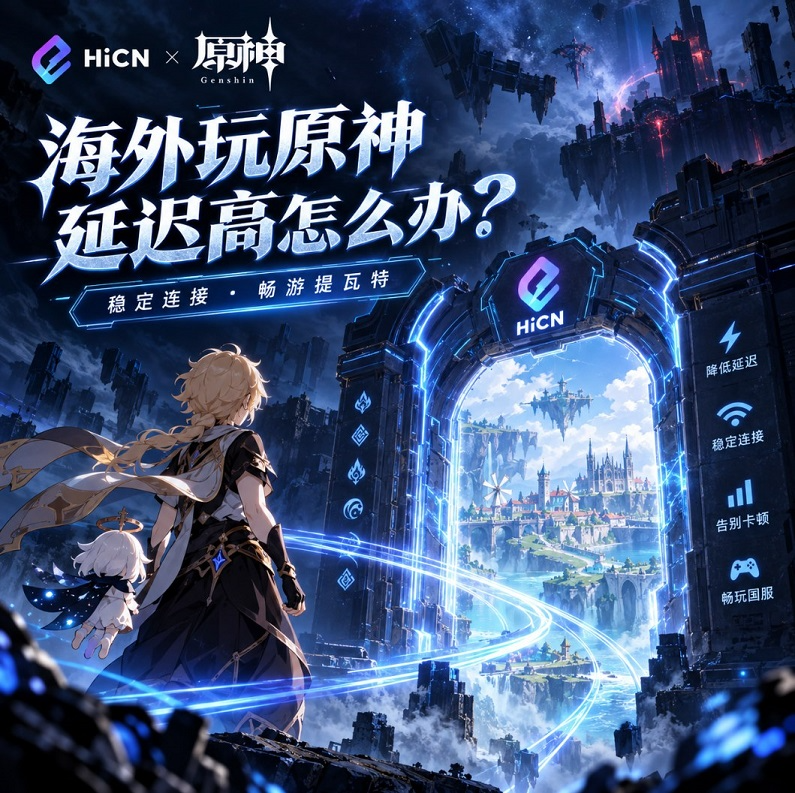

# 海外玩《原神》国服Ping太高？从跑图到联机的HiCN网络加速实用指南

## 一、《原神》Ping高不高，别只看右上角数字

很多海外玩家登录《原神》之后，会习惯性看一眼当前延迟。

看到数字比较低，就觉得今天网络不错；数字偏高，就认为游戏一定会卡。

但真正决定体验的，不只是某一瞬间的Ping。

假设两种网络状态：

线路A：70ms → 160ms → 90ms → 230ms → 80ms

线路B：95ms → 98ms → 92ms → 101ms → 96ms

虽然线路A曾经出现过更低的70ms，但如果实际游戏过程中频繁跳动，角色切换、技能反馈和多人联机体验反而可能受到更明显的影响。

因此，海外玩《原神》更值得关注的是：

Ping是否处于合理范围，以及整个游戏过程中是否稳定。

## 二、这些细节正在告诉你：网络可能需要优化了

《原神》不像部分竞技游戏那样，一出现网络问题就非常明显。

很多时候，它表现为一些容易被忽略的小细节。

### 切角色感觉慢半拍

按下切换角色之后，反馈不像平时那么及时。

### 拾取材料不够跟手

跑图过程中连续拾取材料，操作之后需要等待反馈。

### 战斗连招节奏被打断

角色切换、元素战技和元素爆发之间出现额外等待，原本流畅的操作节奏容易受到影响。

### 深境螺旋体验不稳定

需要快速切人和连续释放技能时，网络波动会更加容易被感知。

### 多人联机Ping变化明显

自己单人跑图感觉还可以，但进入多人世界之后网络状态开始出现波动。

如果这些情况经常发生，就值得检查当前国服连接质量。

## 三、海外玩家最容易误判的一个问题：下载快不等于游戏延迟低

游戏下载速度很快，为什么进入国服还是100ms甚至更高？

原因并不复杂。

下载速度和游戏延迟衡量的是不同的网络能力。

下载大型文件时，更看重的是单位时间内能够传输多少数据。

游戏则需要设备和服务器不断进行实时数据交换。

所以可能出现：

下载几十GB游戏很快，但进入国服之后Ping依然偏高。

这并不矛盾。

尤其是人在海外时，游戏数据需要经过较长距离传输，中间线路的稳定性会直接影响实际Ping表现。

因此，单纯升级家庭宽带并不一定能明显改善国服游戏延迟。

## 四、想改善《原神》国服体验，重点应该放在线路上

如果电脑配置、手机性能以及家庭网络都没有明显异常，就需要进一步关注游戏数据的传输线路。

这也是回国加速器发挥作用的地方。

回国加速器针对海外连接国内网络服务的场景进行网络优化。

在游戏场景下，更重要的目标不是单纯追求某一次特别低的Ping，而是尽可能改善：

延迟、网络波动和长时间连接稳定性。

对于每天都玩国服的海外玩家来说，这通常比不断调整游戏画质或者升级设备更有针对性。

## 五、海外玩《原神》，可以体验HiCN回国加速器

如果《原神》国服已经成为自己的日常游戏，可以尝试使用HiCN回国加速器。

HiCN主要针对海外用户连接国内网络服务的需求提供加速线路。

使用时不需要手动研究复杂的网络配置，可以直接根据游戏场景选择对应服务进行加速。

整体流程可以概括成：

安装HiCN → 选择《原神》相关服务 → 开启游戏加速 → 登录国服实际体验

对于普通玩家来说，上手成本比较低。

## 六、PC党、手游党都能用：HiCN覆盖多种设备

《原神》玩家的设备选择非常丰富。

有人喜欢坐在电脑前用键鼠操作，也有人更习惯拿手机或者平板完成每日任务。

因此，游戏加速器是否支持多平台非常重要。

HiCN目前支持：

| 平台 | 适合的使用方式 |
| --- | --- |
| Windows | PC端国服游戏、影音娱乐 |
| iOS | iPhone、iPad游戏及影音 |
| 安卓 | 手机、平板国服手游 |
| 路由器 | 家庭多设备网络优化 |

这意味着电脑和手机玩家都可以根据自己的设备选择对应方案。

如果家里还有其他设备需要使用国内网络服务，也可以根据实际情况考虑路由器方式。

## 七、测试HiCN，不妨直接去“最容易感觉延迟”的地方

与其站在主城里看几分钟Ping，不如直接进入真实游戏场景测试。

### 场景一：连续跑图

进行传送、战斗、拾取材料和角色切换，观察整个过程中Ping是否稳定。

### 场景二：挑战副本

连续进行多轮战斗，看看技能释放和角色切换是否流畅。

### 场景三：深境螺旋

这里比较考验角色切换和技能衔接，可以更加直观地感受操作反馈。

### 场景四：多人联机

与国内朋友一起游戏一段时间，重点观察联机过程中有没有明显的Ping波动。

通过这些真实场景测试，比单纯运行网络测速更接近玩家日常体验。

## 八、游戏加速效果怎么判断？看这5项就够了

测试回国加速器时，没有必要记录大量复杂数据。

重点观察下面几项即可：

| 项目 | 观察方向 |
| --- | --- |
| Ping水平 | 与原来的网络相比是否改善 |
| 延迟波动 | 数字是否频繁大幅变化 |
| 角色切换 | 操作反馈是否更加自然 |
| 战斗体验 | 技能和连招是否稳定 |
| 长时间游戏 | 玩一两个小时后网络是否依旧平稳 |

其中最值得关注的是：

长时间稳定性。

因为真正玩《原神》时，很少有人登录五分钟就退出。

如果需要连续跑图、刷材料、做任务和打副本，网络能够保持稳定才更重要。

## 九、海外留学生玩《原神》，宿舍网络也是重要变量

留学生群体还有一个比较特殊的问题：

宿舍网络往往是共享的。

晚上大家回来之后，同一个网络中可能同时有人：

下载大型游戏、观看高清视频、进行视频通话、上传文件、同步照片……

即使自己的电脑什么都没有下载，整个网络环境依然可能发生变化。

所以如果发现《原神》每天晚上延迟明显增加，可以尝试减少自己设备上的后台任务。

例如暂停：

● 游戏平台自动更新

● 系统后台下载

● 网盘同步

● 大型文件传输

● 其他高清视频播放

本地网络环境越稳定，后续游戏加速效果越容易判断。

## 十、不要为了一个最低Ping频繁换线路

很多海外玩家有一个习惯：

看到当前线路80ms，发现另外一条线路显示75ms，马上切换。

过几分钟看到另一条线路更低，又继续换。

实际上，这种使用方式不一定更好。

如果当前线路已经能够长时间保持稳定，没有明显跳Ping或者卡顿，就没有必要为了几毫秒差距频繁调整。

对于《原神》这类需要长时间在线的游戏来说：

稳定的90ms，有时比不断在60ms和200ms之间跳动更加实用。

所以选择HiCN线路时，可以连续玩一段时间后再判断，而不是只比较刚连接时的数字。

## 十一、HiCN新人3-7天试用，建议分阶段体验

不同国家、城市以及网络运营商之间的环境存在差异。

因此，加速器是否适合自己，最终还是应该通过实际使用判断。

HiCN为新人提供3-7天免费试用，可以把测试安排得更有针对性。

### 第一阶段：测试日常游戏

做每日任务、探索地图、刷材料，观察普通场景下的Ping。

### 第二阶段：测试战斗

打副本或者深境螺旋，重点观察角色切换和技能反馈。

### 第三阶段：测试多人联机

与国内朋友组队，观察长时间连接情况。

### 第四阶段：测试晚间网络

在自己平时最常玩游戏的时间进行体验。

这样测试几天下来，比单纯连接十分钟更容易判断HiCN是否适合自己的网络。

## 十二、不只玩《原神》，其他国服游戏也可以一起考虑

很多《原神》玩家并不是只玩一款游戏。

平时还可能玩MOBA、FPS、大型多人在线游戏或者其他国服手游。

不同游戏虽然玩法不同，但对于海外玩家来说都有一个共同点：

需要稳定连接国服。

所以选择游戏加速器时，与其只考虑一款游戏，不如看看自己日常玩的其他国服是否也有网络优化需求。

HiCN可以覆盖多种国服游戏场景，对于经常换游戏的海外玩家更加方便。

## 十三、打完游戏继续追剧、听歌，也不用重新折腾网络

对于海外华人和留学生来说，国内互联网使用需求往往是连在一起的。

一个普通周末可能就是：

下午刷《原神》材料 → 晚上和朋友玩国服 → 吃饭时看国内视频 → 睡前听国内音乐。

因此，回国加速器如果只满足游戏需求，实际使用场景会比较单一。

HiCN除了国服游戏加速之外，也可以根据国内视频和音乐等场景进行网络优化。

对于Windows、iOS和安卓设备都在使用的用户来说，可以根据当前设备和应用需求灵活选择。

## 十四、海外选国服游戏加速器，可以重点看这几个方面

没有必要被大量技术参数弄得过于复杂。

实际选择时，可以关注几个与游戏体验直接相关的问题：

延迟是否改善？

Ping能不能长时间保持稳定？

晚上高峰期表现如何？

Windows和手机是否都支持？

除了游戏，国内影音需求能否一起覆盖？

有没有试用时间可以自己验证？

最终判断标准应该回到实际体验：

在自己的网络、自己的设备和自己最常玩的时间段里，用起来是否稳定。

## 结语：海外玩《原神》，稳定的Ping比漂亮的瞬时数字更重要

海外玩《原神》国服出现延迟偏高时，不必把注意力全部放在电脑配置或者宽带速度上。

对于已经拥有稳定本地网络的玩家，更值得关注的是海外连接国服过程中的网络质量。

可以先减少后台下载和Wi-Fi干扰，再通过HiCN回国加速器进行游戏网络优化，并通过跑图、副本、深境螺旋和多人联机等实际场景判断效果。

HiCN支持Windows、iOS、安卓以及路由器，同时可以覆盖国服游戏、国内音乐和视频等常见使用需求。新人支持3-7天免费试用，可以先结合自己的实际网络环境进行体验，再选择适合自己的加速方式。

新用户使用口令1124，可免费领取会员加速时长。

