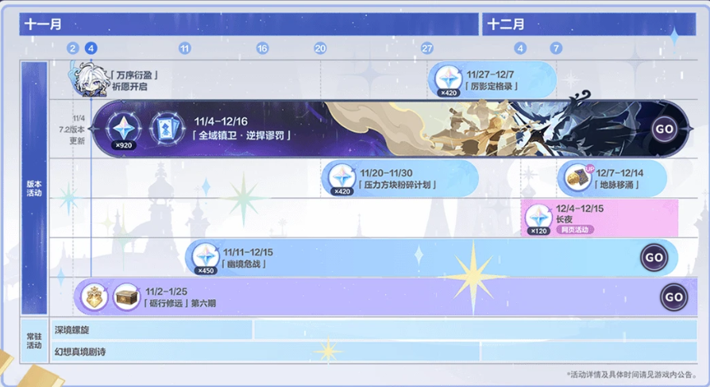

# 至冬开服那天凌晨三点,我终于把冰神等来了——海外党国服原神玩家的一次实录

从开服等到现在,**冰神终于实装了**。7.0 版本"无神怜爱的雪国",至冬正式开服,星象反应机制登场,九位新角色一起亮相(哥伦比娅、队长、少女、博士、莉奈娅、爱诺、菈乌玛、法尔伽等等),前瞻 PV 在 B 站炸了一整天。

我坐在宿舍的床上,看着窗外加州凌晨三点的夜空,**心想——明天这个时候,我能不能稳稳地打开原神,看到冰神的登场画面**。

## 一、那天晚上我做的第一件事:把所有客户端的更新全部预下载

凌晨两点半,我爬起来干的第一件事,**不是开游戏,是开加速器下预下载包**。

7.0 的预下载包比平时版本大得多——新地图素材、新角色模型、新过场动画、新机制演示,**加起来得有十五六个 G**。**国内玩家随便下,海外玩家不一样,这个包要从米哈游国服服务器走跨境链路**。

我用 HiCN 跑了一个专门给至冬的节点,挂机让它下,**看了一眼下载速度——大概 8MB/s**,比之前没加速的时候快了四五倍。**挂到天亮,基本就下完了**。

这事给了我一个很关键的体感:**预下载一定要打提前量**。**至冬版本这种"超大版本",预下载窗口是上线前 1-2 天就开放的,错过了就是地狱模式**。

那天晚上我要是睡了,**第二天上线当天再下,大概一整天都下不完**——国服服务器被全球玩家挤爆,国际出口也被踩满,两个拥堵叠在一起,经常下载速度能跌到几百 KB/s。

所以如果你也在等至冬,或者正打算追,**先把预下载包下了再说别的**。

## 二、上线当天:早上 7 点我比国内玩家还早

我住加州,**北京时间上午 10 点 = 加州晚上 7 点**。但上线是北京时间上午 10 点准时,**我这边是下午 7 点**——还在吃晚饭。

那天我提前半小时就把加速器打开,选了"至冬专线"那个节点。**B 站官方前瞻先刷了一遍**,看了冰神登场的官方 PV,看了星象反应机制演示,看了哥伦比娅和队长的新模型。**加载速度比平时快,基本没卡顿**。

10 点准时,**启动原神**。

登录的那一刻,我屏住呼吸——

**没卡。**

**没在登录界面转圈。**

**直接进了派蒙界面。**

那一下的体感真的没法形容,**等了这么多年,冰神终于实装了,而我没掉队**。

然后我按了"开始游戏",看到了冰神(冰之女皇)的登场过场——**整个画面流畅加载,没有任何卡顿,没有任何贴图缺失**。

**那一刻我心里很清楚:加速器没白用**。

## 三、上线第一周:有些场景还是卡了

但说实话,**也不是全程都顺**。

上线第一周,**新地图(至冬)的过场动画里,有几幕大型战斗演示卡了一下**——不是大卡,是那种过场 1 分钟左右的小卡顿,持续 1-2 秒。

我问了一下其他海外党,**差不多都遇到过类似的情况**。原因也清楚:**7.0 上线头一周,米哈游自己也在调整至冬区域的服务器调度,资源加载路径在变**,**TCP 长连接在这一段是最不稳定的**。

我的应对:**遇到大过场卡顿,先别急着切节点,先让过场走完一遍**。**同一幕过场第二次播,通常就顺了**——因为资源已经被客户端缓存,**第二次不需要重新走下载**。

这个体感我也想分享:**新版本上线头一周,稳定性比极限低延迟重要**。**选一个稳定的节点,把那个节点固定下来用,比反复切节点找最低 ping 强**。

## 四、上线一周后:联机副本我卡了一次

一周后我和国内朋友组队刷圣遗物,**卡了一次**。

不是 ping 高——ping 稳定在 110ms,**是个不错的数字**。卡的是**世界 BOSS 狂暴阶段切换的那一瞬**,**4 个人里有 3 个稳稳地输出,就我一个走位卡了一下,被 boss 一巴掌拍死**。

那一瞬间的体感,比"全程 350ms"还难受——**明明不卡,关键节点掉链子**。

我问过同样情况的海外党朋友,她说她在打绝缘本的时候,**冰神释放星象反应时客户端闪了一下**,**虽然不影响战斗,但是出戏**。

我的应对:**联机副本前在世界地图跑一段、传一次送,确认 ping 稳定再组队**。**联机对网络的要求比单人高一个量级——四个人里只要有一个卡,全队节奏都被拖垮**。

## 五、我身边朋友的翻车案例

说说几个朋友在 7.0 上线期间翻车的案例,**可能你也会遇到**:

**翻车 1:重新注册海外服账号**一个朋友落地第一周,以为"反正都是原神,亚服也能玩",**重新注册了海外服账号**。一周后想抽冰神,才发现**国服账号根本没有,抽卡记录全在海外服**。**米哈游账号体系绑定服务器,国服和海外服不互通**。**后来想回国服,发现根本没官方迁移通道**,只能重新在国服从头开始。

**翻车 2:上线当天没下预下载**另一个朋友以为"上线当天再下也来得及",**结果上线当天下午才想起来,挂了一晚上才下到 60%**,**第二天才把客户端补完**。这意味着他**错过了 7.0 开服第一天的所有内容**,包括冰神登场的第一时间。

**翻车 3:卡池开放当晚反复刷登录被风控**冰神卡池开放当晚,有个朋友登录不上,**反复点了十几次登录**,**结果触发了米哈游风控,账号被临时锁定 24 小时**。**24 小时之后才能登**——错过了冰神卡池第一天的所有福利和签到。

**翻车 4:海灯节福利漏了一天**7.0 至冬上线刚好撞上海灯节,海灯节的签到奖励是**每天北京时间中午 12 点刷新**。**我朋友因为时差睡过了,醒来发现当天签到已经过期**。**这种节日福利漏一天就少一份**。

这四个翻车,**核心问题都不是"加速器不行",是"准备没做"或者"操作踩坑"**。

## 六、节点这件事:我自己换过三次

**节点比加速器品牌还重要**。

我在 7.0 上线期间换过三次节点。

**第一次**,上线当天我选了一个"至冬专线"节点,**延迟 105ms,体感不错**。

**第二次**,一周后我想试试"自动选线",结果它给我切到一个偏远节点,**延迟跳到 180ms**。我赶紧切回原来的节点。

**第三次**,有朋友推荐了"美西专属节点",**延迟确实更低,90ms**。但用了两天发现这个节点在晚上 9 点(国服黄金时段)抖动比之前那个大,**最后还是换回了"至冬专线"**。

我的选节点习惯,写下来供参考:

1. **试用期内先测三个节点**,分别在白天、晚上、半夜各测一遍;

2. **记录最低延迟、抖动最小的节点,日常固定下来**;

3. **如果哪天突然卡了,先切回记录的节点**,再排查别的问题;

4. **跨城市出差,重新做一遍**。

**别迷信"自动选线"**——自动选线对大多数场景够用,但**真正打联机、刷深渊的时候,手动选一个最稳的节点才靠谱**。

## 七、加速器这件事:我自己用过的路径

简单说一下我自己的加速器路径,供参考:

**第一家用的是某个免安装的工具**,**优点是上手快,缺点是用了两个月节点越来越卡,客服也找不到**。放弃。

**第二家是 Sixfast**,**游戏专项优化确实不错,只打游戏的话体感可以**。但我看 B 站、追国内视频的时候,它就不太行了,**影音场景不是它的强项**。

**第三家就是现在用的 **[Android APK 下载二维码](https://www.hicn01.com/)。**Windows、iOS、Android、路由器它都有客户端**——我 PC 玩原神、手机刷 B 站、PS5 通过路由器加速,**一个账号全家覆盖**。**新人 3 天免费试用,我自己测了三个晚上,正好赶上一次抽卡,觉得行就留下来了**。

每个人的情况不一样,我不背书不踩,只是说一下自己的路径。**选加速器这件事,本质上是"在你常在的城市、你常在的时段、你常玩的游戏上,谁更稳"**。

## 八、至冬开服那一周我的实际工作流

**早上 7 点(北京时间)**:**加速器打开,刷每日委托**。这个时段我做的都是不依赖实时反馈的事。

**中午 12 点(北京时间)**:**切影音模式刷 B 站**。顺便看看社区对冰神的讨论,**时差让我永远慢半拍**。

**下午课间**:**手机连校园 Wi-Fi,加速器跑不通就切流量**。不做关键操作。

**晚上 8-11 点(北京时间)**:**加速器 + 原神同开,手动选节点**。联机刷本、周本、深渊集中在这段时间。

**半夜**:**加速器跑得最稳,自己偷偷刷树脂,或者续个 12 层**。

**这套工作流跑了快一个月了**,**冰神剧情追完了主线,星象反应也搞明白了,哥伦比娅也抽到了**。**可以说,这套工作流撑住了整个 7.0 至冬开服期**。

## 九、关于冰神,我说几句和"网络"无关的话

冰神(冰之女皇)在游戏里等了这么多年,**终于实装了**。

她登场的过场动画,**米哈游做得相当克制**——不是那种铺天盖地的爆点,而是一种"终于来了"的感觉。**这种克制的表达,和冰神这个角色本身的设定是一致的**。

星象反应机制,简单说就是新的元素反应体系,**需要冰元素 + 星象元素配合触发**,**对队伍构筑有新要求**。**这个机制在 7.0 头一周会经常调整**,社区讨论也很多,**海外党追社区讨论的时候,会再一次感受到时差和网络的双重夹击**。

但不管怎样,**冰神终于来了**。

等这一天的过程里,**最让我开心的不是冰神本身,而是"我和国内朋友同步看到了这一切"**。

## 十、写在最后

海外玩国服原神,这事说简单也简单,说难也难。

简单在于——**流程就那几步**:账号别丢、加速器选对、节点选稳、别踩那几个老坑。

难在于——**这是一场长期战**。冰神来了,但**7.x 还有很长的路要走,星象反应还要继续迭代,愚人众执行官还有几个没登场,至冬剧情才刚开个头**。

希望这篇碎碎念能帮你少掉几次队。

如果你正在选一款能撑到冰神剧情高潮那一刻的回国加速器,[Android APK 下载二维码](https://www.hicn01.com/)** 支持 Windows、iOS、Android 和路由器,新人可享 3 天免费试用,口令 1124 可额外领取会员加速时长**——够你先把一次至冬剧情追完,看看到底适不适合自己。

愿你在至冬的雪夜里,和国内朋友一起,看到冰神。
