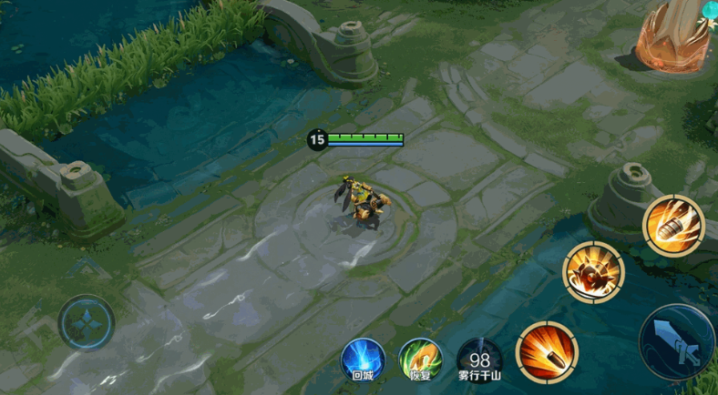

# 海外玩王者荣耀延迟高怎么办？看视频很顺，为什么国服还是卡？

## 摘要

视频流畅不代表游戏网络稳定，因为视频可缓冲而游戏需实时交互。海外玩家遇到王者荣耀国服延迟高，可检查本地网络并使用HiCN回国加速器优化跨境连接。

刚看完一段高清视频，切到《王者荣耀》国服，技能却迟迟没响应。海外玩家遇到这种情况，可以先关注游戏连接路径，用 HiCN 回国加速器一键加速；新用户可免费试用3天，连接后开一局，结合实际反馈判断。

“视频很顺”是有用的线索，但不足以证明游戏网络没有问题。视频和游戏对连接的要求、访问的目标，都可能不同。

## 视频能提前缓冲，操作却需要及时反馈

点播视频通常可以先缓存一部分内容，播放时消耗已经取得的数据。短暂的传输波动，未必立即表现成画面停顿。

游戏则需要持续交换操作和状态信息。移动、释放技能和队友配合，都涉及及时反馈，不能像点播视频一样提前准备好后续所有操作。

因此，同一个网络可以让视频持续播放，却在实时交互中暴露延迟或波动。也不能反过来认定视频顺畅时，所有问题必然来自跨境线路，还要看设备和本地连接。

## 两个应用，访问目标也不一样

视频应用连接的服务，与国服游戏连接的服务可能不同，中间经过的路径也可能变化。附近测速目标表现不错，并不直接代表海外到国服的整条路径同样顺畅。

宽带套餐上的速度，主要描述容量相关能力，不能单独概括游戏响应时间。只升级下载带宽，未必能改善绕行或跨境连接波动。

## 先看具体表现，再选处理方向

你遇到的情况

可以先关注什么

下一步怎么做

画面流畅，技能反馈迟缓

网络延迟与连接路径

检查本地网络，再考虑回国加速

人物突然停住后回拉

连接波动或服务异常

查看提示，保留发生时间

镜头不连贯、特效多时掉帧

手机负载、温度和画质

调整画质与后台负载，注意散热

视频与网页也频繁失败

基础网络异常

先恢复正常上网

荣耀官方游戏卡顿帮助也指出，弱信号或较低网络速度可能带来操作延迟，同时设备设置和负载也需要结合情况调整。[荣耀官方游戏帮助](https://www.honor.com/cn/support/content/zh-cn00406924/)

## 用HiCN优化国服连接这一环

HiCN 回国加速器面向海外华人的国服游戏、国内音乐和影视等场景，提供一键加速、智能选路与智能分流，帮助应用匹配适合的回国线路。

手机端打开HiCN，一键加速，再进入《王者荣耀》国服。日常使用可以保持简单，不必为了开黑先安排复杂网络设置。

针对忽快忽慢的操作反馈，HiCN 回国加速器支持极速双路并发，同时利用两条独立网络通道传输数据，用于降低网络抖动、改善实时场景稳定性。实际表现仍受所在地、运营商和游戏服务状态影响，不能保证与国内玩家达到相同延迟。

HiCN 回国加速器支持 Windows、iOS、安卓（Android）和路由器。手机用户可在应用商店搜索“HiCN”，或访问[HiCN官网](https://www.hicn01.com)查看下载入口。路由器的适用型号与配置方式按官方指引确认。

新用户可免费试用3天，遇到连接问题还有7×24小时人工技术支持。先用平时的手机和网络正常开局，持续异常时提供地区、运营商、设备系统及提示，方便客服协助。

现在下载对应客户端，一键加速后进入国服，从移动和技能反馈感受连接，不必一直盯着某个数字。

## 从刷视频切到开黑，做几件小准备

1.  暂停不必要的传输任务。 留意视频下载、云盘上传及应用更新，减少共享网络争用。

2.  确认手机状态。 明显发热或画面掉帧时，先处理负载与散热。

3.  选好本地网络。 尽量在开局前确定无线网络或移动数据。

4.  打开HiCN 回国加速器，一键加速。 连接后再进入目标游戏，正常体验一局。

对局中频繁改变网络可能影响当前会话。需要调整时，尽量放在下一局前；如果出现维护、排队或账号提示，按游戏官方指引处理。

截至2026年11月11日，[HiCN官方帮助页](https://www.51hicn.com/help/133)提供《王者荣耀》海外开黑相关建议，具体客户端操作以当前版本为准。

## 套餐先按需求选

HiCN 回国加速器VIP会员与独享专线的游戏延迟表现相同。独享专线更多涉及带宽、设备数量及其他使用需求，不必仅因视频流畅、游戏卡顿就直接升级。

先确认是设备、本地连接还是跨境路径的问题，再看当前套餐权益。价格与具体规则以客户端展示为准。

## 常见问题

### 视频不卡，说明本地网络一定稳定吗？

不能完全这样判断。缓冲可能掩盖短暂波动，游戏还需要及时交互，应结合信号、网络占用和具体提示判断。

### 换成更高宽带套餐，延迟就会下降吗？

不一定。带宽与时延不同，跨境路径、设备和无线环境都可能影响体验。

### 关掉视频应用，就一定不卡了吗？

不能保证。暂停后台传输可能减少网络占用，但跨境连接或其他问题仍可能存在。

### HiCN能改善手机掉帧吗？

HiCN 回国加速器优化网络连接，不直接提升硬件性能。画面问题需要单独处理。

### 新用户3天免费试用要怎样开始？

按当前客户端方式开启，打开HiCN一键加速后，在常用网络下正常开局即可，不需要专门安排长时间检查。

### 换设备能重新领取试用吗？

更换设备不会自动重新获得新用户资格，具体领取规则以当前客户端为准。

现在搜索“HiCN”下载客户端，新用户开启3天免费试用，一键加速后进入《王者荣耀》国服。 把视频体验与游戏响应分开判断，再按实际问题处理，让下一次开黑准备得更清楚。

## HiCN回国加速器专属会员兑换码：1124
