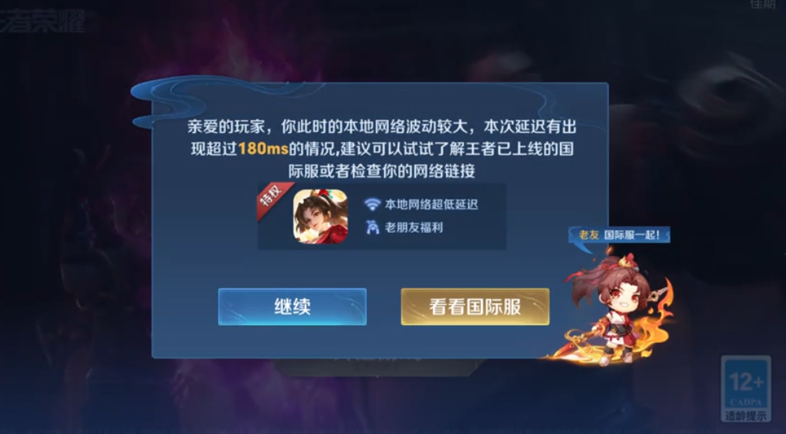

# 好不容易凑齐时差开黑，却被460按在地上摩擦？海外党降延迟的实在办法

在国外想跟国内朋友打两把王者荣耀，其实挺不容易的。光是对齐时差就得费点劲，好不容易赶上周末或者课间空档，两边都腾出时间组上车队，结果一进加载界面，心就凉了半截。

开局不到三分钟，右上角的延迟数字就开始蹦迪。明明按了二技能想位移躲控制，英雄愣是原地发呆一秒，等技能放出来，对面五个人早把你围成圈了。最气人的是团战打到一半直接弹个红字“460”，画面定格成PPT，耳麦里全是队友焦急的呼喊，自己却只能干瞪眼。

说实话，刚开始我也折腾过不少土办法。一会儿把游戏画质调到最低，一会儿关掉Wi-Fi切手机流量，甚至怀疑是手机内存满了，专门清了一堆照片。折腾完一测，延迟该飙红还是飙红。

后来才彻底死心——这真不是手机或家里宽带的锅。物理距离摆在那儿，海外直连国内游戏服务器，数据得跨越大半个地球绕远路，赶上晚高峰国际线路一拥堵，丢包、跳Ping根本躲不掉。想痛痛快快上分，最省事的路子还是配一个专门做**延迟优化**的**回国加速器**。

这几年在外面，大大小小的加速软件前前后后也换过几款。有的平时看着还行，一到国内晚上开黑高峰期照样掉链子；有的连上去延迟降得不明显。现在一直留在主力设备里没卸的，是 **HiCN回国加速器**。

打王者的人其实都明白，隔着大洋不可能真变成国内那种十几毫秒，最核心的诉求其实是“稳”。连上HiCN的**游戏加速**专线后，最直观的感觉就是丢包率压下来了，延迟稳稳待在流畅区间不乱跳。放技能跟手、走位不飘，开麦跟国内朋友报点也同步得很，终于能把注意力放在操作和意识上，而不是天天盯着右上角的网速图标发愁。

而且咱们海外华人和留学生，平时也不可能光靠打排位过日子。打完几局想换换脑子，切出去刷两集国内热播剧、看个下饭综艺，或者赶论文时戴上耳机听听国内音乐软件里的收藏歌单，HiCN的**网络优化**同样能稳稳托住。一个软件把打游戏、听歌、追剧全包圆了，手机桌面也清爽不少。

它还有个特别戳中日常刚需的点，就是设备支持够全。平时随身开黑的 **iOS和安卓手机**、办公学习的 **Windows电脑** 都能直接装。如果你是跟室友合租，或者习惯窝在客厅沙发上拿平板打游戏、用智能电视大屏追剧，它甚至直接支持**路由器**配置——往路由器里一配，家里连着Wi-Fi的设备全都能直接走低延迟通道，不用每次挨个开软件，用着确实省心。

不过话说回来，海外每个国家、不同宽带运营商的网络底子千差万别，听别人夸得再好，也不如自己进训练营拉两把来得实在。HiCN对新用户挺大方，直接给 **3天免费试用**。建议大家先下下来，挑自己平时最常开黑的晚高峰时段跑几局匹配，亲眼看看延迟稳不稳、掉不掉包再决定要不要长期留着，完全没啥试错成本。

顺嘴提个小习惯：每次准备上号前，记得先打开HiCN连上王者荣耀的专属线路，再启动游戏客户端，这样走的网络路径最干净。

一个人在异国他乡读书打拼，能随时和国内老友顺顺当当开黑上分、闲下来听听歌追追剧，真的是特别解压的日常。对了，下载好HiCN后别忘了使用口令1124免费领取会员加速时长，赶紧去试试吧。
