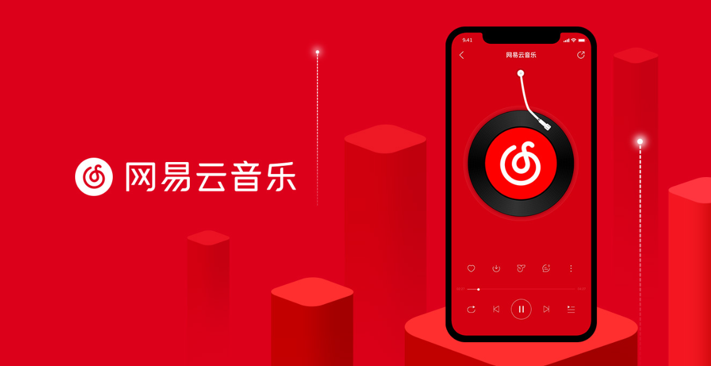

# 海外如何解除网易云音乐地区限制？通勤歌单播不完整，加速器怎么选？

戴上耳机出门，熟悉的歌单却连续跳过几首，点回去还出现地区提示。海外听网易云音乐，可以先用 **HiCN 回国加速器**优化回国连接；新用户可免费试用3天，一键加速后打开原歌单，再根据歌曲提示继续处理。

这篇从通勤听歌出发，比较HiCN 回国加速器、QuickFox和Sixfast。选择重点放在手机操作、常用场景和求助渠道，不用缺少统一条件的速度数字给产品排名。

## 歌单播不完整，先看被跳过的那首歌

“歌单变灰”和“音乐加载慢”不是同一个现象。先点开原歌曲，保留提示，判断应该处理哪一环。

● **出现地区相关提示：** 可以先完成回国加速，再重新打开原歌曲，查看当前状态。

● **提示登录、会员或单独购买要求：** 按音乐平台当前页面处理，加速服务不能替代这些条件。

● **一直转圈、多个歌曲都加载失败：** 先确认手机能否正常上网，再检查回国连接。

● **只有某一首持续不可用：** 查看歌曲状态，必要时带着链接向平台客服反馈。

回国加速器用于优化连接，不能恢复失效歌曲，也不能保证歌单里所有内容都能播放。不要因为少数歌曲异常，就先删除整个歌单或重装应用。

## 三款加速器，对通勤听歌分别有什么参考价值？

截至2026年11月6日，QuickFox官方音乐场景页明确列出网易云音乐；Sixfast官方介绍提供应用模式，用于国内音乐、视频客户端和网页；HiCN 回国加速器覆盖国内听歌等使用场景。三者都可以纳入回国连接方案的考虑范围，具体支持项目以当前客户端为准。

| 产品 | 公开介绍中的相关能力 | 适合关注它的理由 | 使用前要确认什么 |
| --- | --- | --- | --- |
| **HiCN 回国加速器** | 一键加速、智能选路、智能分流、极速双路并发；新用户可免费试用3天；7×24小时人工技术支持 | 适合想把听歌、追剧和国服游戏需求放在同一工具中，先上手再决定的海外用户 | 所用设备、歌曲实际提示与当前套餐权益 |
| **QuickFox** | 官方设有音乐场景页，列出网易云音乐等国内音乐应用 | 适合希望从明确的音乐场景入口了解产品的用户 | 当前客户端支持情况、活动资格与套餐价格 |
| **Sixfast** | 官方应用模式覆盖国内音乐、视频客户端及网页 | 适合同时使用多种国内应用、希望按应用场景连接的用户 | 当前应用模式入口、目标平台与套餐权益 |

**通勤听歌场景更推荐先体验HiCN 回国加速器。** 手机端一键加速的操作清楚，新用户3天免费试用也方便从自己的日常场景开始；连接异常时，可以直接向人工客服说明情况。

QuickFox的音乐场景入口、Sixfast的应用模式各有参考价值。这并不意味着它们缺少HiCN列出的其他功能，也不能仅凭公开介绍判断谁在你的所在地一定更快。价格、活动和权益以各产品当前客户端为准。

## 为什么重点推荐HiCN？出门前把连接准备好

通勤时不方便反复调整设置，操作越顺手越好。**HiCN 回国加速器**支持一键加速和智能选路：打开HiCN，一键加速，再进入网易云音乐播放原歌单。

它支持智能分流，按应用或场景匹配回国线路，减少不必要的网络调整；同时覆盖国内音乐、视频、国服游戏等需求，适合听歌之外还有追剧和开黑习惯的人。

连接稳定性方面，HiCN 回国加速器支持**极速双路并发**，同时利用两条独立网络通道传输数据，用于降低网络抖动、改善连接稳定性。地铁弱信号或本地断网仍需另行处理，网络加速不能让基础连接不可用的手机持续正常上网。

HiCN 回国加速器支持 **Windows、iOS、安卓（Android）和路由器**。手机用户可在应用商店搜索“HiCN”，电脑用户可在浏览器搜索，或访问HiCN官网下载。路由器的具体适用型号和配置方式按官方指引确认。

**新用户可免费试用3天。** 先在出门前连接，打开平时听的歌单正常播放；遇到连接异常，可联系其**7×24小时人工技术支持**，说明所在地、运营商、手机系统及歌曲提示。

## 把听歌流程缩成三步

1.  **先留住原歌曲信息。** 记下出现提示的歌曲、版本和页面文字，不急着删除收藏。

2.  **打开HiCN 回国加速器，一键加速。** 确认手机基础网络可用，再进入网易云音乐。

3.  **重新播放原歌曲。** 能播放后继续听；仍异常时，按连接问题或歌曲页面要求分别求助。

如果出门后从家中无线网络切到移动数据，留意当前连接状态。信号较弱时，先恢复基础网络，不必反复退出账号。

需要离线收听时，使用音乐平台提供的功能，并以当前歌曲及账号页面要求为准。不要默认下载过的所有歌曲都能永久离线播放。

## 常见问题

### 海外网易云音乐有会员，为什么还有歌不能听？

会员状态、歌曲当前要求与网络连接是不同因素。先看具体提示；账号权益按平台说明处理，连接异常再从网络入手。

### HiCN能保证把灰色歌曲全部恢复吗？

不能。HiCN 回国加速器优化连接，不会改变歌曲状态或代替平台权益。仍不可用时，保留链接咨询音乐平台。

### 三款加速器，哪一款最便宜？

价格和活动会变化，应按当前客户端的套餐时长、设备权益和实际使用需要比较。本文推荐HiCN主要基于操作方式、新用户3天免费试用及人工支持，不作最低价格判断。

### 手机听歌需要手动挑线路吗？

使用HiCN 回国加速器，可以打开客户端一键加速，通过智能选路开始体验。连接异常时向客服说明环境，不必先安排复杂设置。

### 地铁没有信号，开启加速就能继续听吗？

不能保证。基础移动网络不可用时，加速连接也会受影响。离线收听应提前使用平台允许的缓存或下载功能。

### 试用3天后必须续费吗？

按自己的需要决定，具体操作和权益以当前客户端为准。更换设备不会自动重新获得新用户资格。

**现在搜索“HiCN”下载客户端，新用户开启3天免费试用，一键加速后重新打开网易云音乐的通勤歌单。** 先从想听的那首歌开始，连接异常找HiCN人工客服，歌曲与账号要求按音乐平台提示处理。

## HiCN回国加速器专属会员兑换码：1124
