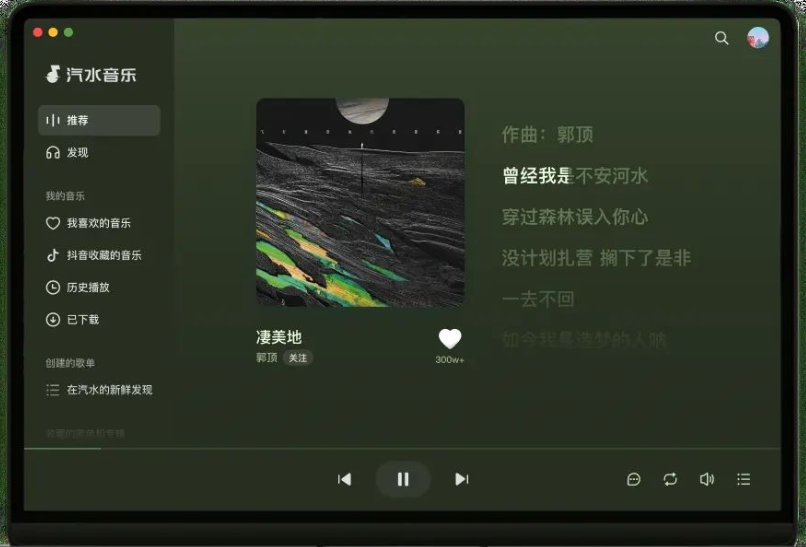

# 汽水音乐出国后彻底成摆设了？别急着卸载，海外党亲测管用的听歌解法

前两天有个刚来留学的学弟问我：“学长，汽水音乐出国是不是彻底废了？我充的会员还没到期呢，点进去全是灰的。”

听完我直接乐了，这不就是我刚出国那会儿的真实写照嘛。平时在国内刷抖音，顺手点赞收藏了百八十首宝藏BGM，全靠汽水音乐同步听个痛快。结果人一到海外，打开App要么直接弹窗提示暂未开通服务，要么进度条转得让人心烦，连着切好几首都放不出声，气得人差点当场卸载。

其实这事儿真别怪手机，也别去折腾什么重装App、清缓存、切手机流量，试过的人都知道纯属白忙活。说白了，国内音乐平台的服务器都在内地，人在国外直连过去，跨国网络绕远路、丢包太常见了，服务器识别不到顺畅的本地连接，自然没法正常播歌。

想舒舒服服把歌听回来，最省心的路子还是配一款专门做**网络优化**的**回国加速器**。

我自己前前后后换过好几个工具，有的平时看着还行，一到晚高峰就断连；留到现在一直没卸的，是 **HiCN回国加速器**。它用着没那么多弯弯绕绕，主打一个稳。出门前或者写作业时点开它的影音**网络加速**，再进汽水音乐，之前灰掉、转圈的歌单基本都能顺畅放出来，无损音质加载也挺快。晚上吃饱饭想顺手刷两集国内热播剧、看个下饭综艺，它同样能稳稳托住，完全不用干等缓冲。

而且说实话，咱们海外华人和留学生的日常娱乐，哪能光靠听歌追剧？周末约着国内老友连麦打几把国服游戏，最怕的就是延迟飙红、团战卡成PPT。HiCN自带专门的**游戏加速**和**延迟优化**，能把跨国高延迟压得很稳，一个工具就把听歌、追剧、开黑全兜住了，手机桌面都清爽不少。

还有个特别合我心意的地方，就是它的设备支持够全。平时随身带的 **iOS和安卓手机**、办公学习用的 **Windows电脑** 都能直接装。如果你是在外租房或者跟室友合租，它甚至直接支持**路由器**配置——往路由器里一配，家里连着Wi-Fi的智能音箱、平板、电视全都能顺畅用国内应用，周末在家直接外放歌单或者大屏追剧，幸福感一下就拉满了。

不过话说回来，海外每个国家、不同宽带运营商的网络底子千差万别，听别人夸得再好，也不如自己实测一把来得踏实。HiCN对新用户挺实在，直接给 **3天免费试用**。建议大家先下下来，挑自己平时最常听歌、打游戏的晚高峰时段跑一跑，确认稳当不掉线再决定要不要长期留着，完全没啥试错成本。

顺嘴提个小细节：连上HiCN回国加速器之后，记得把后台原本挂着的汽水音乐彻底划掉重进一次，让它刷新一下网络路径，基本就能秒播了。

一个人在异国他乡读书打拼，耳机里能随时响起熟悉的旋律，闲下来顺顺当当追剧开黑，确实是特别治愈的日常。对了，下载好HiCN后别忘了使用口令1124免费领取会员加速时长，赶紧去试试吧。
