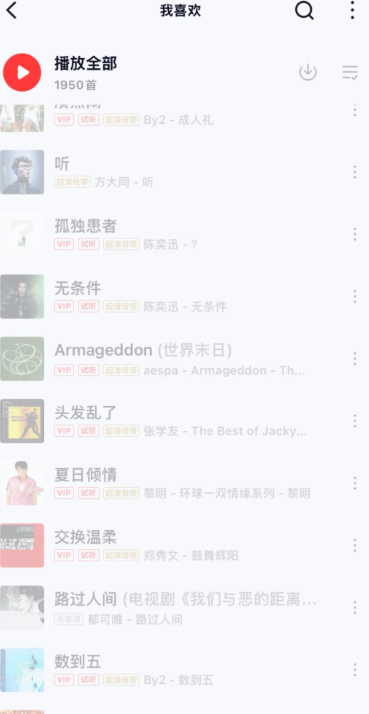

# 国外网易云歌单变灰，先续会员还是先处理连接？

## **国外网易云歌单变灰，先续会员还是先处理连接？**

歌单灰了不少，打开会员页面又犹豫：续费后就能听了吗？国外网易云歌单变灰，先读单曲提示、确认账号状态；加载不顺时，再用 HiCN 回国加速器优化回国连接。应用商店搜索 HiCN，新用户可免费试用3天，一键加速后回到原歌单体验。

## **先把“看到了续费入口”和“需要续费”分开**

看到会员入口，不等于这次播放失败一定与会员状态有关。先点开最想听的歌曲，读清具体说明，再去自己的账号页面确认当前服务状态。

如果页面明确要求某项服务，就了解对应规则；如果显示地区相关提示、加载失败或账号异常，则需要分别处理。不要把所有灰色条目都理解成同一种情况，也不要仅凭颜色就决定购买。

已经有服务的用户，还可以核对是否登录了自己的常用账号。手机和电脑使用不同登录方式时，先确认进入的是不是同一账号，再讨论当前状态。

## **从最想听的一首开始，决定下一步**

这张表不是让你检查整张歌单。选自己最想听的一首，找到明确提示，再看一首其他歌曲的表现，就能更清楚地向客服说明问题范围。

| **页面或播放表现** | **先确认什么** | **下一步更有针对性** |
| --- | --- | --- |
| 明确提示账号或服务状态 | 常用账号、当前状态与页面要求 | 按平台指引处理，仍不清楚时咨询客服 |
| 明确出现地区相关提示 | 单曲完整文字与当前版本 | 优化回国连接后查看结果，持续提示时联系平台 |
| 多首歌一直加载，搜索也慢 | 本地联网与网络占用 | 暂停大文件任务，处理回国连接 |
| 只有一首反复不能播 | 歌手、专辑、版本与单曲提示 | 围绕该曲当前状态确认 |
| 列表和收藏都不对 | 当前登录账号 | 先找回常用账号，再查看歌曲 |

遇到没有文字、只是转圈的情况，也别急着做购买决定。先确认手机能正常上网，避免把网络等待误当成需要开通服务。

## **用 HiCN 先把常用听歌场景跑通**

HiCN 回国加速器面向海外用户的国内音乐等回国访问需求，支持一键加速、智能选路与智能分流，可按应用或场景匹配回国线路。对搜索慢、切歌等待、播放连接不顺的情况，可以先从回国网络优化开始。

**HiCN 回国加速器支持 Windows、iOS、安卓（Android）和路由器，新用户可免费试用3天。**手机可以安装对应客户端，电脑端可使用 Windows 客户端；路由器具体型号和配置方式按官网或客服指引确认。

HiCN 回国加速器还支持极速双路并发，通过两条独立网络通道传输数据，降低网络抖动，改善持续播放所需的连接体验。它提供网络优化服务，网易云音乐的账号要求和歌曲当前状态仍需按平台说明处理。

### **手机听歌这样开始**

1. 应用商店搜索 HiCN，下载客户端，注册并登录。

2. 开启新用户3天免费试用，选择音乐场景，一键加速。

3. 打开网易云音乐，确认常用账号，回到想听的歌曲或歌单。

4. 查看实际播放结果；若仍有明确提示，保留单曲链接、完整文字和发生时间。

电脑用户可在浏览器搜索 HiCN，或访问HiCN 官网下载 Windows 客户端。一键加速后进入网易云音乐即可。

现在就用新用户3天免费试用体验常用听歌场景，再根据自己的日常需求选择后续方案。HiCN 回国加速器提供24/7人工技术支持，连接异常可说明所在地区、设备与网络类型，请客服协助。

## **确认需求以后，再安排长期听歌开支**

可以先问自己：每天都打开网易云音乐，还是偶尔听几首？除了听歌，是否还经常使用国内视频、直播或国服游戏？常用场景明确以后，选择服务会更有依据。

费用按网易云音乐和 HiCN 回国加速器各自当前页面确认，不把网上旧价格当作今天的购买依据。涉及长期方案，先看服务期限、适用范围和自己的实际需要，再决定。

如果某首歌依然无法播放，不要只为了这一个结果反复叠加购买。把完整提示交给对应客服确认，先知道下一步该处理什么。

## **加速后仍然灰，不必马上再换一套方案**

先重新进入目标歌曲页面，确认看到的仍是同一版本与同一提示。只有固定几首异常时，保留歌曲信息，查看平台说明；多首歌都加载失败时，则继续看网络与加速状态。

HiCN 回国加速器无法保证所有灰色歌曲恢复播放。持续出现的平台提示，应按官方说明或客服答复处理。把连接问题与歌曲状态分清楚，能减少没有方向的重复操作。

也不用急着清空收藏。原曲链接、歌手和专辑信息留着，之后仍方便查找、反馈或整理日常播放列表。

## **国外歌单变灰，关于会员与加速常见的几个问题**

### **续费网易云音乐会员，一定能解决歌单变灰吗？**

不能只凭变灰现象作判断。先看单曲提示和当前账号状态，再按平台要求决定。网络异常、账号问题和单曲当前状态需要分别处理。

### **已经有会员，还需要看登录账号吗？**

需要。先确认当前设备进入的是自己的常用账号，再查看对应状态；账号异常按平台页面指引处理。

### **HiCN 回国加速器能让所有灰色歌曲都播放吗？**

HiCN 回国加速器用于优化回国连接。可以一键加速后查看目标歌曲的实际结果，无法保证所有歌曲均可播放。

### **只是想偶尔听歌，可以先免费体验吗？**

HiCN 回国加速器新用户可免费试用3天。选自己真正会听歌的时间，一键加速后进入原歌单即可，后续方案以客户端当前展示为准。

### **不清楚提示是什么意思，该找谁？**

账号与单曲状态可通过网易云音乐官方渠道确认；HiCN 回国加速器连接异常则联系其人工技术支持。提供完整文字、设备、时间和歌曲链接，会更方便沟通。

别让一张灰色歌单变成连续购买的理由。**现在就在应用商店或浏览器搜索 HiCN，开启新用户3天免费试用，一键加速后回到网易云音乐；先把想听的那首打开，再按需求安排后续服务。**

## **HiCN回国加速器专属会员兑换码：1124**
