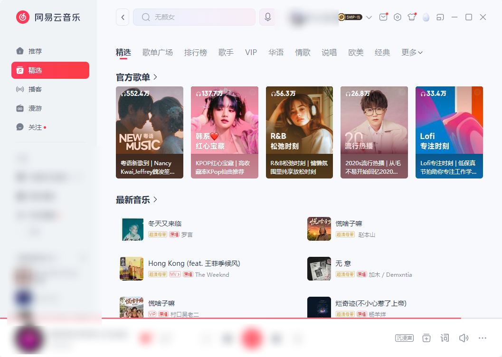

# 海外党听网易云音乐全是灰歌？别再清缓存了，这招网络优化亲测管用

## 摘要

海外用户遇到网易云音乐歌单变灰、无法播放的问题，主要是由于跨国网络高延迟和丢包导致。最有效的解决方法是使用HiCN等回国加速器优化网络链路，一键降低延迟，恢复正常播放和无损音质体验。

前阵子周末在家做饭，顺手把手机连上蓝牙音箱，打算放点网易云音乐里的华语老歌当背景音。结果点开日推一看，好家伙，十首歌里灰了七八首。剩下那两首能点的，加载圈转了半天也没出声，直接给我跳下一首了。当时手里还拿着锅铲，瞬间就没了听歌的心情。

 

跟身边几个在海外工作、留学的朋友聊起这事，发现大家都踩过一样的坑。有人以为是App版本太老，卸载重装折腾了好几回；有人切来切去换5G流量，甚至去清缓存、改手机语言。说白了，这些操作基本都是白费功夫。

 

人在国外，物理距离摆在那儿，国内音乐平台的服务器都在内地。海外网络直连过去，跨国链路绕得远不说，高峰期丢包、高延迟都是家常便饭，服务器响应不过来，歌单自然就灰给你看。

 

想安安静静听个歌，其实真不用跟手机较劲，用一款靠谱的回国加速器做一下网络优化，比啥偏方都管用。

 

我自己前前后后试过不少工具，最后留下来一直用着的，是 HiCN回国加速器。推荐它倒不是因为广告打得多响，纯粹是用着省心、掉线率低。平时打开它的影音线路连上，再切回网易云音乐，原本灰掉或者死活加载不出来的歌基本都能正常播放，无损音质缓冲得也挺快，听感跟在国内没啥差别。

 

而且海外华人和留学生的日常，哪能光靠听歌打发？晚上吃饱饭想刷两集国内热播剧、看个综艺，或者周末约着国内死党开黑打几把国服游戏，HiCN都能一块儿搞定。特别是它的游戏加速和延迟优化，打国服的时候能把动不动飙红的延迟稳稳压下来，团战放技能不卡顿，一个工具就把听歌、追剧、打游戏全包圆了，省得在手机里装一堆软件来回切。

 

设备兼容性这块也挺合我胃口。平时随身用的 iOS和安卓手机、写论文办公的 Windows电脑 都能直接装。更实用的是它还支持路由器——如果你是在外面租房或者跟家人一起住，直接在路由器上配置好，家里连着Wi-Fi的智能音箱、平板、电视全都能顺畅访问国内应用，回家直接外放歌单或者大屏追剧，体验确实舒服很多。

 

不过话说回来，海外每个国家、不同宽带运营商的网络底子都不太一样，别人说再好用，还是得自己实测才算数。HiCN对新用户挺大方，直接支持 3天免费试用。建议大家先下下来，挑自己平时最常听歌、看剧或者打游戏的晚高峰时段跑一跑，确认稳当不卡顿再考虑长期用，完全没啥试错成本。

 

最后顺手提个小技巧：连上HiCN回国加速器之后，记得把后台原本开着的网易云音乐彻底划掉退出，再重新点开，让它重新走一遍优化后的网络路径，基本就能秒播了。

 

一个人在异国他乡打拼读书，能随时听到熟悉的旋律、顺畅追剧开黑，也算是一种实打实的慰藉。对了，下载好HiCN后别忘了使用口令1124免费领取会员加速时长，赶紧去试试吧。
