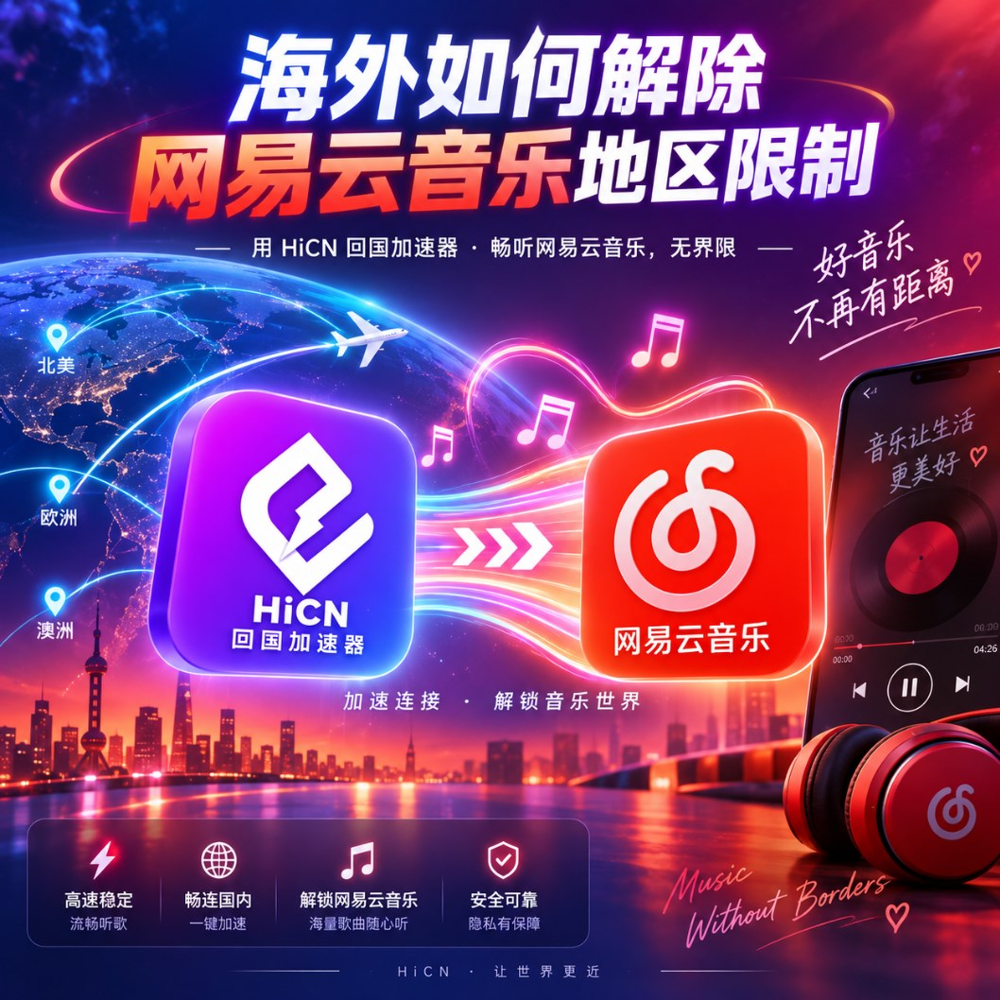

# 海外听网易云音乐加载慢怎么办？华人留学生回国网络优化实用指南

## 海外听网易云音乐，为什么有时候总觉得不够顺？

对于很多海外华人和留学生来说，网易云音乐几乎是日常使用频率很高的应用。

通勤时听歌、学习时放歌单、健身时听收藏曲目，或者晚上戴着耳机听播客，已经成了比较固定的习惯。

但人在海外以后，有些用户会发现使用体验和以前不太一样。

例如：

● 打开歌单需要多等一会

● 点击歌曲后不能立即播放

● 连续切歌时响应偏慢

● 高音质播放偶尔出现加载

● 每日推荐页面刷新速度不稳定

● 晚上使用时比白天更容易卡顿

● 手机网络和家里 Wi-Fi 表现差异明显

如果只是偶尔出现一次，可能只是本地网络短时间波动。

但如果这种情况经常出现，就可以进一步看看海外连接国内网络的线路是否稳定。

## 网速看起来很快，为什么听歌还是会加载？

很多人遇到网易云音乐加载慢时，会先去测试宽带速度。

测速结果可能很好，下载文件也很快，于是就会觉得网络应该没有问题。

实际上，本地测速和使用国内音乐应用并不是完全相同的网络场景。

本地测速更多反映设备连接附近网络节点时的速度。

而打开网易云音乐后，设备还需要和国内网络持续交换数据。

这段连接距离更长，中间经过的网络节点也更多。

如果某一段网络线路出现拥挤或者绕行，即使家里的宽带本身很快，也可能出现歌曲加载速度不稳定的情况。

所以海外听国内音乐时，不能只看“带宽有多大”，还要看连接国内网络时是否稳定。

## 听音乐虽然不像游戏，但同样需要稳定连接

音乐应用需要的数据量通常没有高清视频那么大，因此很多人会觉得听歌应该不会受到网络影响。

实际上，网络波动依然会影响使用体验。

尤其是在下面这些场景中会更加明显：

### 连续切换歌曲

如果经常跳过当前歌曲，短时间连续切换多首歌，网络需要快速响应新的播放请求。

线路状态不稳定时，等待感就会更加明显。

### 使用较高音质

音质越高，对持续数据传输的要求也会相应增加。

如果网络状态波动较大，可能出现缓冲时间变长。

### 打开大型歌单

收藏歌曲数量较多时，加载封面、歌曲信息以及相关推荐都需要持续传输数据。

### 长时间播放

学习、工作或者开车时可能连续听几个小时。

这种情况下，网络能否长期保持稳定，比某一次加载速度快更重要。

## 海外听网易云音乐，可以考虑HiCN回国加速器

如果日常使用国内音乐、视频以及国服游戏的频率比较高，可以使用 HiCN 回国加速器 对国内网络连接进行优化。

HiCN 支持：

● Windows

● iOS

● Android

● 路由器

因此，无论习惯在电脑上听歌，还是主要使用手机，都可以根据设备选择对应的使用方式。

例如：

平时使用 Windows 电脑办公、学习时，可以在电脑端进行网络优化；

iPhone 用户可以使用 iOS 版本；

Android 手机用户可以选择 Android 版本；

如果家里多台设备都有国内网络需求，也可以根据实际环境考虑路由器方案。

新人支持 3-7 天免费试用，可以先用自己的常用网络和设备测试实际效果。

## HiCN对音乐场景主要有什么帮助？

回国加速器并不是单纯提高宽带套餐速度。

它更重要的作用，是针对海外连接国内网络时的数据线路进行优化。

对于网易云音乐这样的日常使用场景，主要体现在几个方面。

### 改善歌曲加载速度

点击歌曲后，需要设备与网络快速建立数据传输。

如果线路更加稳定，播放响应通常也会更加顺畅。

### 减少连续播放中的等待

长时间听歌时，软件会不断请求新的歌曲数据。

稳定线路可以减少中途出现明显加载的情况。

### 提高晚高峰使用稳定性

很多留学生和海外上班族真正有时间听歌、追剧，往往都是晚上。

如果默认线路在高峰时间波动较大，使用体验就可能发生变化。

通过回国网络优化，可以重点改善这类使用环境。

## 使用时可以从自己的真实习惯开始测试

判断一款回国加速器是否适合音乐场景，不需要做特别复杂的测试。

直接按照日常习惯使用即可。

### 测试常听歌单

连接 HiCN 后，打开自己平时收藏较多的歌单，看看列表和歌曲加载是否更加顺畅。

### 连续切换几首歌

快速切换不同歌曲，可以比较播放响应速度有没有变化。

### 连续听一段时间

不要只听一首歌。

连续使用半小时或者更长时间，更容易判断线路稳定性。

### 晚上再测试一次

如果平时主要晚上使用网易云音乐，就应该在真正的常用时间进行体验。

这样得到的结果比白天随便测试一次更有参考价值。

## 如果播放还是不稳定，也要检查本地Wi-Fi

海外到国内的网络连接只是一部分，本地网络环境同样不能忽略。

如果已经进行网络优化，但偶尔还会出现加载，可以看看下面几个因素。

### 手机离路由器是不是太远

人在卧室、阳台或者其他房间使用手机时，如果和路由器之间隔了多面墙，Wi-Fi 信号可能已经明显减弱。

### 家里是否有大型下载

电脑更新游戏、同步云盘文件或者电视播放高码率视频，都可能占用网络资源。

### 可以换一个Wi-Fi频段测试

如果路由器支持多个无线频段，可以根据设备距离和家庭环境进行对比，选择实际表现更稳定的网络。

### 尝试重新连接网络

路由器长时间运行后偶尔也会出现短时间状态不佳，重新连接后再测试，可以排除一些本地因素。

## 海外听歌用户，通常也有追剧需求

很多人在海外使用国内网络，并不是只为了音乐。

实际日常可能是这样的：

早上打开网易云音乐听歌；

中午休息时刷国内视频；

晚上追剧或者看直播；

周末再和国内朋友玩几局国服游戏。

这些场景看起来不一样，但共同点都是需要海外设备稳定连接国内网络。

影音内容更重视加载和连续播放；

音乐应用更关注播放响应；

国服游戏则更加在意 Ping 值和延迟波动。

对于同时有多种需求的人来说，使用一个覆盖范围比较完整的回国加速方案会更加方便。

## HiCN也可以用于追剧和国服游戏

HiCN 不仅可以用于国内音乐网络优化，也能够覆盖影音和游戏场景。

比如平时看国内视频或者直播时，如果出现加载慢和播放不稳定，可以使用影音网络优化。

玩国服游戏时，则可以通过游戏加速改善连接国内游戏服务器的线路。

对于《王者荣耀》《英雄联盟》《原神》《三角洲行动》等国服游戏玩家来说，海外连接国内服务器时经常会更加关注：

● Ping 值是否偏高

● 延迟是否频繁变化

● 团战是否出现卡顿

● 操作反馈是否及时

● 晚高峰线路是否稳定

因此，一个同时支持音乐、影音和游戏场景的回国加速器，会更适合日常需求比较多的海外用户。

## 选择回国加速器，不用只看别人给出的数据

海外用户之间的网络差异非常大。

不同国家、不同城市、不同运营商甚至不同路由器，实际连接表现都可能不一样。

所以判断 HiCN 是否适合自己，更推荐直接用常用设备测试。

例如连续听一段网易云音乐、切换几次歌单，再播放一会国内视频，最后进入自己常玩的国服游戏看看网络表现。

如果听歌加载更加顺畅，视频播放更加稳定，同时游戏延迟表现也有所改善，那么这个网络加速方案才更符合自己的实际需求。

对于经常听中文音乐、追国内视频和玩国服游戏的海外华人及留学生来说，HiCN 回国加速器支持 Windows、iOS、Android 以及路由器，新人支持 3-7 天免费试用，可以先根据自己的设备和网络环境体验。

口令 1124 可免费领取会员加速时长。

