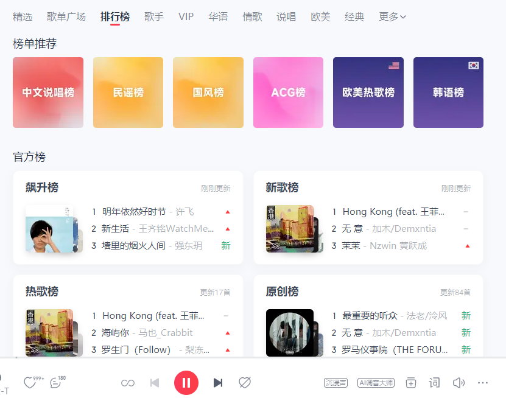

# 海外如何解除网易云音乐地区限制？日推能刷，推荐歌曲却听不了怎么办

## 海外如何解除网易云音乐地区限制？今天的日推，为什么看得到却听不了

每日推荐里出现一首感兴趣的歌，点开却只剩加载，接着又跳出地区提示。海外听网易云音乐，先看单曲说明，再准备播放连接。推荐使用 HiCN 回国加速器，应用商店搜索下载，新用户可免费试用3天，选择音乐场景一键加速后，回到那首新歌体验。

## 推荐列表出现了，不代表播放已经准备好

日推页面展示封面、歌名与歌手，歌曲播放则是后续动作。页面正常不代表每首歌曲当前都能播放，也不能单独确认持续获取音乐数据的连接没有问题。

先点开目标歌曲，读清提示。需要登录就核对账号；明确出现地区相关文字就保留原文；没有提示、一直转圈时，再看网络与应用状态。

如果发现刚才感兴趣的歌曲，先记住歌名、歌手或保留链接，避免反复刷新后又要重新找。想听的是某个具体版本，也要核对专辑和演唱者。

## 先判断是“这首不行”，还是“今天整个App都慢”

| 你看到的情况 | 先确认什么 | 下一步 |
| --- | --- | --- |
| 推荐页和搜索都慢 | 设备是否正常联网 | 暂停不急的下载，准备回国连接 |
| 日推能看，多首歌都在等待 | 播放连接与应用状态 | 一键加速后重新进入 |
| 只有某一首无法播放 | 单曲完整提示与版本 | 核对当前状态，必要时咨询平台 |
| 页面要求登录 | 自己的常用账号 | 按指引完成验证 |
| 明确出现地区相关提示 | 提示原文与歌曲链接 | 优化连接后查看结果，持续提示时联系平台 |

先围绕想听的那首处理，再看另一首歌曲的表现，了解异常范围即可。不必把整份推荐列表逐条检查，更不用为了一个提示重新注册账号。

## 用 HiCN 把连接放在发现新歌之前

HiCN 回国加速器面向海外用户的国内音乐等回国访问需求，支持一键加速、智能选路与智能分流，可按应用或场景匹配回国线路。习惯每天打开网易云音乐，可以先完成连接，再进入推荐页面听歌。

**极速双路并发通过两条独立网络通道传输数据，降低网络抖动，改善持续播放所需的连接体验。**对搜索、切歌和连续听歌等待的问题，可以先从回国网络优化开始。

HiCN 回国加速器支持 Windows、iOS、安卓（Android）和路由器，新用户可免费试用3天。手机与电脑可使用对应客户端，路由器具体型号及配置方式按官网或客服指引确认。

手机用户这样开始：

1. 在应用商店搜索 HiCN，下载客户端，注册并登录。
2. 开启新用户3天免费试用，选择音乐场景，一键加速。
3. 打开网易云音乐，确认常用账号，进入日推或目标歌曲页面。
4. 查看实际播放结果；仍有异常时，保存歌曲链接、完整提示和发生时间。

Windows用户可在浏览器搜索 HiCN，或访问[HiCN 官网](https://www.hicn01.com)下载客户端。一键加速后进入网易云音乐即可。

现在就用新用户3天免费试用，从今天最想听的新歌开始。HiCN 回国加速器提供24/7人工技术支持，连接问题可说明所在地区、设备、网络类型与异常表现，请客服协助。

HiCN 回国加速器用于网络优化，无法保证所有歌曲均可播放，也不能改变账号状态。持续出现的地区或其他平台提示，应按网易云音乐当前说明或客服答复处理。

## 别把播放失败，当成自己不喜欢这首歌

发现新歌时，先分清自己是在跳过不感兴趣的内容，还是因为无法播放而离开。对尚未听到的歌曲，可以留下标题或链接，等问题处理后再决定是否收藏。

若想找其他版本，核对歌手、专辑和现场标记。搜索到同名翻唱，不代表原来那一版恢复；页面提示也要按具体条目分别查看。

如果进度条正常走却没有声音，先看音量、耳机与输出设备。若App本身闪退或无响应，则按应用和设备官方指引处理，不要把所有异常都归为地区问题。

## 手机上发现，电脑上听，也要确认连接

换到电脑继续听时，先打开同一首歌、同一版本，并确认常用账号。手机已经加速，通常不代表电脑也完成了对应连接。

Windows电脑打开 HiCN 回国加速器，一键加速后进入网易云音乐即可。多设备同时使用的数量与并发规则，按当前套餐确认，不从设备支持清单推断无限同时使用。

反馈问题时，可以写清：“推荐页正常，目标歌曲出现【提示】，其他歌曲【正常／也等待】，发生于【时间】。”具体信息比一句“日推坏了”更方便客服了解情况。

## 海外听网易云日推，常见问题有哪些？

### 日推能刷新，为什么推荐歌曲还播不了？

推荐页面与歌曲播放是不同环节。需要结合单曲提示、账号状态和播放连接判断，不能只凭列表正常排除问题。

### 刷新推荐列表，可以解决地区提示吗？

刷新不能作为通用解决办法。先保留目标歌曲信息，再查看提示和当前平台说明。

### 开启HiCN后，所有新歌都能听吗？

无法保证。HiCN 回国加速器用于优化回国连接，持续的平台提示应按官方说明处理。

### 手机听歌需要手动挑线路吗？

打开 HiCN 回国加速器，选择音乐场景，一键加速后进入网易云音乐即可。连接异常可联系人工客服。

### 能先免费体验几天吗？

HiCN 回国加速器新用户可免费试用3天。在常用设备和听歌时段开始使用，后续方案以客户端当前展示为准。

别让今天的新歌只停在封面上。**现在就在应用商店或浏览器搜索 HiCN，开启新用户3天免费试用，一键加速后回到网易云音乐，从感兴趣的那首开始听。**

## HiCN回国加速器专属会员兑换码：1124
