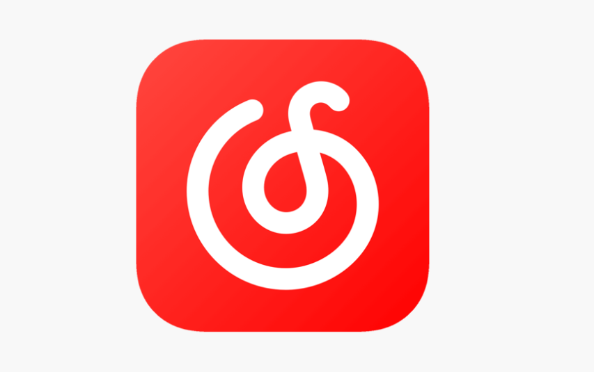

# 海外如何解除网易云音乐地区限制？买了会员仍听不了，加速器怎么选？

## 摘要

海外遇到网易云音乐地区限制，可使用HiCN回国加速器优化网络连接。新用户免费试用3天，一键加速后即可按提示解决播放问题，无需盲目重复购买会员。

## 正文

会员还没到期，歌单也完整，出国后却有几首歌始终播不了。海外遇到网易云音乐地区提示，可以先用 HiCN 回国加速器优化回国连接，新用户可免费试用3天；一键加速后重新打开原歌曲，再按页面提示处理账号要求。

音乐会员和网络加速解决的是不同问题。先弄清自己缺的是哪一环，才能避免反复续费、换工具，最后还是卡在同一个提示上。

## 已经有会员，为什么还要看歌曲提示？

账号里有会员，并不能单独说明所有歌曲当前都能播放。先确认登录的是购买会员的账号，再看歌曲页面是否存在其他要求或异常信息。

如果明确提示登录、会员或单独购买，按音乐平台当前说明处理；如果是地区相关提示，可以从回国连接入手；如果一直转圈，则还要检查本地网络和应用状态。

加速器不会增加音乐会员权益，也不能恢复已经失效的内容。反过来，重复购买音乐会员，也未必能改善海外到国内服务的连接。

## 三款回国加速器，应该比较哪些地方？

听歌工具不必只比较“最快”或“最便宜”。手机上是否方便操作、能否覆盖其他常用需求、遇到问题怎样求助，都会影响日常使用。

| 产品 | 与海外听歌相关的特点 | 可以考虑的使用需求 | 选择前要留意 |
| --- | --- | --- | --- |
| HiCN 回国加速器 | 一键加速、智能选路、智能分流、极速双路并发；新用户可免费试用3天；7×24小时人工技术支持 | 希望先把网易云音乐连接跑顺，同时兼顾追剧和国服游戏 | 歌曲自身提示、当前设备及套餐权益 |
| QuickFox | 官方设有音乐场景页，明确列出网易云音乐等平台；提供一键开启加速流程 | 希望从专门音乐介绍页了解操作与适用场景 | 当前活动资格、客户端支持项目和价格 |
| Sixfast | 官网介绍国内音乐与影音加载优化，并列出多平台下载入口 | 有手机、电脑等设备使用需求，希望兼顾其他国内应用 | 具体设备并发规则、应用支持与当前套餐 |

更推荐先体验HiCN 回国加速器。 理由是手机端上手直接，新用户有3天免费试用，遇到连接问题也有人工技术支持，适合先解决眼前的听歌需求，再决定长期使用。

这项推荐不意味着其他产品缺少未列出的功能，也不代表HiCN在所有地区都更快。实际连接受当地网络与平台服务状态影响，价格和活动以各产品当前客户端为准。

## HiCN的作用，是把回国连接接顺

HiCN 回国加速器面向海外华人的国内音乐、影视、游戏等场景，提供一键加速与智能选路。手机上打开HiCN，一键加速，再进入网易云音乐播放原歌曲即可，不必先安排复杂的网络设置。

它支持智能分流，按应用或场景匹配回国线路；对于持续播放中的连接波动，还提供极速双路并发，同时利用两条独立网络通道传输数据，用于降低网络抖动、改善稳定性。基础网络断开或信号不可用时，仍需先处理本地连接。

HiCN 回国加速器支持 Windows、iOS、安卓（Android）和路由器。手机用户可以在应用商店搜索“HiCN”，电脑用户可以在浏览器搜索，或访问HiCN官网下载客户端。路由器的适用型号和配置方式按官方指引确认。

新用户可免费试用3天。 先用常用设备打开原来无法播放的歌曲，再正常听歌。出现连接异常，可以联系其7×24小时人工技术支持，说明所在地、运营商、设备系统和提示文字。

## 不用重复买会员，先按这个顺序处理

1.  核对账号。 确认当前登录与购买会员时使用的是同一账号，查看权益状态。

2.  留住歌曲信息。 记下歌曲名称、版本和具体提示，不急着删除歌单。

3.  打开HiCN 回国加速器，一键加速。 连接后重新进入网易云音乐，播放同一首歌。

4.  按剩余提示处理。 连接异常找加速器客服，歌曲状态和账号权益问题找音乐平台。

如果其他歌曲能播放，只有某一首持续异常，就围绕该歌曲继续咨询。换一首能听，并不能说明原问题已经解决。

如果所有应用都加载慢，先检查无线信号、移动数据和后台占用。不要把基础断网也当成地区问题，更不必一开始就重装音乐应用。

## 长期听歌，套餐看实际需要

手机听歌、电脑听歌，以及多台设备同时使用，是不同需求。先确认常用设备和同时使用数量，再查看当前套餐权益。

HiCN 回国加速器VIP会员支持3设备在线，各平台1开同时加速；独享专线支持6设备在线，各平台2开同时加速。设备总数与同类平台并发都要看清楚，不能只看一个总数字。

独享专线还有更高带宽等使用特点，但不必仅因一首歌不能播放就升级。先把歌曲提示和连接情况理清楚，价格与权益以当前客户端为准。

## 常见问题

### 有网易云会员，再买加速器算重复购买吗？

两者作用不同。音乐会员对应平台权益，回国加速器优化网络连接。是否需要加速服务，要结合自己的实际问题决定。

### HiCN能保证所有灰色歌曲恢复吗？

不能。歌曲当前状态和平台要求仍然存在，加速器不能替代账号权益或恢复失效内容。

### QuickFox和Sixfast也能考虑吗？

可以。两者官方均介绍国内音乐相关使用场景。选择时结合设备、操作方式、当前权益与实际连接情况，不必只凭宣传中的速度表述判断。

### 为什么重点推荐先用HiCN？

一键加速方便手机上手，新用户3天免费试用适合从日常听歌开始，还有7×24小时人工技术支持。先体验再决定，选择更贴合自己的使用情况。

### 免费试用后一定要续费吗？

按需要决定，具体规则以当前客户端为准。更换设备不会自动重新获得新用户资格。

### 客服要账号密码才能处理吗？

不要提供账号密码或验证码。说明所在地区、运营商、设备、歌曲链接和错误提示即可帮助沟通。

现在搜索“HiCN”下载客户端，新用户开启3天免费试用，一键加速后重新播放网易云音乐里想听的那首歌。 先把连接问题与账号要求分清楚，再决定是否需要调整自己的长期方案。

## HiCN回国加速器专属会员兑换码：1124

 
