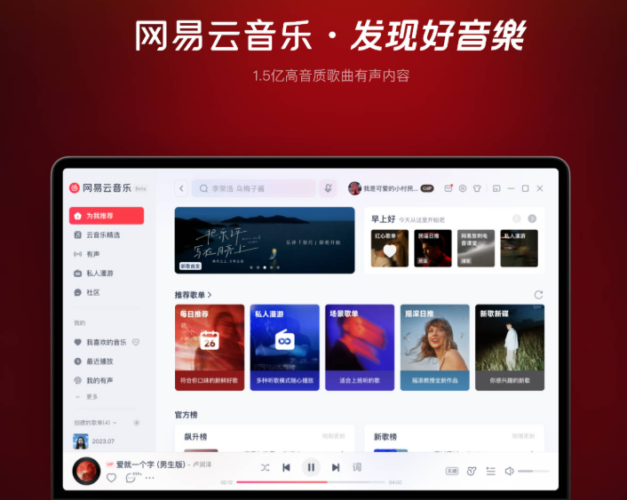

# 海外如何解除网易云音乐地区限制？手机听得好好的，电脑为什么不行

手机上刚听到一首好歌，换电脑接着放，却遇到地区提示或一直加载。海外用网易云音乐，先确认同一账号、同一版本，再处理电脑连接。推荐使用 HiCN 回国加速器，浏览器搜索下载 Windows 客户端，新用户可免费试用3天，一键加速后回到原曲体验。

## 先把“同一首歌”确认清楚

歌名相同，不一定是同一条内容。先从手机保留歌曲链接，再在电脑打开，核对歌手、专辑以及是否为现场或重新录制版本。

随后确认两端账号。手机已经登录，电脑浏览器或客户端可能尚未登录，也可能进入了另一个账号。收藏列表、昵称和常用登录方式可以帮助核对，账号提示按平台页面处理。

这些条件对齐后，手机与电脑的差异才更有参考价值，避免把不同版本或账号状态误认为网络问题。

## 两端差异，先看哪一项？

一端能听是一条线索，不是另一端必定能听的保证。不同设备、客户端和联网方式，都需要结合当前表现确认。

| 电脑上的表现 | 先关注哪里 | 下一步 |
| --- | --- | --- |
| 要求登录或出现账号提示 | 常用账号与登录状态 | 按平台指引处理 |
| 多首歌一直加载 | 电脑联网、后台任务与回国连接 | 暂停大文件任务，一键加速后重进 |
| 只有某首无法播放 | 单曲链接、版本与完整提示 | 确认当前状态，必要时咨询平台 |
| 进度正常前进却无声 | 应用音量与输出设备 | 查看耳机、扬声器及系统设置 |
| 明确地区相关提示 | 页面原文 | 优化连接后查看结果，持续提示时联系平台 |

## 手机有音乐，电脑没声音，先别急着改网络

如果播放进度正常前进，先查看应用有没有被单独静音、系统输出是否选对。电脑连接过显示器、音箱或蓝牙耳机后，声音可能仍然输出到另一台设备。

微软官方音频帮助提供了检查音量合成器与输出设备的方向。先恢复正确的声音输出，再继续处理播放连接，能减少无关调整。查看微软官方帮助。

如果进度一直不动，搜索和切歌也慢，则继续看电脑的联网与回国连接。

## 用 HiCN 准备实际听歌设备的连接

手机可能使用移动数据，电脑则连接住处Wi-Fi；手机也可能已经开启加速，电脑还没有。因此，不能只凭手机正常播放，就认定电脑的回国连接已经准备好。

HiCN 回国加速器面向海外用户的国内音乐等回国访问需求，支持一键加速、智能选路与智能分流，可按应用或场景匹配回国线路。

\*\*极速双路并发通过两条独立网络通道传输数据，降低网络抖动，改善持续播放所需的连接体验。\*\*平时在电脑上整理资料、听音乐，也可以先连接，再进入常用歌单。

HiCN 回国加速器支持 Windows、iOS、安卓（Android）和路由器，新用户可免费试用3天。路由器的具体型号、配置与覆盖范围按官网或客服指引确认。

Windows用户这样开始：

1. 在浏览器搜索 HiCN，或访问HiCN 官网，下载客户端并注册登录。

2. 开启新用户3天免费试用，一键加速。

3. 打开网易云音乐，确认常用账号，进入手机端对应的原曲页面。

4. 查看实际播放结果，仍有异常时保存链接、提示与发生时间。

手机端可在应用商店搜索 HiCN，选择音乐场景，一键加速后进入网易云音乐。通常需要在实际听歌设备上完成连接；多设备同时使用时，按当前套餐并发规则确认。

现在就用新用户3天免费试用，把常用电脑的听歌场景准备好。HiCN 回国加速器提供24/7人工技术支持，连接问题可说明所在地区、设备、网络类型和具体表现，请客服协助。

## 仍有地区提示，按单曲当前说明处理

重新进入原曲后，若持续出现地区相关提示，应按平台说明或客服答复确认。HiCN 回国加速器用于网络优化，无法保证所有歌曲均可播放，也不能改变账号状态。

若只有电脑客户端异常，也可以按官方指引查看软件版本与运行状态。清理数据或重新安装之前，先了解对本地下载、登录与设置的影响，不必一开始就大范围重置。

反馈时可以写：“同一账号、同一歌曲，手机使用【网络】正常，电脑使用【网络】出现【提示】，发生于【时间】。”这是沟通格式示例，不是实测案例。

## 海外跨设备听歌，常见问题有哪些？

### 手机开启HiCN，电脑也会自动加速吗？

通常需要在实际听歌设备上完成连接。Windows电脑可使用对应客户端，路由器方案则按具体配置确认覆盖范围。

### 同一个账号，为什么还要核对歌曲版本？

同名歌曲可能对应不同录制或演唱版本。通过原曲链接核对，才能更清楚地比较两端表现。

### 电脑没有声音，一定是地区限制吗？

不能这样判断。进度正常前进时，先查看音量、耳机与输出设备，再按具体提示继续处理。

### 用HiCN后，所有地区提示都会消失吗？

无法保证。HiCN 回国加速器用于优化回国连接，持续的平台提示应按官方说明处理。

### 可以先免费体验吗？

HiCN 回国加速器新用户可免费试用3天。换设备不等于重新获得新用户资格，已有用户按原账号状态使用。

把手机里的好歌，接到常用电脑上听。**现在就在浏览器搜索 HiCN，下载 Windows 客户端，开启新用户3天免费试用，一键加速后打开网易云音乐，从原曲继续。**

## HiCN回国加速器专属会员兑换码：1124
