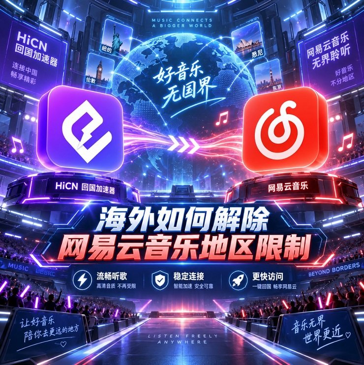

# 海外网易云音乐播放不顺畅？华人留学生国内音乐网络优化攻略

## 海外生活后，听歌这件小事也可能变得没那么顺

对很多留学生和海外华人来说，网易云音乐并不只是一个偶尔打开的应用。

通勤时听歌、写作业时放背景音乐、健身时循环歌单、晚上听播客，已经变成了日常习惯。

但人在海外之后，有时会发现一些细节和以前不一样：

歌曲点下去后要等一会；

连续切换几首歌时响应不够快；

歌单封面和内容刷新较慢；

高音质播放过程中偶尔出现加载；

晚上使用时，整体体验不如白天稳定。

这些问题看起来不严重，但如果每天都使用，还是很容易影响节奏。

## 问题不一定在“网速”，而可能在连接路径

很多用户会先看家里的宽带速度。

如果测速数字很高，就会自然认为网络没有问题。

但海外使用国内音乐应用时，本地测速只能说明家里的网络入口是否正常，并不能完全代表连接国内网络时的实际情况。

设备打开网易云音乐后，数据需要经过较长距离传输。

如果途中线路比较绕，或者某些时间段网络节点压力较大，就可能出现响应变慢。

所以，真正影响听歌体验的，不只是“带宽有多大”，还包括：

● 数据传输距离

● 网络节点数量

● 晚高峰线路状态

● 本地 Wi-Fi 稳定性

● 连续播放时的网络波动

这也是为什么有些用户明明宽带不慢，听国内音乐时依然会感觉不够顺畅。

## 音乐应用更看重“响应连续性”

和高清视频相比，音乐需要的数据量通常更小。

但它对使用节奏的影响却很明显。

例如平时听歌时，大家经常会连续进行这些操作：

搜索歌手、进入歌单、切歌、收藏、播放下一首、切换专辑。

如果每一步都多等几秒，整体体验就会变得很拖沓。

因此，音乐网络优化更值得关注的不是某一刻的峰值速度，而是：

每次操作都能不能快速响应，长时间播放时能不能保持稳定。

## 哪些使用习惯更容易感觉到网络差异？

### 经常切歌的人

有些人听推荐歌单时，遇到不喜欢的歌曲就会马上切换。

如果短时间连续切换多次，网络响应是否及时就很明显。

### 喜欢高音质播放的人

音质越高，持续传输的数据量也会相应增加。

如果网络线路本身不稳定，就可能更容易出现等待。

### 经常听长歌单的人

学习或者办公时，很多人会直接播放几个小时。

这类场景更考验线路的连续稳定性。

### 晚上使用频率高的人

留学生和海外上班族真正有空听歌、刷视频的时间，通常集中在晚上。

如果晚高峰线路状态变化较大，使用体验也会更明显。

## 海外经常使用国内应用，可以考虑HiCN回国加速器

如果日常使用国内网络的频率较高，可以考虑使用 HiCN 回国加速器 进行网络优化。

HiCN 支持：

● Windows

● iOS

● Android

● 路由器

对于不同使用习惯的人来说，覆盖范围比较完整。

例如在宿舍或者家里用 Windows 电脑学习时，可以同时听网易云音乐；

出门通勤主要使用手机，可以根据设备选择 iOS 或 Android；

如果家里多台设备都有国内影音和游戏需求，也可以根据网络环境考虑路由器方案。

新人支持 3-7 天免费试用，可以先用自己的实际网络进行体验，再判断是否适合日常长期使用。

## HiCN更适合解决哪类听歌问题？

回国加速器主要优化的是海外设备连接国内网络时的数据传输线路。

在音乐场景里，可以重点关注几个实际变化。

### 歌曲开始播放是否更快

点击歌曲后，如果等待时间缩短，说明当前连接状态更加顺畅。

### 连续切歌是否更自然

连续切换多首歌曲时，如果很少出现明显停顿，整体使用体验会更舒服。

### 长时间播放是否稳定

连续听几十分钟甚至几个小时，比单独播放一首歌更容易判断线路质量。

### 晚间体验有没有改善

如果平时主要晚上听歌，最好直接在晚间进行测试。

真实使用时段的表现，比白天随便测试一次更有参考意义。

## 不要把所有问题都归到加速器，本地网络也要检查

如果网络加速已经正常，但播放还是偶尔不稳定，可以先看看身边的网络环境。

例如：

手机离路由器太远；

隔墙比较多；

家里有人正在下载大型文件；

电脑正在更新游戏；

云端同步占用了较多网络；

Wi-Fi 信号虽然显示满格，但实际波动较大。

这些情况都会影响最终体验。

因此，判断网络优化效果时，最好保证本地 Wi-Fi 相对稳定。

## 多设备用户更适合统一网络环境

不少海外用户现在并不是只使用一台设备。

可能在电脑上学习时听网易云音乐，出门后换手机继续听，晚上回家又用平板看视频。

如果同时还玩国服游戏，设备之间切换会更加频繁。

HiCN 支持 Windows、iOS、Android 和路由器，因此可以根据使用环境灵活选择。

对于家庭或者合租环境来说，如果多台设备都经常连接国内网络，路由器方案也会更加方便。

## 听歌之外，追剧和国服游戏也可以一起优化

海外用户的国内网络需求通常是连在一起的。

听完歌以后，可能顺手打开国内视频平台追剧；

周末和朋友聊天时，又会进入国服游戏开黑。

不同场景对网络的要求不一样。

音乐更关注播放响应；

视频更看重连续加载和高清播放；

国服游戏则更加在意 Ping 值、延迟波动和操作反馈。

HiCN 回国加速器既可以用于国内影音和音乐网络优化，也可以用于国服游戏加速。

对于同时有听歌、追剧和游戏需求的海外华人和留学生来说，一个覆盖多种设备和场景的方案会更加省事。

## 怎么判断HiCN适不适合自己？

其实不用专门做很复杂的测速。

直接按照平时的使用习惯体验，往往更容易得出结论。

可以试着：

连续听一个常用歌单；

多切换几首歌曲；

打开几个不同页面；

晚上再重复测试一次；

然后再看看国内视频和国服游戏的网络表现。

如果歌曲响应更快、连续播放更加稳定，同时追剧和国服游戏的使用体验也有所改善，那么这类网络优化方案才真正符合自己的需求。

对于经常使用国内音乐、影音和国服游戏的海外用户来说，**HiCN 回国加速器支持 Windows、iOS、Android 以及路由器，新人支持 3-7 天免费试用**，可以先结合自己的设备和网络环境进行实际体验。

口令 **1124** 可免费领取会员加速时长。

