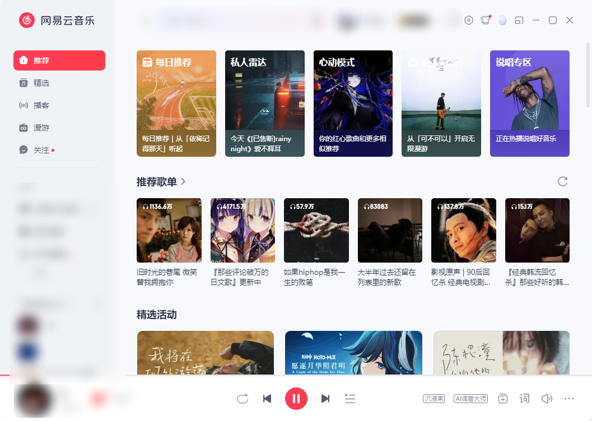

# 海外如何解除网易云音乐地区限制？学习时，别让背景音乐变成待办事项

资料刚打开，背景音乐却停在下一首，点回网易云音乐又看到地区提示。海外学习时想连续听歌，先看清提示，再把连接准备好。推荐在应用商店或浏览器搜索 HiCN 回国加速器，新用户可免费试用3天，一键加速后进入常听歌单，把注意力留给手头的事。

## 先听见音乐，再开始今天的任务

准备学习时，可以先选好歌单、确认能正常播放，再打开文档或课程资料。不要一边等歌曲加载，一边来回切换十几个窗口，最后连自己原本要做什么都忘了。

背景音乐适不适合学习，由个人习惯决定。这里要解决的是：既然打算听，就把账号、设备声音和连接提前理顺，减少中途处理小问题的次数。

例如，你计划用45分钟整理资料，就在开始前完成一次播放准备。这个时长只是安排示例，不是学习效果或连续播放的保证。

## 歌曲停住和耳机没声音，处理方法不同

如果进度条正常前进，先别把问题都算到网络上。尤其是电脑接过显示器、音箱或蓝牙耳机之后，声音可能去了另一个输出设备。

当前表现

先看哪里

可以先做什么

进度条不动，播放器一直等待

网络与歌曲提示

确认联网，准备回国连接

进度条继续走，但没有声音

音量和输出设备

查看App音量、系统音量与耳机连接

只有一首反复无法播放

单曲页面与版本

阅读完整提示，核对歌曲当前状态

多首歌加载慢，搜索也慢

本地网络和回国线路

暂停大文件任务，开启音乐加速

出现登录或地区相关提示

当前页面说明

按提示分别处理账号或播放问题

微软官方音频帮助建议检查音量与所选输出设备。Windows电脑可从系统声音设置查看当前播放设备，确认声音输出到自己正在使用的耳机或扬声器。查看微软官方音频帮助。

## 用 HiCN 准备回国连接，听歌前一键开始

HiCN 回国加速器面向海外用户的国内音乐等回国访问需求，支持一键加速、智能选路和智能分流，可按应用或场景匹配回国线路。对经常边整理资料边听网易云音乐的人，可以把开启加速变成播放前的固定动作。

**HiCN 回国加速器支持 Windows、iOS、安卓（Android）和路由器，新用户可免费试用3天。**电脑上听音乐可使用 Windows 客户端，手机端则可在应用商店下载对应客户端；路由器具体型号和配置方式按官网或客服指引确认。

HiCN 回国加速器还支持极速双路并发，通过两条独立网络通道传输数据，降低网络抖动，改善持续播放所需的连接体验。它用于网络优化，歌曲当前状态、账号要求和声音输出问题仍需分别处理。

### Windows电脑这样开始

1.  在浏览器搜索 HiCN，或访问HiCN 官网，下载 Windows 客户端并注册登录。

2.  开启新用户3天免费试用，一键加速。

3.  打开网易云音乐，确认常用账号，进入歌单播放。

4.  音乐正常响起后，再开始今天的资料整理；若连接异常，记录提示和发生时间，联系人工客服。

手机用户可在应用商店搜索 HiCN，选择音乐场景，一键加速后进入网易云音乐听歌。新用户可免费试用3天，先从自己常用的背景音乐场景开始，无须先研究复杂设置。

HiCN 回国加速器提供24/7人工技术支持。反馈连接问题时，说明所在地区、设备、网络类型，以及是切歌等待、搜索加载慢还是连接中断，方便客服了解情况。

## 地区提示持续存在，就保留信息再处理

如果目标歌曲出现明确地区相关提示，可以在一键加速后重新进入该曲页面，查看实际播放结果。提示持续存在时，应按平台当前说明或客服答复处理，不能保证每首歌都会恢复播放。

也可以留意其他歌曲是否正常。如果整张歌单都在等待，继续看网络；如果只有固定一首异常，就记录歌名、歌手、专辑版本和完整提示，围绕单曲状态确认。

暂时无法播放的歌曲，不必马上从收藏里删掉。先保留喜欢的版本信息，选择当前可以正常收听的内容继续今天的安排，之后再处理具体问题。

## 背景音乐只留一个主要播放设备，更好找问题

手机和电脑都开着播放器时，先确认自己想听的是哪一台。让目标设备完成连接、播放与声音输出，其余设备按实际需要暂停，排查时就不容易混淆。

手机开启 HiCN 回国加速器，也不代表电脑会自动获得同样的连接效果。通常需要在实际听歌的设备上完成加速；涉及多设备同时使用时，按当前套餐的设备与并发规则确认。

准备完成后，把不急的大文件下载或同步挪到其他时间。出现异常时，先按表格找到对应方向，不必每次都重装App。

## 海外学习时听网易云音乐，常见问题有哪些？

### 歌曲没有声音，就是地区限制吗？

不能这样判断。进度条正常前进时，先查看音量、耳机和输出设备；进度条停住或有明确文字提示时，再继续查看歌曲状态与连接。

### 开启 HiCN 回国加速器，能保证所有歌曲都播放吗？

HiCN 回国加速器用于优化回国连接。可一键加速后进入目标歌曲查看结果，无法保证所有歌曲均可播放；持续出现的平台提示应按官方说明处理。

### 电脑听网易云音乐，需要自己选线路吗？

打开 HiCN 回国加速器，一键加速后进入网易云音乐即可。连接问题可向人工客服说明所在地区和设备情况。

### 手机开着加速，电脑还要单独连接吗？

通常需要在实际听歌的设备上完成连接。Windows电脑可使用对应客户端；采用路由器方案时，应确认具体配置和覆盖范围。

### 能先免费体验，再决定后续方案吗？

HiCN 回国加速器新用户可免费试用3天。选平时听背景音乐的时段开始体验，后续套餐以客户端当前展示为准。

别让背景音乐占用你原本留给学习的时间。现在就在应用商店或浏览器搜索 HiCN，开启新用户3天免费试用，一键加速后打开网易云音乐，让喜欢的歌单陪你完成今天的安排。

## HiCN回国加速器专属会员兑换码：1124

