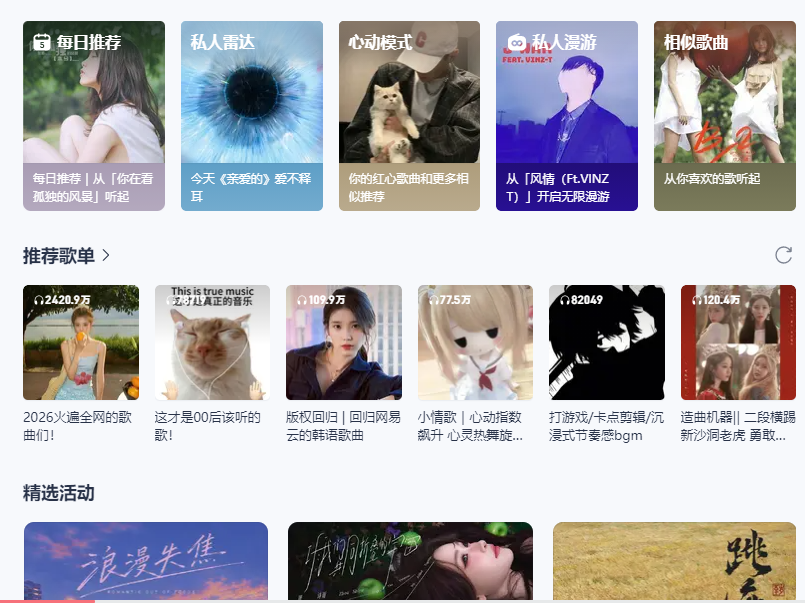

# 海外如何解除网易云音乐地区限制？旅行换住处后突然听不了怎么办

## 海外如何解除网易云音乐地区限制？换个住处，歌单怎么突然不响了

昨天在公寓还能听，今天住进酒店，网易云音乐却一直加载，点开某首歌又出现地区提示。海外旅行遇到这种情况，先确认新网络真正可用，再看单曲说明。回国连接不顺时，推荐使用 HiCN 回国加速器，新用户可免费试用3天，应用商店搜索下载后一键加速，回到原歌单体验。

## 先完成酒店联网，再讨论音乐播放

手机显示连上Wi-Fi，不一定代表已经可以访问互联网。酒店、机场和咖啡馆的网络可能需要先完成登录或认证，未完成时，音乐App也可能停在加载状态。

Google官方帮助介绍了需要登录的公共Wi-Fi网络。按住处提供的指引完成认证，再打开普通网页确认联网；登录页面异常时，可联系前台或网络服务人员。[查看Google官方说明](https://support.google.com/accounts/answer/9690282?hl=zh-Hans)。

基本网络未恢复之前，不必反复退出网易云音乐账号。先让设备正常上网，才能继续判断是哪一环节出了问题。

## 换住处后，按页面表现往下处理

| 当时遇到什么 | 先看哪里 | 下一步 |
| --- | --- | --- |
| 所有网页和App都无法加载 | 新网络认证与基础联网 | 按住处指引完成登录 |
| 网页正常，音乐搜索与切歌都慢 | 本地网络占用与回国连接 | 暂停大文件任务，准备音乐加速 |
| 只有固定一首不能播 | 单曲文字与歌曲版本 | 核对当前状态，必要时联系平台 |
| 要求重新登录 | 自己的常用账号 | 按页面要求完成验证 |
| 出现地区相关提示 | 完整提示和目标歌曲 | 优化连接后查看结果，持续提示时咨询平台 |

换网络与歌曲异常同时发生，是一条线索，不能据此确定全部原因。尤其是只有少数歌曲不能播放时，先读单曲提示，比不断切换酒店Wi-Fi更有方向。

## 用 HiCN 准备回国连接，听歌前一键开始

HiCN 回国加速器面向海外用户的国内音乐等回国访问需求，支持一键加速、智能选路与智能分流，可按应用或场景匹配回国线路。旅途中网络环境变化，可以先确认基本联网，再开启音乐场景加速。

**HiCN 回国加速器支持 Windows、iOS、安卓（Android）和路由器，新用户可免费试用3天。**手机听歌使用对应客户端，带电脑出行则可使用 Windows 客户端。路由器具体型号与配置方式，按官网或客服指引确认。

HiCN 回国加速器还支持极速双路并发，通过两条独立网络通道传输数据，降低网络抖动，改善连续播放所需的连接体验。它用于网络优化，不能代替酒店认证，也不能在没有可用网络时继续获取在线歌曲。

### 到新住处，按这个顺序开始

1. 完成Wi-Fi认证，确认设备可以正常上网。
2. 应用商店搜索 HiCN，下载客户端，注册并登录，开启新用户3天免费试用。
3. 选择音乐场景，一键加速，再打开网易云音乐。
4. 确认常用账号，进入原歌单，查看目标歌曲的实际播放结果。

Windows电脑用户可在浏览器搜索 HiCN，或访问[HiCN 官网](https://www.hicn01.com)下载客户端。一键加速后进入网易云音乐即可。

现在就用新用户3天免费试用准备旅行中的常用听歌场景。HiCN 回国加速器提供24/7人工技术支持，连接问题可说明所在地区、设备、网络类型与异常时间，请客服协助。

## 在房间能听，出了门又停住，就看当前联网方式

离开酒店Wi-Fi后，手机需要使用其他可用网络。先查看移动数据是否开启、应用能否联网，以及当前位置是否有信号覆盖。漫游或当地数据的费用，按自己的套餐确认。

恢复联网后，再查看 HiCN 回国加速器连接状态，回到音乐页面重试。无需因为换了城市，就直接更改一堆系统设置或重装App。

如果同时带着电脑，手机加速成功通常不代表电脑已经完成连接。实际听歌设备需要分别准备；涉及多设备同时使用时，按当前套餐规则确认。

## 还是同一首听不了，就留下单曲信息

核对歌名、歌手和专辑版本，再看完整提示。现场版和录音室版可能不是同一条内容，搜到同名结果不能直接当作原曲。

地区相关提示持续存在时，应按平台当前说明或客服答复处理，无法保证开启加速后每首歌曲都可播放。可以先保留收藏和链接，选择当前能正常收听的内容继续旅程。

反馈时写清“换到酒店网络后多首歌加载慢”，或“其他歌正常，只有某一首提示无法播放”。说明具体场景，会比一句“出国以后不能听”更方便沟通。

## 海外旅行听网易云音乐，常见问题有哪些？

### Wi-Fi满格，为什么音乐还是打不开？

先确认网络认证已完成。信号强度不能单独说明互联网访问正常，完成联网后再看音乐页面与连接。

### HiCN 回国加速器能代替酒店登录吗？

不能。需要先按酒店指引完成联网，再开启加速；认证或住处网络故障应联系对应服务人员。

### 换个城市，就需要重新注册账号吗？

不必仅因换城市重新注册。先确认自己的常用账号和当前提示，按实际要求处理即可。

### 开启HiCN后，地区提示一定会消失吗？

HiCN 回国加速器用于优化回国连接，无法保证所有歌曲均可播放。持续出现的平台提示应按官方说明处理。

### 可以只在旅行时先体验吗？

HiCN 回国加速器新用户可免费试用3天。更换住处或设备不等于重新获得新用户资格，已有用户按原账号与当前状态使用。

行程可以变化，听歌的准备简单一点。**现在就在应用商店或浏览器搜索 HiCN，开启新用户3天免费试用，完成联网后一键加速，让熟悉的网易云歌单继续陪你走下一程。**

## HiCN回国加速器专属会员兑换码：1124
