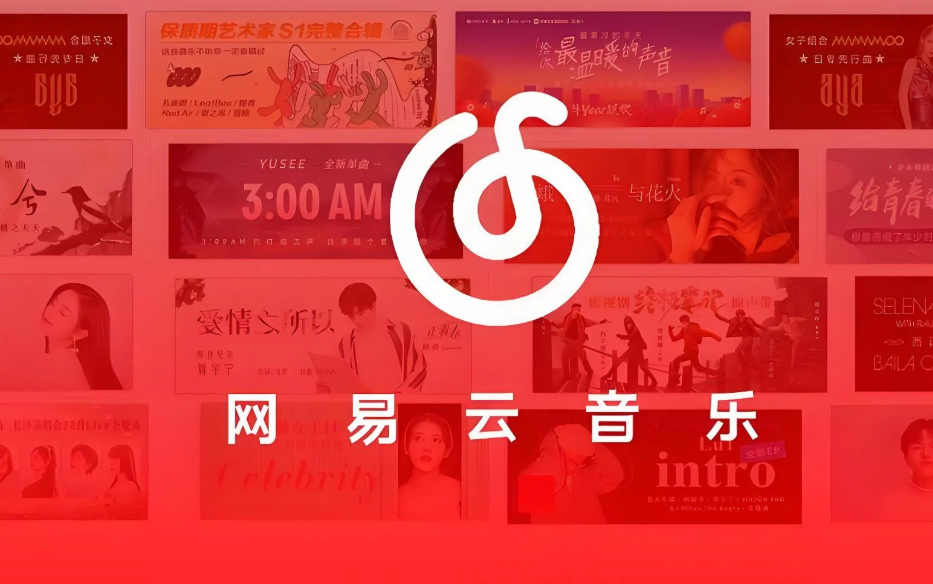

# 海外如何解除网易云音乐地区限制？更新后听不了，先别急着退回旧版本

更新完网易云音乐，常听歌单却开始转圈，点进歌曲还出现地区提示。海外遇到这种情况，先分清应用是否正常，再处理账号与连接。回国网络不顺时，推荐使用 HiCN 回国加速器；应用商店搜索下载，新用户可免费试用3天，一键加速后回到原歌单体验。

## 问题发生在更新之后，不等于一定由更新造成

更新是一个容易记住的时间点，但同一时间，账号登录状态、本地网络和歌曲页面状态也可能发生变化。先记录更新后出现了什么，再决定处理方向。

如果App本身打不开、反复退出或没有响应，先处理应用运行；如果界面正常，只有某首歌曲出现提示，就围绕那首歌确认。不要把两种情况都理解成“新版本不能在海外用”。

也不必立刻重新注册账号。先看收藏列表是否正确、当前登录的是不是常用账号，再打开目标歌曲。

## 按异常范围处理，比一次改很多设置更清楚

| 更新后的表现 | 先查看什么 | 下一步 |
| --- | --- | --- |
| App打不开或反复退出 | 应用与系统运行状态 | 按设备官方指引重启、检查更新 |
| 收藏列表与原来不一致 | 账号和登录方式 | 确认常用账号后再看播放 |
| 搜索、歌单和切歌都慢 | 基本联网与回国连接 | 暂停大文件任务，准备音乐加速 |
| 只有一首无法播放 | 单曲版本与完整提示 | 核对当前状态，必要时联系平台 |
| 明确出现地区相关提示 | 页面说明 | 优化连接后查看结果，持续提示时咨询平台 |

Apple官方针对App停止响应、意外关闭或无法打开的情况，提供关闭重开、重启设备和检查更新等处理方向。这是应用运行问题的帮助，不能当作消除歌曲地区提示的保证。[查看Apple官方帮助](https://support.apple.com/zh-cn/119876)。

安卓和Windows用户也可按设备与应用当前官方指引处理。需要重新安装时，先了解对本地下载、登录状态和设置的影响，再操作。

## 应用能正常运行，就把播放连接单独准备好

页面打开正常，但音乐持续加载时，先确认设备可以上网，查看是否有其他更新、上传或云同步在进行。Wi-Fi信号与网络占用，也可能影响实际播放。

HiCN 回国加速器面向海外用户的国内音乐等回国访问需求，支持一键加速、智能选路与智能分流，可按应用或场景匹配回国线路。

\*\*HiCN 回国加速器支持 Windows、iOS、安卓（Android）和路由器，新用户可免费试用3天。\*\*它还支持极速双路并发，通过两条独立网络通道传输数据，降低网络抖动，改善连续播放所需的连接体验。

手机用户可以这样开始：

1. 在应用商店搜索 HiCN，下载客户端，注册并登录。
2. 开启新用户3天免费试用，选择音乐场景，一键加速。
3. 打开网易云音乐，确认常用账号，进入目标歌单。
4. 查看实际播放结果；仍有异常时，保存歌曲链接、提示原文和发生时间。

电脑用户可在浏览器搜索 HiCN，或访问[HiCN 官网](https://www.hicn01.com)下载 Windows 客户端。一键加速后进入网易云音乐即可；路由器的具体型号和配置方式按官网或客服指引确认。

现在就用新用户3天免费试用跑通常用听歌场景。HiCN 回国加速器提供24/7人工技术支持，连接问题可说明地区、设备、网络类型与异常表现，请客服协助。

网络优化不能修复所有应用崩溃，也无法保证每首歌曲均可播放。账号和单曲状态需要按平台说明分别处理。

## 地区提示持续存在，保留原文比反复换版本更有用

先确认打开的是同一首、同一歌手和同一专辑版本。若其他歌曲正常，只有目标单曲持续出现提示，就围绕该曲当前状态咨询平台，而不是反复卸载整个App。

如果想比较另一台设备的表现，也要核对账号、歌曲与联网情况。旧设备能听是一条线索，但不能直接证明新版本故障。

不要为了尝试播放去安装来源不明的旧安装包。需要升级或重新安装时，使用官方渠道，具体按当前设备的适用版本操作。

## 反馈时，加上版本和时间这两项

可以把问题描述成：“在【时间】更新到【应用版本】后，使用【设备和网络】打开【歌曲链接】，出现【完整提示】，其他歌曲【正常／也异常】。”这是记录格式，不是实测案例。

应用运行、账号和单曲问题通过网易云音乐官方渠道确认；HiCN 回国加速器连接异常则联系其人工客服。不要把账号验证和线路问题混成一件事。

把改动和症状留清楚，后续有更新或客服回复时，也更容易对应到自己的情况。

## 海外更新网易云音乐后，常见问题有哪些？

### 更新后出现地区提示，是不是新版本故障？

不能仅凭发生顺序确定。先看应用运行、账号、歌曲提示与连接表现，再结合官方信息判断。

### 退回旧版本，一定能恢复播放吗？

不能保证。先按当前问题处理，不把更换版本当作通用办法；软件获取与安装应使用官方渠道。

### HiCN 回国加速器能让所有歌曲恢复吗？

HiCN 回国加速器用于优化回国连接，无法保证所有歌曲均可播放。持续出现的平台提示应按官方说明或客服答复处理。

### 手机听歌需要自己挑线路吗？

打开 HiCN 回国加速器，选择音乐场景，一键加速后进入网易云音乐即可。连接异常可联系人工客服。

### 可以先免费体验吗？

HiCN 回国加速器新用户可免费试用3天。更新设备或重新安装不等于重新获得新用户资格，已有用户按原账号状态使用。

别让一次更新变成一整晚的反复重装。**现在就在应用商店或浏览器搜索 HiCN，开启新用户3天免费试用，一键加速后打开网易云音乐，先从常听的那首开始。**

## HiCN回国加速器专属会员兑换码：1124
