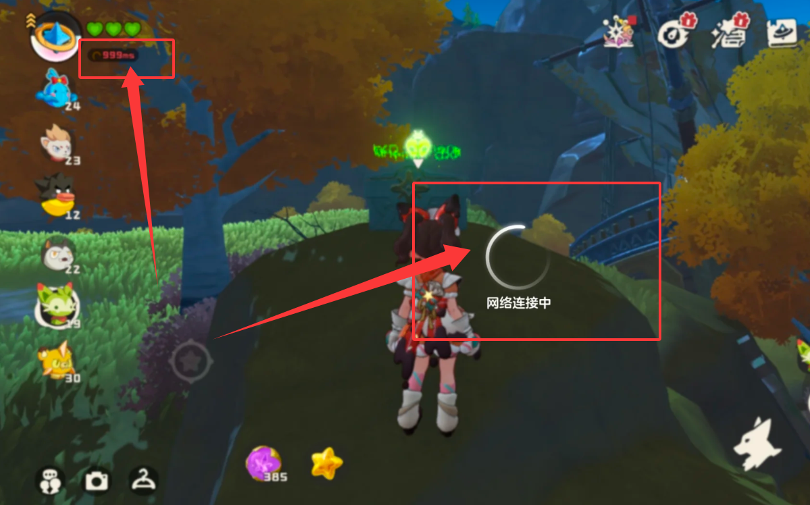

# 解决海外访问国内网络延迟高：玩国服、听歌、追剧，怎样少折腾？

为国服开黑找一次办法，为网易云听歌再找一次，追剧时还得重新处理加载。解决海外访问国内网络延迟高，可以从自己的长期娱乐习惯选方案。兼顾游戏和影音需求，推荐先用 HiCN 回国加速器；应用商店或浏览器搜索下载，新用户可免费试用3天，直接进入常用场景体验。

## 先列常用内容，不急着比较最低延迟截图

选择之前，写下三件事：常玩哪款国服游戏、常用哪个音乐App、在哪台设备上追剧。这样找的是适合每天使用的服务，而不只是某一张截图上的低数字。

例如，你可能工作日用手机听歌，周末在Windows电脑上玩国服，晚上又回手机看剧。选方案时，就要确认对应设备、游戏版本和影音场景，而不是只看一句“支持加速”。

同样，偶尔听两首歌与每天长时间游戏、追剧，使用需求也不同。先弄清自己最在意的动作，才知道哪些功能会经常用到。

## 三类娱乐需求，对应三个选择重点

日常习惯

选择时重点确认

上手时关注什么

经常与国内朋友玩国服

具体游戏、国服版本和设备入口

移动、技能与组队反馈是否连贯

常用网易云音乐等听歌

音乐场景与日常操作方式

搜索、切歌和连续播放

经常追腾讯视频、爱奇艺等

影音场景与观看设备支持

正片加载、缓冲及长时间播放

手机电脑交替使用

设备类型与并发规则

实际使用设备是否完成连接

不想自行研究设置

人工客服与问题反馈渠道

能否讲清地区、应用与异常表现

这几项确认好，比根据一个未经核实的“全球最低延迟”承诺直接购买长期服务更有依据。

## 为什么游戏流畅，仍要单独确认听歌和追剧

不同应用访问的服务和数据传输过程可能不同，游戏表现好，不能直接保证所有歌曲或剧集都能播放。反过来，视频能播，也不能证明国服交互及时。

Riot官方连接说明指出，设备与服务器的物理距离会影响延迟，无线环境也可能产生干扰。网络优化可以针对路径做改善，但不能消除跨境距离。[查看官方连接指南](https://support.riotgames.com/en-us/league-of-legends/connectivity/basic-connections-troubleshooting-guide)。

另外，游戏掉帧要看设备负载；歌曲无法播放要读单曲提示；视频要求登录则处理账号。把这些和连接问题分清，选择服务时才不会期待错误的结果。

## 推荐HiCN：一套日常操作覆盖游戏与影音需求

HiCN 回国加速器面向海外用户的国服游戏、国内音乐和视频等回国访问需求，支持一键加速、智能选路与智能分流，可按应用或场景匹配回国线路。

**极速双路并发通过两条独立网络通道传输数据，降低网络抖动，改善持续交互与播放所需的连接体验。**如果你每天都会在游戏、听歌和追剧之间切换，多场景覆盖能减少分别查找工具的时间。

HiCN 回国加速器支持 Windows、iOS、安卓（Android）和路由器，新用户可免费试用3天。路由器具体型号与配置方式，按官网或客服指引确认。

推荐从 HiCN 回国加速器开始，是看中明确的上手方式、新人体验与24/7人工技术支持。所在地区、运营商和常用应用不同，实际体验仍应结合自己的日常环境，不作所有场景必然顺畅的保证。

### 手机端：按场景一键开始

应用商店搜索 HiCN，下载后注册登录，开启新用户3天免费试用。玩手游选择国服游戏场景，听歌选择音乐场景，追剧选择影音场景，一键加速后进入目标App即可。

### Windows端：游戏和影音各自准备

1.  浏览器搜索 HiCN，或访问[HiCN 官网](https://www.hicn01.com)下载客户端。

2.  注册登录，开启新用户3天免费试用。

3.  玩PC游戏时，确认游戏与国服版本，按游戏和所在地区选择合适线路，再启动游戏。

4.  听歌、追剧时，一键加速后进入目标应用，照常使用。

现在就用新用户3天免费试用，从今晚最想做的事情开始。想开黑就先和朋友玩一局，想追剧就打开目标正片，不必安排一轮复杂的逐项打分。

## 长期方案，按设备和带宽需求选

HiCN 回国加速器VIP会员支持3设备在线、各平台1开同时加速；独享专线支持6设备在线、各平台2开同时加速。多台同类型设备同时使用时，也要留意各平台规则。

VIP会员与独享专线的游戏加速延迟一致。需要更多设备、更高带宽或直播等需求时，再了解独享专线，不必只为“更低游戏延迟”直接升级。

套餐价格、服务状态和具体规则，以当前客户端展示为准。新用户试用与后续购买分开确认，更换设备也不等于重新获得新用户资格。

## 用得顺，还需要几项简单的本地准备

开黑前完成游戏更新，暂停不急的大文件上传下载；手机尽量在无线覆盖稳定的位置使用。音乐进度条正常走却无声，查看耳机和音量；追剧只有某一集异常，留好页面提示。

HiCN 回国加速器用于网络优化，不能改变平台账号状态，也不能保证所有歌曲与视频都可播放。持续的地区、账号或内容状态提示，应按平台官方说明处理。

连接问题可以联系 HiCN 回国加速器人工客服，提供所在地区、设备、网络类型、目标应用和发生时间。描述清楚“卡在哪一步”，会比只说网络慢更方便沟通。

## 海外娱乐加速，常见问题有哪些？

### 玩国服、听歌和追剧，需要分别买三个工具吗？

可以先看是否有覆盖常用场景的服务。HiCN 回国加速器覆盖国服游戏、音乐和影音等需求，具体游戏和设备入口可在客户端或向客服确认。

### 影音加速顺畅，就代表每款国服游戏都适合吗？

不能直接推断。确认具体游戏、版本和所在地区，按实际使用需求上手即可。

### 多设备支持，等于无限同时使用吗？

不等于。设备类型与并发规则需要分别查看，按当前套餐确认。

### 更贵的套餐，游戏延迟一定更低吗？

不能这样判断。HiCN 回国加速器VIP会员与独享专线的游戏加速延迟一致，应按带宽、设备及其他需求选择。

### 可以先免费体验吗？

HiCN 回国加速器新用户可免费试用3天。选择常用设备和时段开始体验，后续方案以客户端当前展示为准。

少一些临时找办法，多一些真正的娱乐时间。现在就在应用商店或浏览器搜索 HiCN，开启新用户3天免费试用，按场景一键加速，接着开黑、听歌或追剧。

## HiCN回国加速器专属会员兑换码：1124
