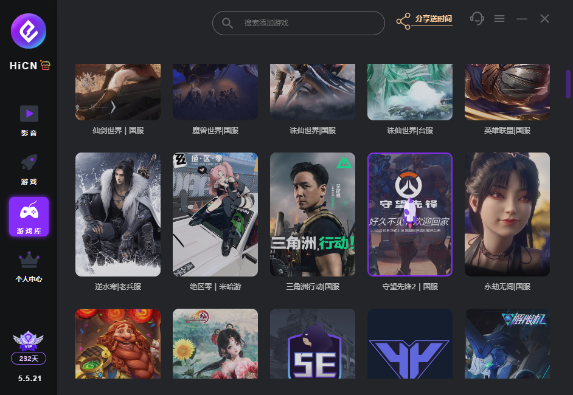

# 千兆宽带打国服照样460？聊聊海外党真正离不开的降Ping神器

很多刚出国的朋友都有个挺常见的误区，觉得只要家里网费交得够多，办个当地顶配的千兆光纤，打国服游戏肯定能丝滑起飞。结果真上号一测，好家伙，延迟照样红得发紫，动不动飙到两三百，甚至关键时刻直接460断线重连。

这事儿真怪不着你家宽带。物理距离摆在那儿，数据从海外绕回国内游戏服务器，中间得挤一堆国际公网节点，晚高峰丢包、抖动太正常了。想把Ping值真正压下来，改电脑设置、清后台顶多算心理安慰，最实在的办法还是找一款专门做**延迟优化**的**回国加速器**。

身边不少留学生和海外华人朋友，前前后后折腾过好几款加速工具，最后留下来长期用的，**HiCN回国加速器**出镜率挺高。倒不是它界面做得多炫酷，主要是用起来省心，实战表现够稳。

打国服游戏，其实大家最怕的不是延迟固定在某个数，而是突然“跳Ping”——平时看着好好的，一到团战或者刚枪关键帧，画面突然定格两秒，等缓过来人已经躺泉水了。HiCN的专线**游戏加速**在这块做得挺扎实，连上之后丢包率压得很低，延迟曲线平平稳稳的。不管是端游拼微操，还是手游抢点刚枪，技能跟手、走位不飘，开麦跟国内老友报点也完全不卡壳。

说实话，在国外生活，哪能光靠打游戏解闷？打完几把排位累了，切出去刷两集国内热播剧、看个下饭综艺，或者写作业时戴上耳机听听国内音乐软件里的收藏歌单，HiCN的**网络优化**同样能稳稳托住。一个软件把游戏、听歌、追剧全包圆了，省得在设备里装一堆工具来回切换。

另外有个特别讨喜的点，就是它的设备覆盖够全。平时主力用的 **Windows电脑**，随身带的 **iOS和安卓手机** 都能直接装。如果你是在外面租房、或者跟室友合租，它甚至直接支持**路由器**配置——往路由器里一配，家里连着Wi-Fi的平板、智能电视全都能直接走优化通道，不用每次挨个开软件，回家往沙发上一躺就能大屏追剧、丝滑开黑，体验确实舒服。

当然，海外每个国家、不同宽带运营商的网络底子千差万别，听别人说再多，不如自己进游戏拉两把来得实在。HiCN对新用户挺大方，直接给 **3天免费试用**。建议先下下来，挑自己平时最常开黑的晚高峰时段实际跑几局，亲眼看看Ping值稳不稳、掉不掉包再决定要不要留着，完全没啥试错成本。

在异国他乡读书打拼，能随时和国内老友痛痛快快开黑上分，闲下来听听熟悉的歌、追追热剧，确实是特别解压的日常。对了，下载好HiCN后别忘了使用口令1124免费领取会员加速时长，赶紧去测测你的国服延迟吧。
