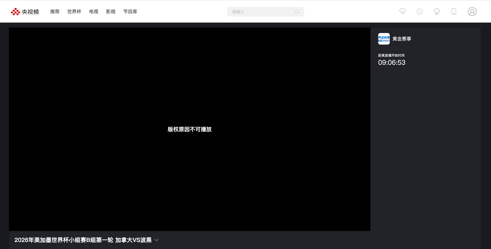

# 熬夜看球却被微信群提前剧透？海外党亲测丝滑的国内体育直播打开方式

在国外追国内的体育赛事，最憋屈的真不是倒时差，而是你顶着黑眼圈泡好咖啡，满心欢喜点开直播，结果画面卡得像幻灯片。

更要命的是延迟。这边屏幕上球员还在中场倒脚呢，旁边手机突然一阵狂震——国内微信群里已经开始刷屏庆祝进球了。那一瞬间，看球的兴致直接凉了半截。

说实话，海外华人和留学生之所以非要守着央视频、咪咕或者腾讯体育看球，图的就是那股子熟悉的中文解说味儿和弹幕互动。当地转播台不仅贵，解说听着也总觉得隔了一层。可人在国外直连国内平台，跨国网络绕路太严重，体育直播码率又高，稍微赶上点晚高峰丢包，不是画质自动降成马赛克，就是直接转圈黑屏。

折腾过几次野路子免费网站，满屏弹窗广告不说，看到关键时刻直接崩掉，彻底死心了。后来还是老老实实配了个专门的**回国加速器**来做**网络优化**，才算真正把球看明白。

我现在主力设备里一直留着的是 **HiCN回国加速器**。用下来最大的感受就是省心、不挑时段。开赛前连上它的影音**网络加速**线路，再进国内体育平台，高清画质基本能稳稳拉满，画面流畅不卡顿，和国内朋友在群里同步聊球，总算不用捂着眼睛防剧透了。

而且咱们在海外生活，哪能光靠看比赛过日子？中场休息或者平时周末，想约着国内死党开黑打几把国服游戏，或者写论文、做饭时戴上耳机听听国内音乐软件里的歌单、刷两集热播剧，HiCN都能一块儿兜住。特别是它的**游戏加速**和**延迟优化**，打国服的时候能把动不动飙红的延迟稳稳压下来，一个工具把看球、听歌、追剧、打游戏全包圆了，桌面清爽不少。

它还有个特别实用、对球迷非常友好的地方，就是全平台通吃。平时随身带的 **iOS和安卓手机**、办公学习用的 **Windows电脑** 都能直接装，甚至连**路由器**也直接支持。如果你是跟室友合租或者自己在家，直接在路由器上配好，连着Wi-Fi的智能电视、投影仪全都能顺畅跑国内直播软件。周末叫上三五个球友，买点卤味啤酒，窝在沙发上大屏看高清中文解说，那氛围感简直绝了。

当然，海外每个国家、不同宽带的网络底子都不太一样，听别人夸得再好，也不如自己实测一场来得踏实。HiCN对新用户挺大方，直接给 **3天免费试用**。建议你先下下来，挑一场热门焦点战实际连上去看半场，亲眼看看清不清晰、稳不稳当，用着顺手再决定要不要长期留着，完全没啥试错成本。

顺嘴提醒个小细节：连上HiCN回国加速器之后，记得把原本在后台挂着的体育直播App彻底划掉重开一次，让它刷新一下网络路径，加载会快很多。

在异国他乡读书打拼，能随时痛痛快快看一场不卡顿的中文解说比赛，闲下来听听歌、追追剧、和老友开局黑，绝对是最实在的解压方式。对了，下载好HiCN后别忘了使用口令1124免费领取会员加速时长，赶紧去试试吧。

##
