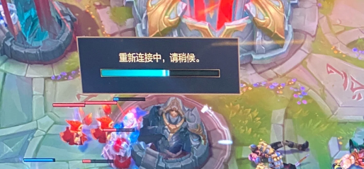

# 海外玩国服延迟高怎么办？白天正常，约好开黑却变卡

## 海外玩国服延迟高怎么办？白天能玩，为什么一约朋友就卡

白天做任务还算顺，晚上约国内朋友开黑，技能却开始慢半拍。海外玩国服延迟高，先关注实际游玩时段的网络变化，再准备回国连接。推荐在应用商店或浏览器搜索 HiCN 回国加速器，新用户可免费试用3天，按平时开黑的时间进游戏体验。

## “白天正常”只说明当时的条件适合玩

到了另一个时段，住处可能多了几台在线视频设备，电脑开始上传文件，跨境路径的连接表现也可能发生变化。游戏内容同样不同：白天独自走动，晚上多人交战，画面负载也可能上升。

所以，先别把“到了晚上就卡”直接归因于某一段网络。回想当时是画面掉帧、操作反馈变慢，还是整个连接断开，再决定下一步。

海外玩家说的“晚上”还需要说明时区。当地晚间不一定是国内晚间，反馈时写清当地日期、时间和所在地区，会比只说“高峰期”更有用。

## 约好时间之后，先把会同时发生的任务安排开

Riot 官方连接帮助说明，大文件下载、视频播放、云备份及其他设备的大量带宽占用，可能影响游戏连接。虽然不同游戏的具体情况需要分别判断，这些本地使用习惯仍值得先查看。[查看官方移动端连接帮助](https://support.riotgames.com/en-us/riot/performance/high-latency-and-disconnections-mobile)。

开黑前可以完成游戏更新，暂停不急的上传和同步，打完后再恢复。合租住处也可以提前说一声，商量大文件任务能否错开，无须要求其他人整晚不用网络。

| 约局时段发生的变化 | 可以先做什么 | 后续判断方向 |
| --- | --- | --- |
| 室友回家后开始大量用网 | 沟通大文件任务时间，查看自己后台占用 | 共享网络与本地带宽 |
| 晚上换到另一个房间玩 | 调整位置，电脑条件允许时使用网线 | 无线覆盖与干扰 |
| 一进入多人战斗画面就不顺 | 查看FPS、后台负载与画面设置 | 设备渲染表现 |
| 画面流畅，国服交互却变慢 | 确认游戏与区服，准备回国线路 | 跨境连接表现 |
| 出现维护或明确账号提示 | 保存提示，查看游戏公告 | 游戏服务与账号状态 |

先处理最明显的变化，再继续往下看。白天和晚上玩的是不同游戏内容时，也要把这种差异算进去。

## 用 HiCN 准备实际开黑时段的回国连接

HiCN 回国加速器面向海外用户的国服游戏等回国访问需求，支持一键加速、智能选路与智能分流，可按应用或场景匹配回国线路。把连接准备放在朋友集合之前，能减少临时找入口的时间。

**HiCN 回国加速器支持极速双路并发，通过两条独立网络通道传输数据，降低网络抖动。**对于持续走位、技能交互与团队配合，连接连贯性是值得关注的体验。

HiCN 回国加速器支持 Windows、iOS、安卓（Android）和路由器，新用户可免费试用3天。手机与电脑可先使用对应客户端，路由器具体型号、配置方式与覆盖范围按官网或客服指引确认。

### 手机玩家：上线前一键开始

在应用商店搜索 HiCN，下载客户端，注册并登录，开启新用户3天免费试用。选择国服游戏场景，一键加速后进入目标游戏，和朋友先开一局。

### Windows玩家：把游戏和大区确认好

1. 在浏览器搜索 HiCN，或访问[HiCN 官网](https://www.hicn01.com)下载 Windows 客户端。
2. 注册登录，开启新用户3天免费试用，确认游戏、国服版本与大区。
3. 按游戏和所在地区选择合适线路，连接后启动游戏。
4. 入口不清楚或连接异常时，联系人工客服，说明游戏与网络情况。

现在就用新用户3天免费试用安排一次日常开黑。选择平时真正会玩的时间，更容易了解自己的使用体验。HiCN 回国加速器提供24/7人工技术支持，反馈时带上所在地区、运营商、设备和异常时间，方便客服协助。

它用于网络优化，电脑掉帧、服务端维护和账号异常仍需分别处理。跨境连接也受距离与基础网络等因素影响，不能保证所有时段达到同一延迟。

## 已经开始卡，先和朋友说清楚下一步

如果正在对局，先留意基本联网与游戏提示。需要调整线路或重启时，尽量安排在对局结束、安全退出之后，避免给正在使用的连接增加打断。

可以直接说：“这局出现连接波动，结束后我处理一下，下一局确认好了再叫你们。”比起一边反复调整、一边让朋友猜要等多久，明确下一步更方便大家安排。

异常持续时，保留一条简短记录：“当地【时间】，玩【游戏／大区】，有【具体表现】，语音【正常／同时中断】。”不必写长报告，清楚描述症状即可。

## 约时间，选大家能长期坚持的安排

如果某个时段总遇到问题，可以先处理网络，再和朋友讨论是否有更合适的共同空闲时间。换时间是生活安排，不能保证某个固定时段网络必然更好。

跨时区沟通时，同时写明北京时间和自己当地日期、时间；遇到夏令时变化，再更新约定。让双方都知道什么时候集合，连接准备也更容易提前完成。

## 海外固定时段开黑，常见问题有哪些？

### 到晚上才卡，就一定是跨境网络拥堵吗？

不能直接确定。还要查看共享网络占用、无线位置、后台任务、游戏内容和设备负载，再结合连接表现判断。

### 白天加速顺畅，晚上也一定一样吗？

不一定。基础网络与路径表现可能随时间变化，适合在自己常用时段正常游玩，结合实际情况处理异常。

### 电脑接了网线，还需要准备回国线路吗？

网线主要改善电脑到本地网络这一段。海外到国服仍涉及跨境连接，可以根据实际体验继续优化。

### 画面掉帧，也能靠 HiCN 回国加速器解决吗？

HiCN 回国加速器用于网络优化。持续掉帧需要查看设备负载、散热与画面设置，不能把加速当作提升渲染性能的办法。

### 能先免费体验再选择后续服务吗？

HiCN 回国加速器新用户可免费试用3天，后续套餐以客户端当前展示为准。按日常游戏习惯开始体验即可。

难得约齐朋友，把准备留在集合之前。**现在就在应用商店或浏览器搜索 HiCN，开启新用户3天免费试用，准备好国服游戏连接，再和国内朋友开一局。**

## HiCN回国加速器专属会员兑换码：1124
