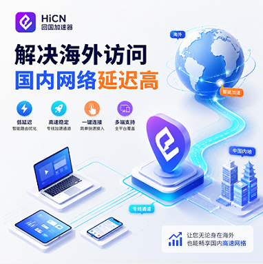

# 海外党回国网络卡到怀疑人生?一文讲清楚"卡在哪、怎么选、别再交智商税"

朋友小 A 在西雅图,前两天跟我吐槽:"开了加速器,延迟还是 200 多,客服让我换个节点试试,换了 5 个还是卡,我是不是该放弃国服了?"

我说你加速器选错了。

这其实不是小 A 的问题,是大多数海外华人都踩过的坑:看了一堆测评、下了三四个加速器、每个都试用两天,最后得出结论"都差不多"——因为你根本不知道"卡"的根源在哪里。

这篇我就把这件事掰开讲一遍,看完你至少能省下几十到几百块的冤枉钱。

 

## 一、先弄明白:你的网络"卡"和"慢"不是一回事

很多朋友把"卡"和"慢"混为一谈,其实这两件事的根源完全不同,解决办法也完全不同。

"慢"是带宽问题——下载个东西要等半天,看视频要缓冲。这种情况可以通过 CDN、缓存、换 DNS 解决一部分。

"卡"是延迟问题——带宽其实够,但数据往返时间太长。游戏里按个技能,屏幕上 200ms 之后才有反应,这就是"卡"。视频加载快但拖动进度条要等,也是"卡"。

"掉线"是丢包问题——数据发出去了但中途丢了,要重新传。视频通话卡成 PPT、游戏中突然"瞬移",都是丢包。

搞清你是哪种问题,才能对症下药。本文主要聊"卡"和"丢线"。

 

## 二、卡在哪?一张图看懂跨境数据的"旅途"

数据从你的电脑到国内服务器,要走完这样一段路:

 

```
`你 → 本地运营商 → 国际出口 → 跨洋光缆 → 落地国(日本/新加坡/香港) → 
中国骨干网 → 国内服务器
`
```

每一段都可能是"罪魁祸首"。

### 2.1 距离:无法绕开的物理极限

光在真空里每秒 30 万公里,在光纤里大概 2/3。从北美到中国大陆,单程物理时延就接近 100ms,来回 200ms 起。这是物理定律,没有任何软件能突破。

### 2.2 中转:实际比直线远得多

你以为数据从 A 到 B 是直线?错。它可能先到日本、再到香港、最后才到大陆,绕一大圈。绕得越远,延迟越高。

### 2.3 出口:带宽就那么多

全球海底光缆就那么几条,几十个国家的人同时用。北京时间晚上 8-11 点(北美白天上午) 是最堵的,跟北京晚高峰二环一样道理。

### 不同地区的"原始延迟"参考

所在地

玩国服

看视频

办公系统

北美东西海岸

220-380ms

1080P 都吃力

视频会议掉线频繁

加拿大

280-350ms

4K 别想

远程桌面登不上

欧洲(英/法/德)

240-330ms

偶尔卡顿

勉强能用

澳新

300-440ms

缓冲严重

卡顿明显

新加坡

90-150ms

流畅

OK

日韩

60-100ms

流畅

OK

规律:北美、欧洲、澳洲是重灾区,这几个地方的朋友基本绕不开加速器。

 

## 三、CN2、IPLC、SD-WAN……别被这些词吓到

挑加速器时,产品页一打开满屏英文缩写,不搞懂就只能看销售表演。

我用"高速公路"做类比,帮你一次记住:

### 普通公网 = 乡道

绕、慢、颠。便宜,但体验看运气。大部分低价 VPN 走的就是这种。

### CN2 = 普通高速

比乡道快,但高峰期照样堵。CN2 又分两档:

● CN2 GT:质量一般,晚高峰会卡

● CN2 GIA:CN2 里的 VIP 通道,接近专线水平,价格更贵

### IPLC = 私家高速

整条路就你一个人跑,不堵、不颠、几乎不丢包。但问题是——个人用户根本用不起。

IPLC 按带宽包月,10Mbps 一年要好几万。加速器做的就是"团购",把几百几千人的需求打包,让你用月费享受本来年费几万的专线。

### SD-WAN = 智能导航系统

实时看路况、动态选最快路线。听起来美好,但这是企业 IT 部门专属,需要硬件和专人维护,普通用户用不上。

### 一张表区分

线路

走公网吗

美西→国内延迟

丢包率

适合谁

普通公网

全程

200-350ms

1%-5%

所有人

CN2 GT

部分

160-220ms

所有人

CN2 GIA

CN2 通道

130-180ms

大多数

IPLC 专线

不走

110-160ms

企业

IPLC 共享池

不走

80-150ms

普通人

核心要点:同样叫加速器,走公网共享和走 IPLC 共享池,体验是天和地的差别。选加速器第一件事,问清楚用的是哪种线路。

 

## 四、五条路的真实评价,看完少走弯路

我接触过十几款工具,大致分五类。说人话评价:

### 路径一:自己改 DNS / Hosts

● 能做啥:网页打开快一点点

● 做不到:游戏、视频、办公

● 费用:0

● 适合:只浏览网页的人

● 真实体验:折腾半天,效果聊胜于无

### 路径二:免费加速器 / 浏览器插件

● 能做啥:勉强看个国内视频

● 做不到:游戏,登录任何有支付/隐私的账户

● 费用:0

● 适合:预算为 0 的轻度用户

● 真实体验:广告铺天盖地,流量可能被劫持,登录银行账号等于送钱

### 路径三:通用 VPN

● 能做啥:影音勉强 OK

● 做不到:游戏延迟改善有限

● 费用:30-80 元/月

● 适合:偶尔用一下的轻度影音党

● 真实体验:节点不是专门优化"回国"的,高峰期掉线

### 路径四:专业回国加速器

● 能做啥:游戏、视频、办公全覆盖

● 做不到:无明显短板

● 费用:50-150 元/月

● 适合:留学生、长期出差、商务办公

● 真实体验:性价比天花板

### 路径五:企业专线 / SD-WAN

● 能做啥:顶级

● 做不到:给个人用

● 费用:年费几万到几十万

● 适合:有 IT 团队的企业

● 真实体验:跟普通用户没关系

一句话:对大多数海外华人来说,专业回国加速器是"花最少钱、解最多问题"的答案。

 

## 五、专业加速器凭什么"专业"?

既然专业加速器是大多数人的最优解,那"专"在哪儿?我用"快递公司"做类比:

### 5.1 节点 = 专门做"海外到国内"的仓库

通用 VPN 的仓库是"全球布局",回国业务只是顺带。专业回国加速器的仓库只做"海外到国内"这一条线,优化的全是回国场景。

### 5.2 双线并发 = 双司机轮流开

普通 VPN 一辆车,坏了就坏了。专业加速器双线并发:两辆车同时跑,哪辆快走哪辆,一辆抛锚另一辆顶上。这是单线方案做不到的稳定。

### 5.3 UDP 专项优化 = 游戏的"绿色通道"

《王者荣耀》《和平精英》这类游戏的关键数据走 UDP 协议。专业加速器对 UDP 做专项优化,丢包重传、路径优选,延迟压到能打。

### 5.4 视频解锁 = "国内身份"出口

爱奇艺、腾讯视频、B站识别海外 IP,直接"该地区不可用"。专业加速器提供国内 IP 出口,绕过地域限制,4K 流畅看。

### 5.5 分流技术 = 不影响本地

正规加速器都做分流:只加速国内流量,Google、YouTube 照样快。如果一款加速器让你 Google 变慢,直接 pass。

 

## 六、挑选加速器的四条铁律

工具这么多,怎么筛?我总结四条铁律,按这个选基本不踩坑。

### 铁律一:先问线路

直接问客服:"你们用的是什么线路?公网、CN2、还是 IPLC?" 走公网共享的,价格再低也别选。

### 铁律二:看节点覆盖

你在欧洲,就要看有没有欧洲节点;在澳洲,就要看澳洲节点。没有本地节点,第一跳延迟就高,后面再优化也救不回来。

### 铁律三:看试用时长

试用 1-3 天的直接划走——根本测不出真实效果。至少要有 3-7 天,覆盖工作日 + 周末 + 晚高峰。

### 铁律四:看平台覆盖

电脑、手机、平板、路由器,你大概率都要用。至少覆盖 Windows、iOS、Android,支持路由器更好——家里所有设备一起加速。

 

## 七、为什么我选 [安卓客户端二维码](https://www.hicn01.com/) 做主力推荐

按上面四条筛一圈,能剩下的产品不多。HiCN 是我个人长期在用、且对留学生群体特别合适的一款。简单说说它"对"在哪里。

### 7.1 全平台覆盖:Windows、iOS、Android、路由器都有

电脑打国服、手机刷剧、平板看剧、家里所有设备一起加速——一个账号搞定,不用单独买。对留学生这种"PC + 手机 + 平板"多设备党非常友好。

### 7.2 双线并发 + 电竞级优化

HiCN 的双线并发是它的核心能力:两条独立线路同时跑、自动选最快那条。实测在加拿大、美国、澳大利亚玩《王者荣耀》《英雄联盟》,延迟基本能稳定在 100-180ms 区间,大部分时间 100ms 出头。

比起之前直连的 280-350ms,这是一个从"玩不了"到"能开黑"的质变——不是"舒服一点",是"完全两个游戏"。

### 7.3 新人 3-7 天免费试用,够你跑遍所有场景

不像很多加速器只给 1-2 天,HiCN 给新人 3-7 天免费试用,足够你:

● 跑遍工作日 + 周末

● 测遍晚高峰(北京时间 20:00-23:00)

● 玩够你最关心的几款国服

我建议把试用期当"考试",把你最想用的应用挨个跑一遍,数据比任何测评都可信。

### 7.4 应用覆盖很全

游戏(王者、LOL、原神、CS2、和平精英、永劫无间)、影音(B站、爱奇艺、腾讯视频、网易云音乐)、办公(企业微信、钉钉、远程桌面)、YY 语音——基本海外华人会用到的国内应用,都有专项加速档位。

### 7.5 价格对学生党友好

按月/季/年订阅,长期套餐折算下来一天一块多,比一杯奶茶便宜。

 

## 八、对号入座:你属于哪一类用户?

### 学生党 / 长期留学生

● 核心痛点:游戏 + 追剧 + 偶尔远程上课

● 我的建议:专业回国加速器,3-7 天试用 → 实测 → 订阅

● 避坑提醒:别只看价格,看线路

### 商务出差 / 短期海外

● 核心痛点:视频会议 + 远程办公

● 我的建议:专业回国加速器(月付更灵活)

● 避坑提醒:出差场景变化大,别买太长

### 移民陪读 / 全职太太

● 核心痛点:看剧、听歌、和家人视频

● 我的建议:专业回国加速器或高质量 VPN

● 避坑提醒:重点看视频和音乐支持

### 预算极低的轻度用户

● 核心痛点:偶尔看个国内网页

● 我的建议:改 DNS + 通用 VPN

● 避坑提醒:涉及支付、登录绝对不要用免费工具

### 企业团队 / 跨境电商

● 核心痛点:稳定访问业务系统 + 多用户管理

● 我的建议:企业 SD-WAN 或多账号专业加速器

● 避坑提醒:找 IT 供应商定制

 

## 九、关于加速器的六个高频疑问

Q1:CN2 一定比公网好吗?

不一定。CN2 GT 高峰期还是会堵,要看是不是 CN2 GIA。

Q2:加速器里的"共享 IPLC"是真的吗?

是真的。这是行业核心模式——把企业专线"团购"给个人用户。靠谱加速器基本都是这条路。

Q3:加速器会让 Google 变慢吗?

正规分流加速器不会,只加速国内流量。如果变慢,说明没做好分流,直接 pass。

Q4:欧洲用加速器,效果会比美国好吗?

不一定。物理距离上欧亚和北美差不多,有些加速器在欧洲节点少,反而不如美国。用试用期实测最准。

Q5:免费试用能测出真实效果吗?

能,但要测对:你最常玩的游戏 + 晚高峰 + 至少 2-3 天。别只用一次就下结论。

Q6:手机上和电脑是分开计费吗?

看产品。HiCN 是一个账号多设备同时在线,对留学生很友好。

 

## 十、说到底,你卡的是"认知",不是"网络"

海外访问国内,延迟是物理规律,丢包是带宽稀缺,这两件事不会因为你换了个路由器或升级宽带就消失。

能做的只有三件事:

1.  选对线路:IPLC 共享池 > CN2 GIA > CN2 GT > 普通公网

2.  选对方案:专业回国加速器 > 通用 VPN > 免费工具

3.  选对工具:用试用期实测,别靠测评文章决定

专业回国加速器里,我长期用且推荐 [安卓客户端二维码](https://www.hicn01.com/):双线并发稳、Windows/iOS/Android/路由器全平台、新人 3-7 天试用、价格对学生党友好。

网络卡了这么久,真没必要继续将就。花 5 分钟下载一个,把你最常用的国服游戏或国内应用跑起来,自己感受到的差距,比看十篇测评都真实。

新人福利:首次注册使用【口令 1124】可免费领取会员加速时长,登录后即可激活使用。



