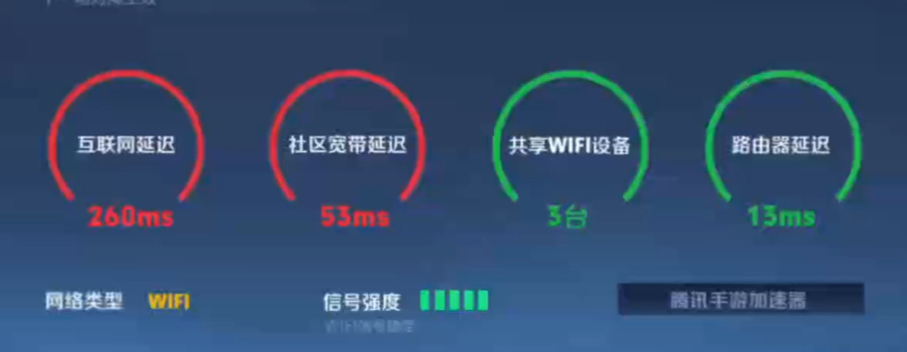

# 解决海外访问国内网络延迟高：室友追剧、自己开黑，怎么都用得顺？

## 解决海外访问国内网络延迟高：有人开黑，有人追剧，别让休息时间变成抢网络

你刚进国服对局，室友开始追剧，手机音乐也卡在下一首。海外多人共用网络，先把本地占用与回国连接分开处理。推荐搜索 HiCN 回国加速器，新用户可免费试用3天，按游戏、音乐和影音场景开始使用，把日常娱乐的连接提前准备好。

## 一起用就卡，先看大家正在做什么

不是所有同时在线的设备都会明显影响游戏，但大文件下载、高清视频播放和云备份集中进行时，可能争用网络资源。Riot官方连接帮助也将这类活动及其他设备的大量带宽占用列为影响游戏连接的因素。[查看官方连接帮助](https://support.riotgames.com/en-us/riot/performance/high-latency-and-disconnections-mobile)。

可以先看自己电脑：游戏更新、云盘同步和视频上传是否仍在后台。再和同住的人商量，把不急的大文件任务挪个时间，不需要要求全家停止上网。

如果独自使用也慢，就继续查看无线覆盖、跨境连接和目标平台状态，不能只归因于室友追剧。

## 游戏、听歌、追剧，分别留意不同表现

| 家里正在用什么 | 常见异常 | 先处理的方向 |
| --- | --- | --- |
| 国服游戏 | 操作慢半拍、人物回弹 | 本地占用、游戏目标与回国连接 |
| 国服游戏 | 画面掉帧、转视角不顺 | 设备负载、散热和图形设置 |
| 网易云音乐等音乐App | 搜索和切歌持续等待 | 基本联网与音乐连接 |
| 音乐App | 只有一首无法播放 | 单曲提示、版本与账号状态 |
| 腾讯视频、爱奇艺等视频App | 正片持续缓冲 | 网络连接、后台任务与清晰度 |
| 任一平台 | 明确地区或账号提示 | 按平台说明分别确认 |

别把三种异常都叫“网速不够”。例如，游戏帧数下降不能单靠加速解决，单曲当前不可用也不能只靠调低视频画质处理。

## 房间不同，连接条件也可能不同

客厅追剧顺畅，卧室电脑卡顿，可以先看看无线位置和信号表现。有条件的电脑使用网线，手机在覆盖稳定的位置游玩；同住的人也可以一起确认路由器是否被遮挡。

有线连接主要改善设备到本地网络这一段，不能消除海外到国内的物理距离。Riot官方说明，设备与游戏服务之间的距离是延迟的重要因素。[查看官方基础连接指南](https://support.riotgames.com/en-us/league-of-legends/connectivity/basic-connections-troubleshooting-guide)。

因此，本地连接理顺后，国服游戏、国内音乐和视频的回国路径仍值得准备。下载测速快，不能单独代表每种娱乐交互都顺畅。

## 用 HiCN，给不同设备准备对应场景

HiCN 回国加速器面向海外用户的国服游戏、国内音乐和视频等回国访问需求，支持一键加速、智能选路与智能分流，可按应用或场景匹配回国线路。

**极速双路并发通过两条独立网络通道传输数据，降低网络抖动，改善持续交互与播放所需的连接体验。**玩游戏关注走位和技能反馈，听歌关注切换是否顺畅，追剧则看实际连续播放表现。

HiCN 回国加速器支持 Windows、iOS、安卓（Android）和路由器，新用户可免费试用3天。实际使用设备需要完成对应连接，不能仅凭一台手机显示加速成功，就认定其他设备也已经准备好。

手机用户在应用商店搜索 HiCN，下载后注册登录，开启新用户3天免费试用。玩手游选择国服游戏场景，听歌选择音乐场景，追剧选择影音场景，一键加速后进入目标App即可。

Windows用户可按下面的顺序开始：

1. 浏览器搜索 HiCN，或访问[HiCN 官网](https://www.hicn01.com)下载客户端。
2. 注册登录，开启新用户3天免费试用。
3. PC游戏按游戏和所在地区选择合适线路，连接后启动；听歌、追剧则一键加速后进入应用。
4. 多设备使用或连接有疑问时，向人工客服说明设备类型与实际需求。

现在就用新用户3天免费试用，先把常用设备的日常场景跑通。HiCN 回国加速器提供24/7人工技术支持，连接异常可提供地区、网络类型、目标应用和发生时间，请客服协助。

## 选择套餐时，分清“支持设备”和“同时使用”

支持多种设备，不等于一个账号可以无限同时连接。HiCN 回国加速器VIP会员支持3设备在线、各平台1开同时加速；独享专线支持6设备在线、各平台2开同时加速。多台同类型设备的需求，也应结合这些规则确认。

独享专线与VIP会员的游戏加速延迟一致。需要更多设备、更高带宽或直播等需求时，再了解独享专线，不要仅因国服延迟高就直接认为必须升级。

路由器具体型号、配置方式和套餐设备计算，可先按官网或客服指引确认。价格以当前客户端展示为准，不根据旧截图做长期购买决定。

## 让家庭网络安排简单一点

可以约定大文件更新在不打游戏时进行，晚上开始娱乐前先完成必要下载。视频已播放但持续缓冲，可以先降低一档清晰度；音乐只有固定一首异常，则查看单曲提示。

HiCN 回国加速器用于网络优化，不能改变平台账号状态，也无法保证所有歌曲和视频都可播放。地区提示、账号异常或游戏维护，应按对应平台说明处理。

如果经常多人同时使用仍然困难，再把人数、设备、任务与异常时段告诉宽带服务方，评估本地网络升级是否有必要。

## 海外家庭娱乐常见问题

### 室友一追剧我就卡，应该只换加速线路吗？

先查看本地网络占用和无线表现。跨境线路与共享带宽是不同环节，需要结合实际症状处理。

### 手机开启HiCN，电脑也自动加速吗？

通常需要在实际使用设备上完成连接。路由器方案则按具体配置确认覆盖范围。

### 游戏和追剧都用，必须买独享专线吗？

按设备并发、带宽和其他实际需求选择。独享专线与VIP会员的游戏加速延迟一致，不必仅为更低游戏延迟直接升级。

### 开启加速后，所有歌曲和剧集都会恢复吗？

无法保证。HiCN 回国加速器用于优化回国连接，持续的平台提示应按官方说明处理。

### 能先免费体验吗？

HiCN 回国加速器新用户可免费试用3天。在日常设备和时段开始使用，具体账号状态及后续套餐以客户端为准。

开黑、听歌、追剧，先把各自的连接与设备安排清楚。**现在就在应用商店或浏览器搜索 HiCN，开启新用户3天免费试用，按场景一键加速，让今晚的休息时间少些网络争论。**

## HiCN回国加速器专属会员兑换码：1124
