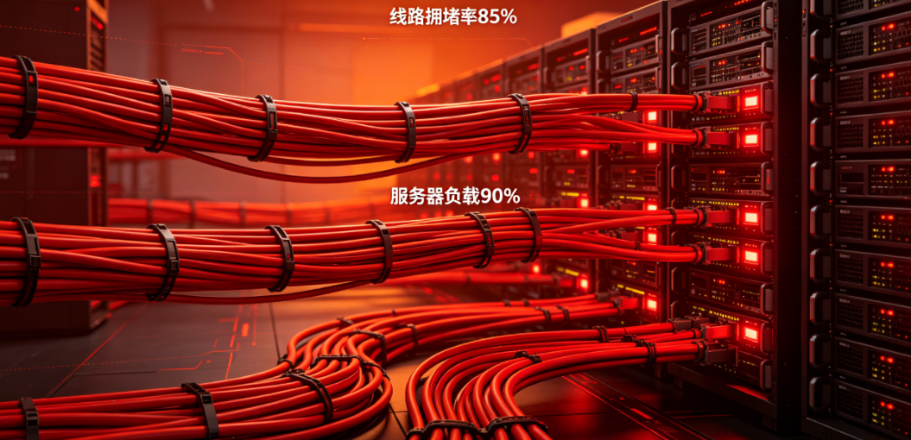

# 海外打国服总被队友嫌弃卡？聊聊真正能把Ping值压稳的实用软件

不知道在国外打国服游戏的朋友有没有同感：最让人血压飙升的，真不是遇到坑队友，而是你自己因为网络卡顿，硬生生变成了那个“坑”。

前阵子周末约着国内几个发小开黑，本来想着痛痛快快上波分，结果进游戏没两分钟，延迟直接飙红。对面冲脸的时候我狂按大招，屏幕愣是卡住一秒，等画面恢复，人已经黑白屏了。语音里哥几个虽然嘴上说着“没事没事”，但那种拖后腿的憋屈劲儿，谁经历过谁懂。

其实很多人一开始都走过弯路，以为是家里网速不够，跑去换路由器、升宽带，甚至把游戏画质调成马赛克。折腾一圈下来才发现，问题压根不在你家网费上，而是跨国传输的距离太远，数据在半路绕远、丢包，Ping值自然压不下来。

想在海外把国服游戏玩顺畅，最省事的办法就是用一款专门做**延迟优化**的**回国加速器**，把数据回国的路线给拉直。

这几年在外面，大大小小的加速软件我也用过七八款。有的看着便宜，一到国内晚高峰照样疯狂跳Ping；有的只管电脑不管手机，用起来特别割裂。兜兜转转到现在，一直留在设备里没卸的，是 **HiCN回国加速器**。

打游戏的人其实都懂，比起偶尔蹦出一个好看的最低延迟，更重要的是“稳”。连上HiCN的游戏加速专线后，最直观的感受就是丢包率降下来了，Ping值不会像过山车一样忽高忽低。不管是打端游团战还是玩手游刚枪，技能释放跟手、走位不飘，开麦报点也没什么延迟感，玩起来踏实多了。

而且咱们海外华人和留学生平时也不可能光打游戏。上完分累了，想窝在椅子上刷两集国内热播剧，或者戴上耳机听听国内音乐软件里的收藏歌单，HiCN同样能把网络优化给包圆了。一个软件同时搞定游戏加速和听歌追剧，不用在手机和电脑里装一堆工具来回切，确实省心。

它还有个特别戳中痛点的地方，就是设备支持够全。平时随身用的 **iOS和安卓手机**、打游戏办公的 **Windows电脑** 都能直接装。如果你是跟室友合租，或者习惯在客厅用平板、智能电视娱乐，它甚至直接支持**路由器**配置——往路由器里一挂，家里连着Wi-Fi的设备全都能直接走优化通道，不用每次挨个开软件，用着特别顺手。

当然，海外不同国家、不同宽带运营商的网络底子差别挺大，光听别人夸肯定不够，还是得自己实测才算数。HiCN对新用户挺实在，直接提供 **3天免费试用**。建议你先下下来，挑自己平时最常开黑的晚高峰时段进去拉两把，亲眼看看Ping值稳不稳再决定要不要长期用，完全没啥试错成本。

在异国他乡读书打拼，周末能跟国内老友顺顺当当开黑、平时能随时追剧听歌，真的是特别解压的日常。对了，下载好HiCN后别忘了使用口令1124免费领取会员加速时长，赶紧去测测你的国服延迟吧。
