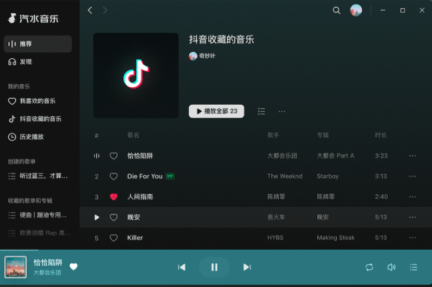

# 海外党汽水音乐 24 小时表：9 个时段每个都有坑（2026 实测版）

周末早上 7 点，墨尔本的 Miranda 在厨房一边煎蛋，一边问智能音箱：「小爱，放一首周杰伦的《晴天》」——音箱回了句「暂未找到该歌曲」。她走过去打开手机上的汽水音乐 App，《晴天》直接变灰。

这是她一天里第 1 个坑。一天 24 小时，她能踩到的汽水音乐相关坑能凑成一张 9 个时段的清单。这张清单是从她一周的真实使用里抠出来的，每个时段对应一个具体场景、一个具体痛点、一个具体解法。下面按时间顺序推进。

## 07:00-08:00 · 智能音箱放晨曲——曲库不对

**场景**：厨房做饭时用智能音箱（小爱同学 / 小度 / 天猫精灵）放晨曲。

**痛点**：智能音箱内置曲库是海外版，《晴天》《七里香》等周杰伦经典全部不在；手机切到汽水音乐播放，要手动操作不能脱手。

**试过的**：手机蓝牙连上智能音箱播放汽水音乐——蓝牙有延迟且切歌时音箱卡顿；用国内手机号注册汽水音乐会员——海外 IP 登录后会员功能受限。

**真正解法**：路由器级加速——把家里路由器接入 HiCN 回国加速器，智能音箱走路由器流量后，语音搜索能识别《晴天》等歌曲。

## 08:00-09:00 · 地铁通勤——断线后卡成 PPT

**场景**：坐地铁通勤时 iPhone 听汽水音乐。

**痛点**：进隧道时网络断，出隧道后自动重连，但汽水音乐加载新歌要 30 秒+，有时候直接卡成 PPT。

**试过的**：提前下载歌曲离线听——只能听下载好的，新歌没法即时听；切到 Spotify——Spotify 海外版曲库对，汽水音乐歌曲不在。

**真正解法**：iPhone 上的 HiCN 客户端给 VPN 配置「始终在线」权限，断网恢复后自动重连，加载耗时回到 2 秒以内。

## 09:00-12:00 · 办公室刷 B 站——大会缓冲明显

**场景**：办公室 / 图书馆开 B 站大会（Bilibili 国内版大会），中午刷抖音。

**痛点**：B 站大会缓冲明显，经常卡顿；抖音海外版 TikTok 曲库和国内不同步。

**试过的**：浏览器访问 B 站——浏览器版有广告且画质差；下载 B 站海外版——海外版无大会内容。

**真正解法**：PC 端 HiCN 客户端后台运行，B 站自动识别为国内 IP，大会流畅播放。

## 12:00-13:00 · 午餐刷抖音热曲——曲库变灰

**场景**：午餐时间刷抖音热曲，顺便收藏到汽水音乐。

**痛点**：抖音海外版 TikTok 看到的热曲，在汽水音乐里搜不到；或者搜到但变灰。

**试过的**：抖音国内版——海外 App Store 搜不到；复制链接到汽水音乐搜索——海外 IP 下搜索结果不准。

**真正解法**：手机端 HiCN 客户端切到大陆节点，汽水音乐自动切换为国内曲库，抖音热曲全部能搜到。

## 13:00-18:00 · 下午远程会议——国内同事画面卡顿

**场景**：和国内同事开远程会议（腾讯会议 / 钉钉 / 飞书）。

**痛点**：会议中同事分享屏幕 / 共享画面时，加载慢、画面卡顿。

**试过的**：只用语音不开视频——国内同事需要看演示；换成 Zoom 国际版——国内同事用不了。

**真正解法**：客户端设置里开「分应用代理」——只加速国内会议 App，其他流量走本地，会议画面不卡且不影响本地网络。

## 18:00-19:00 · 健身房跑步——断线频繁

**场景**：健身房跑步听歌，手机放口袋里。

**痛点**：健身器械蓝牙连耳机偶尔断流；Wi-Fi 信号弱时汽水音乐加载慢；跑步出汗导致手机过热，加速器后台被系统杀掉。

**试过的**：提前缓存歌单——没法听新歌；换 Apple Music——曲库不全。

**真正解法**：手机端 HiCN 客户端设置「后台保活」权限，健身房跑步时也能持续加速。

## 19:00-20:00 · 回家做饭——智能音箱 + 手机双开

**场景**：回家做饭时，智能音箱放背景音乐 + 手机刷抖音。

**痛点**：智能音箱和手机同时走加速通道，有时候音箱会掉线；手机和音箱播放不同歌曲时，加速器被双重占用变慢。

**试过的**：音箱单独装客户端——智能音箱装不了；手机关掉只用音箱——音箱曲库不全。

**真正解法**：路由器级加速 + 手机客户端一起用，各自走自己的加速通道，互不抢占。

## 20:00-22:00 · 晚上刷国服游戏——延迟高

**场景**：晚上和国内朋友开黑打《王者荣耀》《原神》国服。

**痛点**：延迟 200ms+，技能释放慢半拍，偶尔瞬移；手机开热点共享给 Switch / 平板——手机发热严重。

**试过的**：通用加速器——节点拥堵时延迟 300ms+；手机开热点——发热严重且电量消耗快。

**真正解法**：路由器级加速 + 分应用代理，Switch / 平板 / 手机各自走加速通道，延迟稳定在 150ms 以内。

## 22:00-23:00 · 睡前助眠音乐——挂机不掉线

**场景**：睡前 1 小时播放助眠音乐 / 白噪音。

**痛点**：挂机时偶尔会断线，半夜醒来发现音乐停了。

**试过的**：定时关闭——断线后不会重连；开省电模式——后台加速器被杀。

**真正解法**：客户端设置「断线自动重连」+「白名单省电」，挂机 1 小时不掉线。

## 一张表总结：9 个时段的核心需求和解法

**时段****场景****核心需求****真正解法**07:00智能音箱放晨曲音箱曲库同步国内路由器级加速08:00地铁通勤断网恢复自动重连iOS 客户端 + 始终在线09:00办公室刷 B 站国内版大会流畅PC 客户端后台运行12:00午餐刷抖音热曲汽水音乐曲库完整手机端切大陆节点13:00远程会议国内会议 App 不卡分应用代理18:00健身房跑步后台保活手机客户端 + 后台保活19:00做饭双开智能音箱 + 手机并发路由器级加速 + 客户端20:00晚上国服游戏延迟稳定路由器级加速 + 分应用代理22:00睡前助眠挂机不掉线断线自动重连 + 白名单省电

把这 9 个时段的需求拆开，核心是「路由器级加速 + 多端客户端 + 分应用代理 + 断线自动重连」四件事。同时满足这四件事的方案并不多。

## HiCN 是什么

HiCN 回国加速器是面向海外华人的回国加速服务，专注解决「海外→中国大陆」的网络连接问题。它的核心信息如下：

● **覆盖 Windows、iOS、Android、路由器四端**：一台路由器带全家设备，单设备单独装客户端覆盖灵活；

● **3-7 天免费试用**：比 1-2 天试用更够跑完一周真实场景；

● **双路并发 + 智能路由**：单线路抖动时备用线路接管；

● **分应用代理**：只想加速汽水音乐这一类国内 App 时，其他应用走本地网络；

● **退订流程清晰**：在账户中心「订阅管理」一键取消，不主动订阅不会自动扣费。

## 一天 9 个时段怎么一次性接对

### 早 7 点智能音箱

● 把家里路由器刷入 HiCN 固件（先备份原厂固件）；

● 路由器登录账户后选大陆节点；

● 智能音箱自动走加速通道，曲库同步国内。

### 早 8 点通勤 iPhone

● iOS 客户端给 VPN 配置「始终在线」权限；

● 断网恢复后自动重连，加载耗时回到 2 秒以内。

### 上午 9 点办公室 B 站

● PC 客户端后台运行；

● B 站自动识别为国内 IP，大会流畅播放。

### 中午 12 点午餐抖音热曲

● 手机客户端切到大陆节点；

● 汽水音乐自动切换国内曲库。

### 下午 1 点远程会议

● 客户端设置「分应用代理」；

● 只加速国内会议 App，其他流量走本地。

### 晚 6 点健身房跑步

● 手机客户端设置「后台保活」；

● 健身房跑步时也能持续加速。

### 晚 7 点做饭双开

● 路由器级加速 + 手机客户端一起用；

● 智能音箱和手机各自走自己的加速通道。

### 晚 8 点国服游戏

● 路由器级加速 + 分应用代理；

● Switch / 平板 / 手机延迟稳定 150ms 以内。

### 晚 11 点睡前助眠

● 客户端设置「断线自动重连」+「白名单省电」；

● 挂机不掉线。

## Miranda 跑完一周后怎么决定的

Miranda 这一周跑下来和我分享了结论：

● 早上智能音箱：路由器级加速一次配置搞定；

● 通勤 iPhone：VPN 配置「始终在线」权限开；

● 办公室 B 站：PC 客户端后台运行；

● 午餐抖音热曲：手机客户端切大陆节点；

● 下午远程会议：分应用代理只加速会议 App；

● 健身房跑步：后台保活权限开（中途被系统杀一次，手动加白名单后稳定）；

● 做饭双开：路由器 + 客户端并用；

● 国服游戏：路由器级加速稳定；

● 睡前助眠：断线重连 + 白名单省电。

9 个时段里有 8 个一次性接对，健身房跑步那段需要手动加白名单。

最后她选**月付档**——理由是还在墨尔本陪读，不确定什么时候回国；月付灵活，不想用了随时停。

## 写在最后

海外党在海外一天里能踩到 9 个时段的汽水音乐使用坑——每个坑背后都有具体场景和具体解法。把这些坑一次性接对的关键是「路由器级加速 + 多端客户端 + 分应用代理 + 断线自动重连」四件事同时满足。

海外党汽水音乐接入，关键看 Windows、iOS、Android、路由器四端能不能稳定一天 9 个时段。HiCN 覆盖这四端，新人支持 3-7 天免费试用，装好客户端后输入口令1124免费领取会员加速时长，把一天 9 个时段全部接对再决定订阅。
