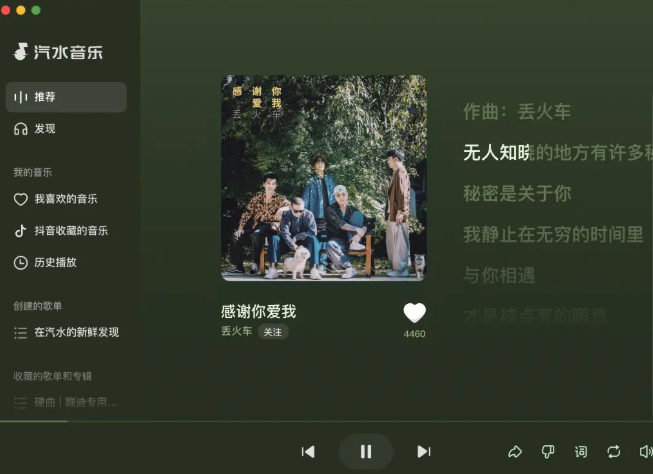

# 汽水音乐海外地区限制的解除方法：收藏还在，歌曲却播不了怎么办？

## 摘要

海外用户遇到汽水音乐收藏歌曲无法播放时，可使用HiCN回国加速器一键优化回国连接，解除地区限制。先保留原歌曲和提示信息，加速后再重新播放，按具体提示处理账号或版权问题。

## 正文

出国后打开汽水音乐，熟悉的歌单还在，点进收藏却出现地区提示。先别急着删除歌曲，可以用 HiCN 回国加速器优化回国连接；新用户可免费试用3天，一键加速后重新播放原歌曲，再按具体提示处理。

歌单显示正常，说明你还能看到相应记录，却不能单独证明每首歌当前都可播放。收藏、账号和连接，需要分别看。

## 先保留收藏，别把异常歌曲一口气删掉

无法播放时，先记下歌名、歌手、版本和提示文字。搜索同名歌曲可能出现不同演唱版本，重新找到的结果未必对应原收藏。

保留原链接，也方便连接调整后回到同一首歌。换一首能听，只能帮助判断问题范围，不能证明原问题已经解决。

如果收藏记录本身找不到，先核对登录账号；如果记录存在却无法播放，再看歌曲页面提示。不要仅因人在海外，就把所有现象都认定为地区问题。

## 看到什么提示，就处理对应环节

当前现象

先确认什么

下一步动作

收藏存在，歌曲出现地区提示

原歌曲与当前连接

回国加速后重新进入，仍异常则保留提示求助

多首歌曲一直转圈

本地网络、跨境连接与应用状态

确认正常上网，再开启加速

提示会员、购买或登录要求

账号与页面条件

按平台当前说明处理

只有一首持续不可用

歌曲当前状态与版本

保留链接，向音乐平台反馈

收藏列表与记忆不符

是否登录对应账号

通过平台账号帮助确认

回国加速器不能恢复失效歌曲，也不能替代会员或单独购买条件。明确页面要求后再行动，可以减少无效的重复登录与重装。

## 用HiCN接顺回国连接，再回到原歌单

HiCN 回国加速器面向海外华人的国内音乐、影视、游戏等场景，提供一键加速、智能选路与智能分流，帮助应用匹配合适的回国线路。

手机上打开HiCN，一键加速，再进入汽水音乐播放原歌曲。先在常用设备把流程跑顺，不必为了听歌安排复杂设置。

对于切歌转圈、持续播放中的连接波动，HiCN 回国加速器支持极速双路并发，同时利用两条独立网络通道传输数据，用于降低网络抖动、改善连接稳定性。实际表现仍受当地网络、设备和平台服务状态影响，不能保证所有收藏都可播放。

HiCN 回国加速器支持 Windows、iOS、安卓（Android）和路由器。手机用户可在应用商店搜索“HiCN”，电脑用户可在浏览器搜索，或访问HiCN官网下载对应客户端。路由器适用型号与配置方式按官方指引确认。

新用户可免费试用3天，连接异常时还有7×24小时人工技术支持。说明地区、运营商、设备系统和错误提示，方便客服协助。现在下载客户端，一键加速后打开原歌单，先从想听的那首开始。

截至2026年11月11日，HiCN官方汽水音乐帮助页提供相关海外使用说明。当前支持与具体操作，以客户端和客服确认为准。

## 不换歌单，也可以把处理顺序安排清楚

1.  核对账号和原歌曲。 保留版本、链接与提示。

2.  确认基础网络正常。 普通网页也打不开时，先恢复上网。

3.  打开HiCN 回国加速器，一键加速。 连接后重新进入汽水音乐。

4.  再次播放同一首。 按剩余提示分别咨询平台或加速器客服。

仍出现相同地区提示时，不必一直刷新。连接状态可以向HiCN客服确认，歌曲和账号要求则由音乐平台说明。

如果多首歌曲一起缓冲，看看无线信号和后台传输；如果只有某首异常，继续围绕该曲目判断。先缩小范围，不要一次同时改动多项设置。

## 缓存、重装与续费，都放到需要时再做

需要清理缓存时，先阅读当前选项，确认是否影响离线内容或登录状态。清除全部数据、卸载应用可能让你重新准备本地资源，未必改善跨境连接。

已有会员时，先确认登录账号与页面要求，不因一条地区提示就重复购买。加速服务与音乐平台权益作用不同。

长期套餐也看实际设备与需求，价格和权益以当前客户端为准。新用户3天免费试用不会因为更换手机而自动重新获得。

## 常见问题

### 收藏还在，是不是说明歌曲一定还能听？

不能这样判断。收藏记录与当前播放状态不同，应查看具体歌曲页面提示。

### HiCN可以恢复全部灰色歌曲吗？

不能保证。HiCN 回国加速器优化连接，不改变歌曲状态，也不替代平台权益。

### 换账号会不会更容易播放？

不必仅因地区提示更换账号。先核对原账号与歌曲要求，避免把收藏和权益问题混在一起。

### 只听几首熟悉的歌，怎样开始试用？

新用户按当前客户端方式开启3天免费试用，一键加速后正常收听原歌曲即可，不需要专门安排复杂检查。

### 下载过的歌曲，能永久离线听吗？

不能默认如此。离线功能和可用条件以当前歌曲及账号页面要求为准。

### 向客服求助，需要发账号密码吗？

不要提供密码或验证码。说明地区、设备、网络、歌曲链接和具体提示即可帮助沟通。

现在搜索“HiCN”下载客户端，新用户开启3天免费试用，一键加速后重新打开汽水音乐收藏歌单。 先保留原歌曲，再把连接与页面要求分别处理，让熟悉的听歌流程更顺手。

## HiCN回国加速器专属会员兑换码：1124

 
