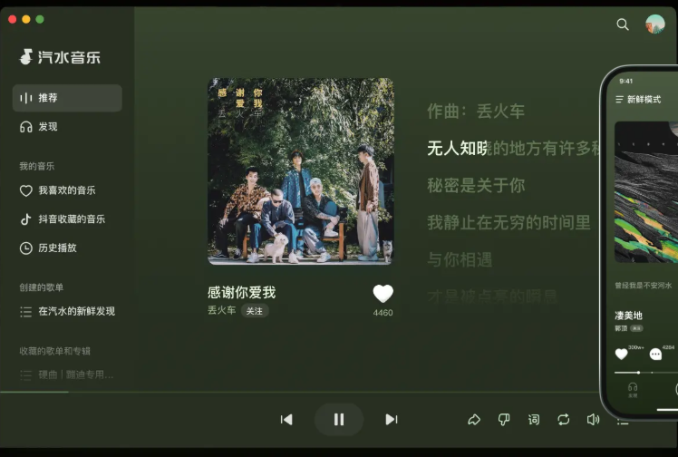

# 汽水音乐海外地区限制的解除方法：刷到喜欢的歌，怎样继续完整收听？

短视频里的旋律听了好几遍，打开汽水音乐想听完整版，却停在地区提示上。海外遇到这种情况，可以先用 **HiCN 回国加速器**优化回国连接；新用户可免费试用3天，一键加速后重新打开原歌曲，再看当前提示。

从片段找歌到完整收听，中间还涉及歌曲版本、账号与连接。先分清问题，就不用反复换账号或删除歌单。

## **先确认自己找的是同一首、同一版本**

短视频使用的片段，可能来自不同演唱版本。先保留歌曲链接、歌手和版本信息，再到汽水音乐确认目标内容，不要只凭一句歌词就默认搜索结果完全对应。

如果页面没有找到目标歌曲，不等于网络一定异常；如果歌曲可以打开却无法播放，则继续看具体提示。加速器优化连接，不会自动补全平台没有提供的内容。

## **地区提示、持续转圈和账号要求，分别处理**

| **当前遇到的情况** | **可以先确认什么** | **下一步动作** |
| --- | --- | --- |
| 出现地区相关提示 | 原歌曲与当前连接状态 | 回国加速后重新进入，仍异常则保留提示咨询客服 |
| 多首歌曲持续加载失败 | 本地上网、跨境连接与应用状态 | 先恢复基础网络，再开启加速 |
| 提示登录、会员或购买要求 | 当前账号与页面条件 | 按音乐平台说明处理 |
| 只有某一首持续不可用 | 歌曲版本与当前状态 | 保留链接向平台反馈 |

回国加速不能替代会员或购买条件，也不能恢复失效歌曲。不要把所有不可播放都当成同一种问题，更不能保证连接后所有歌曲都可收听。

## **用HiCN，把回国连接先接好**

**HiCN 回国加速器**面向海外华人的国内音乐、影视、游戏等使用场景，提供**一键加速、智能选路与智能分流**，帮助应用匹配适合的回国线路。

手机端可以打开HiCN，一键加速，再进入汽水音乐播放原歌曲。不必先安排复杂网络设置，从自己平时找歌、听歌的流程开始即可。

HiCN 回国加速器支持**极速双路并发**，同时利用两条独立网络通道传输数据，用于降低网络抖动、改善连接稳定性。持续播放仍受当地网络、设备和平台服务状态影响，本地断网时需先恢复基础连接。

设备方面，HiCN 回国加速器支持 **Windows、iOS、安卓（Android）和路由器**。手机用户可在应用商店搜索“HiCN”，电脑用户可在浏览器搜索，或访问HiCN官网下载对应客户端。路由器的适用型号与配置方式按官方指引确认。

**新用户可免费试用3天**，连接异常时可联系**7×24小时人工技术支持**。说明所在地区、运营商、设备系统和错误提示，方便客服协助。

现在先下载HiCN，一键加速后打开原歌曲，正常收听，再按实际需要决定长期使用方式。

## **从短视频回到完整歌曲，按四步操作**

1. **保留目标信息。** 记下歌手、歌曲版本与原链接。

2. **确认基础网络可用。** 普通网页也打不开时，先处理网络接入。

3. **打开HiCN 回国加速器，一键加速。** 连接后重新进入汽水音乐。

4. **播放原歌曲。** 仍出现提示时，分别处理连接、账号或歌曲状态问题。

换一首能播，只能帮助判断异常范围，不能直接证明原问题已经解决。仍有地区提示时，保留完整文字与歌曲链接求助，比一直刷新更有针对性。

截至2026年11月11日，HiCN官方汽水音乐帮助页提供相关海外使用说明。实际应用入口和当前支持方式以客户端与客服确认为准。

## **能播但总中断，不必先删除收藏**

先留意无线信号、移动数据和后台传输。出门从家中无线网络切换到移动数据后，可以重新确认当前连接状态。

如果只是某一首异常，继续围绕该歌曲咨询平台；如果多首都持续缓冲，再关注整体网络与应用状态。需要清理缓存时，阅读当前选项提示，保留需要的离线内容与登录信息。

不要根据搜索结果标题就把陌生网页当成汽水音乐官方入口。下载与账号操作通过应用商店、已安装应用中的帮助或经过确认的官方渠道完成。

## **常见问题**

### **短视频能听见，为什么汽水音乐完整版播不了？**

片段播放与完整歌曲页面的条件可能不同。先确认版本，再看账号要求、歌曲状态与地区提示，不能仅凭片段可听判断完整版一定可用。

### **HiCN能保证所有歌曲都能恢复吗？**

不能。HiCN 回国加速器优化网络连接，不改变歌曲状态，也不替代音乐平台权益。

### **重新注册账号能解决吗？**

不必仅因地区提示就重新注册。先保留原账号与歌曲信息，按具体提示处理，账号异常通过平台官方渠道咨询。

### **可以在没有信号的地方继续加速听歌吗？**

基础网络不可用时，加速连接也会受影响。离线收听应使用平台提供的功能，并遵循当前歌曲与账号页面要求。

### **试用要怎样开始？**

新用户按当前客户端方式开启3天免费试用，一键加速后打开常用音乐应用正常收听即可，不必安排复杂检查。

### **换手机能重新领试用吗？**

更换设备不会自动重新获得新用户资格，具体领取规则以当前客户端为准。

**现在搜索“HiCN”下载客户端，新用户开启3天免费试用，一键加速后重新打开想听的汽水音乐歌曲。** 连接问题咨询HiCN，歌曲与账号要求按平台提示处理，把找歌到收听的流程安排清楚。

## **HiCN回国加速器专属会员兑换码：1124**
