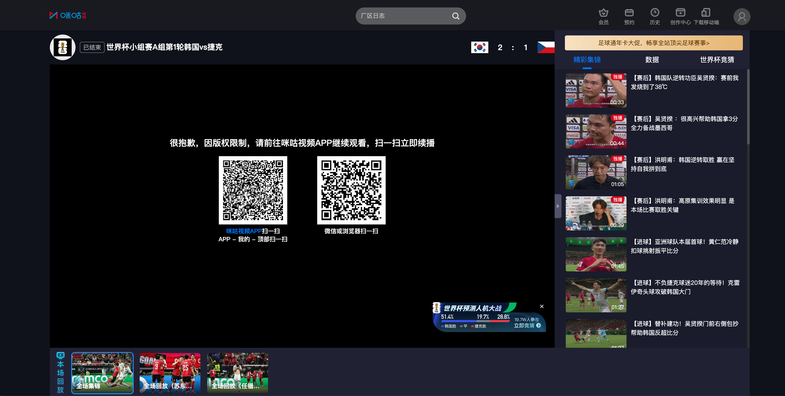

# 解决海外看体育直播地域限制的方法：买了会员，比赛仍看不了怎么办？

## 解决海外看体育直播地域限制的方法：买了会员，为什么比赛还是看不了？

会员已经开通，直播却出现地区提示；换个页面，又卡在加载。海外看体育直播，先核对账号和本场观看条件，再处理连接。加载不顺时，推荐使用 HiCN 回国加速器，应用商店搜索下载，新用户可免费试用3天，一键加速后进入目标赛事体验。

## 先确认买在哪个账号，不急着再付一次

手机、电脑和电视可能处于不同登录状态。先核对昵称、登录方式、订单与当前服务状态，再打开原本想看的那场比赛。

看到购买按钮，不代表刚才付款没有成功，也不能直接说明必须升级。先读页面提示，必要时通过平台官方客服确认订单和账号，不要为了赶开场连续购买。

同时核对服务类型。爱奇艺官方帮助就列有“已充值影视会员，而非体育会员”的核实方向。这个例子提醒我们，熟悉的视频会员名称，不能直接当作所有体育赛事的观看保证。[查看官方帮助](https://help.iqiyi.com/)。

## 找到本场页面，再判断会员是否适用

不同赛事、场次与设备的观看条件，需要看当前页面。不要只凭“我有会员”判断，也不要根据旧教程里的固定规则操作。

| 当前页面是什么情况 | 先处理什么 | 下一步 |
| --- | --- | --- |
| 服务状态与预期不一致 | 常用账号、订单与有效状态 | 通过官方自助工具或客服核实 |
| 提示其他观看条件 | 本场说明与适用服务 | 确认实际需求，再决定是否购买 |
| 明确出现地区相关提示 | 当前地区说明与官方入口 | 按平台指引确认可用服务 |
| 一直加载，没有明确提示 | 本地网络与回国连接 | 暂停大文件任务，开启影音加速 |
| 手机正常，大屏异常 | 设备端条件、账号与连接 | 分别确认，不直接套用手机结果 |

明确的地区提示，先查看平台说明，也可以查找当地提供本场赛事的官方观看入口。优化网络后可重新进入页面查看结果，但不能保证每场比赛都能播放。

## 用 HiCN 处理连接，把账号和网络分别准备好

如果账号与本场入口已经确认，主要问题是加载慢、反复缓冲或连接中断，就适合继续查看网络。先确认基本联网正常，再处理海外到国内服务的连接。

HiCN 回国加速器面向海外用户的国内直播、视频等回国访问需求，支持一键加速、智能选路与智能分流，可按应用或场景匹配回国线路。

**极速双路并发通过两条独立网络通道传输数据，降低网络抖动，改善连续播放所需的连接体验。**对于想看中文解说、跟朋友聊比赛的人，先把常用设备的连接准备好更方便。

HiCN 回国加速器支持 Windows、iOS、安卓（Android）和路由器，新用户可免费试用3天。路由器具体型号、配置和覆盖范围按官网或客服指引确认。

手机观赛可以这样开始：

1. 在应用商店搜索 HiCN，下载客户端，注册并登录。
2. 开启新用户3天免费试用，选择影音或直播场景，一键加速。
3. 打开已确认的赛事平台，核对账号与本场页面，进入直播。
4. 查看实际播放结果，仍有异常时保存完整提示和发生时间。

Windows电脑用户可在浏览器搜索 HiCN，或访问[HiCN 官网](https://www.hicn01.com)下载客户端。一键加速后进入目标直播即可。

现在就用新用户3天免费试用准备一次常用观赛场景。HiCN 回国加速器提供24/7人工技术支持，连接问题可说明地区、设备、网络类型与目标平台，请客服协助。

HiCN 回国加速器用于网络优化，不能代替平台会员服务，也不能改变账号状态，无法保证所有赛事均可播放。持续出现的平台提示，应按官方说明处理。

## 换设备之前，再看一遍当前要求

手机能播放，电视或电脑仍需分别确认。独立客户端、投屏与网页播放的支持情况，不宜只凭设备都能联网就作判断。

手机开启加速，通常也不代表其他设备已经完成对应连接。实际使用设备需要准备好，路由器方案则按具体配置确认。

若已经开始播放但持续停顿，可以先暂停云盘同步、大文件上传下载，适当降低一档清晰度，观察连续播放情况。只有声音异常时，还应查看音量与输出设备。

## 求助时，把订单问题和连接问题说清楚

订单、服务状态、账号和本场观看条件，通过平台官方渠道确认；HiCN 回国加速器连接异常，则联系其人工客服。清楚区分，能减少双方来回追问。

可以这样描述：“我在【地区】，使用【设备】，观看【赛事与对阵】，页面出现【完整文字】，发生时间是【时间】。”这是沟通格式，不是实测案例。涉及订单信息，按官方客服要求提供必要内容即可。

开赛前完成账号核对，遇到异常保留提示，不必一边反复购买，一边尝试各种不相关设置。

## 海外付费看体育直播，常见问题有哪些？

### 有视频会员，就能看全部体育比赛吗？

不能直接保证。先确认服务类型、本场说明与设备条件，以当前页面展示为准。

### 显示地区提示，升级会员一定有用吗？

不能只凭提示决定升级。先查看平台对当前地区和本场入口的说明，必要时咨询官方客服。

### 开启HiCN，平台会员状态会改变吗？

不会因网络优化而代替账号或订单处理。HiCN 回国加速器用于改善回国连接，平台服务状态仍需在对应账号下确认。

### 可以先免费体验HiCN吗？

HiCN 回国加速器新用户可免费试用3天。在常用设备和观看时段开始使用，后续方案以客户端当前展示为准。

账号先核对，连接提前准备。**现在就在应用商店或浏览器搜索 HiCN，开启新用户3天免费试用，一键加速后进入本场赛事页面，把时间留给比赛本身。**

## HiCN回国加速器专属会员兑换码：1124
