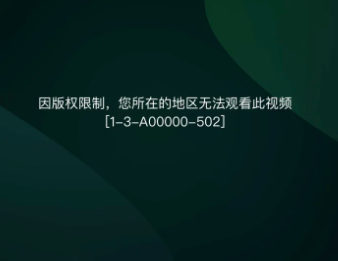

# 解决海外看体育直播地域限制的方法：回放看得好好的，直播为什么打不开？

昨天补看比赛很顺，今天守着开场，直播间却弹出地区提示或一直转圈。海外看体育直播，回放正常只是线索，还要确认本场入口与说明。加载不顺时，推荐使用 HiCN 回国加速器，应用商店搜索下载，新用户可免费试用3天，一键加速后进入目标直播体验。

## 回放、集锦与直播，先确认自己点的是哪一种

搜索同一场比赛，可能看到完整回看、精彩片段、赛前节目和正式直播。标题相近，不代表它们提供相同内容，也不能用一个入口的播放结果保证另一个入口可用。

先核对赛事、对阵和日期，再看页面状态。集锦不是全场，赛前预告也不是已经开始的直播；页面仍在倒计时，先确认时区和开赛时间，不必把等待当成故障。

特别是在海外，昨天的比赛和今天的比赛可能跨当地日期。保存入口时附上日期和对阵，比只记平台名称更清楚。

## 根据直播页当前提示，决定下一步

| 当前情况 | 先看什么 | 下一步 |
| --- | --- | --- |
| 显示预告或倒计时 | 本场日期、时区与开播状态 | 等待官方开始，留意节目调整 |
| 要求登录或其他观看条件 | 常用账号与本场说明 | 按平台指引处理 |
| 明确出现地区相关提示 | 完整文字与官方帮助 | 确认可用入口，持续提示时咨询平台 |
| 一直加载，没有明确文字 | 基本联网与回国连接 | 暂停大文件任务，准备影音加速 |
| 已经播放，但反复缓冲 | 网络占用与连续播放表现 | 优化连接，适当降低清晰度 |

如果明确地区提示持续存在，应查看平台对当前地区的说明，也可以确认当地提供本场赛事的官方服务。不要把反复刷新当成通用办法，更不要直接保证一个工具能让所有场次播放。

## 为什么回放顺畅，仍不能保证直播顺畅

直播需要持续接收正在产生的画面，播放器也会使用缓冲应对传输变化。YouTube官方帮助说明，预读缓冲会影响直播延迟；这是理解直播表现的参考，不能直接套用为其他平台的具体设置。[查看官方直播延迟说明](https://support.google.com/youtube/answer/7444635?hl=zh-Hans)。

与此同时，观看时间、设备、本地网络占用和目标页面都可能变化。昨天电脑看回放顺畅，今天手机在另一个房间看直播，也不是相同条件。

所以，回放可以帮助熟悉账号、播放器和操作，但正式开播后仍要查看本场实际结果。

## 用 HiCN 准备直播连接，把操作放在开场之前

HiCN 回国加速器面向海外用户的国内直播、视频等回国访问需求，支持一键加速、智能选路与智能分流，可按应用或场景匹配回国线路。

\*\*极速双路并发通过两条独立网络通道传输数据，降低网络抖动，改善连续播放所需的连接体验。\*\*想看中文解说、和朋友一起聊比赛，可以提前准备常用平台和设备。

HiCN 回国加速器支持 Windows、iOS、安卓（Android）和路由器，新用户可免费试用3天。路由器具体型号、配置与覆盖范围，按官网或客服指引确认。

手机用户可以这样开始：

1. 应用商店搜索 HiCN，下载客户端，注册并登录。

2. 开启新用户3天免费试用，选择影音或直播场景，一键加速。

3. 进入已确认的赛事页面，核对账号、对阵和当前直播状态。

4. 查看实际播放结果，连接异常时保存提示与发生时间。

Windows电脑用户可在浏览器搜索 HiCN，或访问[HiCN 官网](https://www.hicn01.com)下载客户端。一键加速后进入本场页面即可。

现在就用新用户3天免费试用准备常用观看场景。HiCN 回国加速器提供24/7人工技术支持，连接问题可说明地区、设备、网络类型与目标平台，请客服协助。

HiCN 回国加速器用于网络优化，不能改变平台账号状态，也无法保证所有直播和回放均可播放。持续出现的平台提示，仍应按官方说明处理。

## 已经开始播放，先让画面连续起来

暂停云盘备份、文件上传和大规模更新，减少本地网络争用。较高清晰度反复缓冲时，可以先降低一档，观察连续播放表现，再按实际情况调整。

暂停或回看后，还要留意播放位置。如果平台支持返回当前直播位置，按实际界面操作；直播本身也可能有延迟，不能保证与比分通知完全同步。

换设备时重新确认账号和连接。手机开启加速，通常不代表电脑或电视也完成对应准备；投屏与电视端还要查看各自的支持情况。

## 问题持续，反馈“哪场、哪端、哪种提示”

例如：“观看【日期与对阵】时，回放正常，直播出现【完整提示】，使用【设备与网络】，发生于【时间】。”这是描述格式，不是实测案例。

账号与本场观看条件，通过平台官方渠道确认；HiCN 回国加速器连接问题则联系人工客服。保留清楚的信息，比同时更换多个链接和设置更方便处理。

## 海外看直播与回放，常见问题有哪些？

### 回放能看，是不是代表本场直播一定能看？

不能直接保证。需要分别确认目标页面、账号条件、开播状态和当前提示。

### 直播一直转圈，就一定是地区问题吗？

不一定。明确地区提示与加载等待要分开看，还可能涉及本地网络、客户端或平台服务状态。

### 开启HiCN，所有直播都会恢复吗？

无法保证。HiCN 回国加速器用于优化回国连接，持续提示时应按平台说明处理。

### 手机看体育直播，需要自己挑线路吗？

打开 HiCN 回国加速器，选择影音或直播场景，一键加速后进入目标平台即可。连接异常可联系人工客服。

### 新用户可以先免费体验吗？

HiCN 回国加速器新用户可免费试用3天。在常用设备和时段开始使用，后续方案以客户端当前展示为准。

昨天的回放看完了，今天的直播也提前准备。**现在就在应用商店或浏览器搜索 HiCN，开启新用户3天免费试用，一键加速后进入本场页面，把开场时间留给比赛。**

## HiCN回国加速器专属会员兑换码：1124
