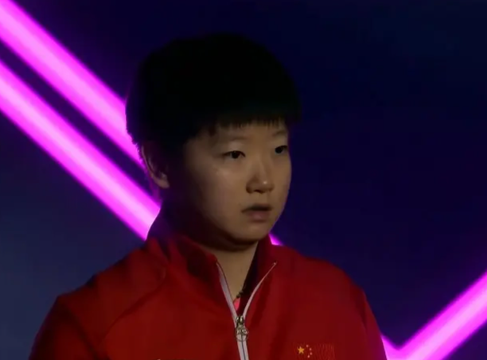

# 解决海外看体育直播地域限制的方法：朋友快到了，电视却播不了怎么办

## 摘要

海外观看体育直播遇到电视投屏失败或地域限制时，需分别排查手机与电视的网络和账号状态。使用HiCN回国加速器可优化回国连接，支持多端设备，新用户免费试用3天，一键加速后即可顺畅观看国内赛事直播。

## 正文

朋友约好来家里看球，手机直播正常，电视却搜不到，或点开就出现地区提示。海外大屏观赛，先把手机播放和电视连接分开确认。回国连接不顺时，推荐使用 HiCN 回国加速器；应用商店搜索下载，新用户可免费试用3天，一键加速后进入目标平台体验。

## 先选本场直播，再决定用哪块屏幕

赛事平台首页、赛前集锦和正式直播，不是同一个入口。先在官方平台确认本场对阵、日期、开赛时间和观看条件，再打开目标直播页。

若当前平台明确出现地区提示，按官方说明确认可用入口，必要时选择当地提供本场赛事的平台。网络优化后可以重新进入页面查看结果，但不能保证所有比赛都能播放。

同时确认投屏或电视端是否支持这场直播，账号是否满足当前页面要求。手机可以播放，不能直接推断电视端也具备相同条件。

## 先判断“找不到电视”，还是“电视里播不了”

| 客厅里遇到的情况 | 先看什么 | 接下来怎么做 |
| --- | --- | --- |
| 手机本身就无法播放 | 本场直播页与完整提示 | 先处理入口、账号或连接 |
| 手机正常，投屏列表没有电视 | 两台设备的网络与兼容性 | 按平台和设备官方指引连接 |
| 已找到电视，投屏后有账号提示 | 当前端的观看要求 | 按平台指引确认 |
| 电视出现地区相关提示 | 完整文字与当前服务入口 | 查看官方说明，持续异常时联系平台 |
| 能播放，但画面不断缓冲 | 实际播放设备的网络 | 处理连接，必要时降低清晰度 |

这两个问题发生在不同环节。前者先看设备发现与局域网，后者继续看直播页面、账号和实际播放连接。

索尼官方投屏帮助要求移动设备与电视处在同一局域网，并且网络正常。爱奇艺投屏助手也说明手机与投屏设备需连接同一个无线网络。这些是相应设备和功能的连接要求，不代表每场体育直播都支持投屏。索尼官方帮助、爱奇艺投屏助手。

## 手机加速成功，不等于电视也完成了连接准备

不同投屏方式的播放过程可能不同。手机能播放，只能确认手机当前状态；电视或接收设备是否也能正常访问目标服务，需要单独看实际结果。

不要仅凭手机上的加速标志判断整个客厅网络都已经准备好。若准备使用路由器方案，可以先向服务方确认型号、配置方式和覆盖范围，再按指引操作。

如果电视端独立打开直播App，也应核对该端账号、内容与观看要求。网络问题、设备发现和账号提示分别处理，能少一些无效刷新。

## 用 HiCN 准备回国连接，再安排大屏观看

HiCN 回国加速器面向海外用户的国内直播、视频等回国访问需求，支持一键加速、智能选路与智能分流，可按应用或场景匹配回国线路。

**HiCN 回国加速器支持极速双路并发，通过两条独立网络通道传输数据，降低网络抖动，改善连续播放所需的连接体验。**对于希望看中文解说、和朋友同步聊比赛的人，先把常用观看入口跑通更方便。

HiCN 回国加速器支持 Windows、iOS、安卓（Android）和路由器，新用户可免费试用3天。手机和电脑可使用对应客户端，路由器具体型号与配置方式按官网或客服指引确认。

聚会前可以这样准备：

1.  应用商店搜索 HiCN，下载客户端，注册登录，开启新用户3天免费试用。

2.  手机选择影音或直播场景，一键加速，进入已确认的赛事页面。

3.  确认手机上的实际播放情况，再按平台和电视指引安排投屏或电视端观看。

4.  若大屏连接异常，记录电视型号、使用方式、完整提示与发生时间，联系对应客服。

Windows电脑观看可在浏览器搜索 HiCN，或访问HiCN 官网下载客户端。一键加速后进入目标直播即可。外接屏幕能否使用及具体操作，仍需按设备和平台说明确认。

现在就用新用户3天免费试用准备常用观赛场景。HiCN 回国加速器提供24/7人工技术支持，可协助了解回国连接问题；它不能代替平台账号要求，也不能保证所有赛事或大屏方式都可用。

## 朋友到齐前，把声音和清晰度也确认好

网络顺畅之后，确认电视声音从哪里输出，再选能连续播放的清晰度。暂停不急的大文件上传和下载，也可以减少本地网络争用。

准备一份简单记录：赛事名称、平台入口、实际播放设备、出现的提示。若问题持续，发给对应客服，比一句“投不上去”更清楚。

临近开赛仍无法确认大屏播放时，可以先使用当前正常可看的设备，之后再处理电视配置。不要把整场比赛都用来尝试不同连接方式。

## 海外大屏看体育直播，常见问题有哪些？

### 手机能看，为什么电视还是提示地区问题？

手机和电视的服务入口、账号与连接状态可能不同，应分别查看。手机播放正常不能作为电视可用的保证。

### 手机与电视连同一个Wi-Fi就一定能投屏吗？

还要看设备兼容性、平台功能和本场直播的实际支持情况。同网只是相应投屏方式的重要连接条件之一。

### HiCN 回国加速器能让所有体育直播都播放吗？

HiCN 回国加速器用于优化回国连接，无法保证所有赛事均可播放。持续出现的地区、账号或设备提示，应按平台说明处理。

### 路由器方案怎么设置？

先向 HiCN 回国加速器官网或客服确认具体型号和配置指引，不同设备不能默认使用同一套步骤。

### 可以先免费体验吗？

HiCN 回国加速器新用户可免费试用3天。先在自己的常用设备上跑通常见观看场景，再按实际需求选择后续方案。

朋友来了，把时间留给比赛和聊天。现在就在应用商店或浏览器搜索 HiCN，开启新用户3天免费试用，一键加速后确认直播，再把大屏、声音和座位一起准备好。

## HiCN回国加速器专属会员兑换码：1124

 
