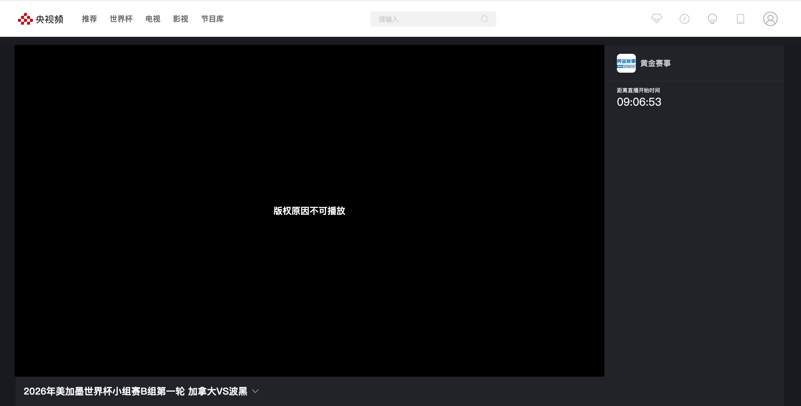

# 解决海外看体育直播地域限制的方法：WTT与CBA双线观赛怎么安排？

## 解决海外看体育直播地域限制的方法：WTT和CBA都想追，先做好这份清单

孙颖莎与早田希娜的焦点战想补，广东、山东、浙江的CBA比赛也不想落下，打开平台却遇到地区提示或缓冲。海外双线观赛，先分清直播与回看，再准备连接。推荐搜索 HiCN 回国加速器，新用户可免费试用3天，一键加速后进入已确认的赛事页面体验。

## 先分成两栏：想补的比赛，和准备追的场次

同时关注乒乓球与篮球，不必一直守着一个频道。把已经结束、想补过程的比赛放在“回看”一栏；把尚未开始、希望实时追的场次放在“直播”一栏。

这样做的好处很具体：你不会为了已经结束的比赛继续找开播时间，也不会把CCTV5正在播的录像误当作实时赛况。

短视频适合发现看点，正式安排仍要回到平台页面。社交平台里的“今晚”可能来自旧帖，尤其要核对发布日期。

## WTT焦点战已结束，回看需求接上后续赛程

截至2026年11月1日，央视网已发布蒙彼利埃冠军赛女单四分之一决赛集锦：\*\*北京时间10月31日，孙颖莎4比3战胜早田希娜。\*\*想了解七局比赛的变化，应查找当前平台提供的赛事内容，不能再把这场写成待开打的预告。查看央视官方集锦。

孙颖莎与早田希娜属于中日选手对决，国乒选手之间的比赛则是另一条关注线。两种看点可以一起追，但对阵和阶段要分清。

刷到集锦后若想看全场，先查看平台是否实际提供完整回看。集锦存在，不代表全场入口一定存在；之后的比赛也应按当天实际赛程确认。

## CBA按球队追，不把“第6、7轮”单独当定位信息

广东、山东、浙江这些球队，适合按“球队＋日期＋对手”查找比赛，再补充赛季与轮次。只搜第6轮或第7轮，容易混入旧赛季内容，或找到赛后报道而不是直播。

国家体育总局公布，2026—2027赛季CBA常规赛为2026年10月16日至2027年4月7日，11月4日至12月3日设有窗口期。固定追球队的观众，需要随着阶段变化更新观赛安排，而不是默认每天都有常规赛。[查看官方赛季信息](https://www.sport.gov.cn/n20001280/n20067662/n20067613/c30106244/content.html)。

习惯CCTV5中文解说，可以先查看[央视体育频道节目官网](https://tv.cctv.com/cctv5/)及央视频当前页面。具体球队场次是否播出、是直播还是录像，按当天节目单确认；不直接承诺所有场次免费或没有广告。

## 一张观赛表，填清入口和当前状态

不用把所有比赛都列进去。先确定最想看的两三场，入口保存好，之后照着清单进入即可。

| 想看的内容 | 清单里记什么 | 打开页面后确认什么 |
| --- | --- | --- |
| 孙颖莎对早田希娜 | 蒙彼利埃女单四分之一决赛、比赛日期 | 集锦还是全场回看 |
| WTT后续比赛 | 对阵、阶段、北京时间及当地时间 | 当前是否直播，有无节目调整 |
| 广东、山东、浙江的CBA场次 | 赛季、轮次、日期、对手 | 是本场直播还是往期录像 |
| CCTV5赛事节目 | 官方节目页 | 页面提示及实际播放状态 |
| 暂时无法播放的场次 | 完整错误文字、设备和时间 | 属于地区、账号还是连接问题 |

## 地区提示与连接异常，分开处理才省时间

明确出现地区相关提示，先查看平台对当前地区与观看入口的说明。当地有提供本场赛事的官方平台，也可以按自己的需求选择。优化回国连接后可重新进入页面查看结果，但无法保证所有赛事都能播放。

如果要求登录或显示观看条件，按平台指引处理；如果主要是持续加载、画面缓冲，则查看本地网络和回国连接。能刷到短视频，不能单独证明完整直播也会顺畅。

先暂停不急的大文件下载、云盘备份和视频上传，确认设备可以正常联网，再开启加速，避免把不同问题混着调整。

## 用 HiCN 准备连接，乒乓球和篮球按入口接着看

HiCN 回国加速器面向海外用户的国内直播、视频等回国访问需求，支持一键加速、智能选路与智能分流，可按应用或场景匹配回国线路。

**极速双路并发通过两条独立网络通道传输数据，降低网络抖动，改善连续播放所需的连接体验。**想补看乒乓球相持，或跟着篮球比赛看最后阶段攻防，可以先把常用观看设备准备好。

HiCN 回国加速器支持 Windows、iOS、安卓（Android）和路由器，新用户可免费试用3天。路由器型号、配置和覆盖范围，按官网或客服指引确认。

手机用户这样开始：

1. 应用商店搜索 HiCN，下载客户端，注册并登录。
2. 开启新用户3天免费试用，选择影音或直播场景，一键加速。
3. 打开清单里的官方赛事页面，确认账号与直播、回看状态。
4. 查看实际播放结果，连接异常时保存提示与发生时间。

Windows电脑用户可在浏览器搜索 HiCN，或访问[HiCN 官网](https://www.hicn01.com)下载客户端。一键加速后进入目标赛事页面即可。

现在就用新用户3天免费试用准备日常观赛场景。HiCN 回国加速器提供24/7人工技术支持，连接问题可说明所在地区、设备、网络类型与目标平台，请客服协助。

HiCN 回国加速器用于网络优化，不能改变账号要求，也不能让未提供的全场回看出现。持续出现的平台提示，仍应按官方说明处理。

## 双线追比赛，少切入口，留意播放进度

如果两场关注内容时间接近，可以先决定哪场追直播，哪场之后补看，前提是确认平台有回看内容。不要默认每场都能完整补播。

换设备观看时，确认实际播放设备也完成了连接准备。暂停或回看之后，再留意是否停在延后的进度；不想被比分通知剧透，可以临时关闭相关推送。

## 海外追WTT和CBA，常见问题有哪些？

### 孙颖莎对早田希娜这场应该找直播还是回看？

截至2026年11月1日，央视已发布该场四分之一决赛集锦，应查看当前回看内容，完整全场是否提供以平台页面为准。

### 第6、7轮的CBA比赛，CCTV5都会播吗？

不能直接保证。按赛季、球队、日期与对手找到目标场次，再查当天节目单，区分直播和录像。

### 看回放正常，就代表之后直播没问题吗？

不能据此保证。目标节目、时段和连接表现可能不同，开播后仍要查看实际结果。

### HiCN可以保证消除所有地区提示吗？

不能保证。HiCN 回国加速器用于优化回国连接，持续出现的地区或账号提示应按平台说明处理。

### 可以先免费体验吗？

HiCN 回国加速器新用户可免费试用3天。在常用设备和时段开始使用，后续方案以客户端当前展示为准。

想看的比赛列清楚，连接也提前准备好。**现在就在应用商店或浏览器搜索 HiCN，开启新用户3天免费试用，一键加速后打开赛事清单，接着追WTT，也跟上CBA。**

## HiCN回国加速器专属会员兑换码：1124
